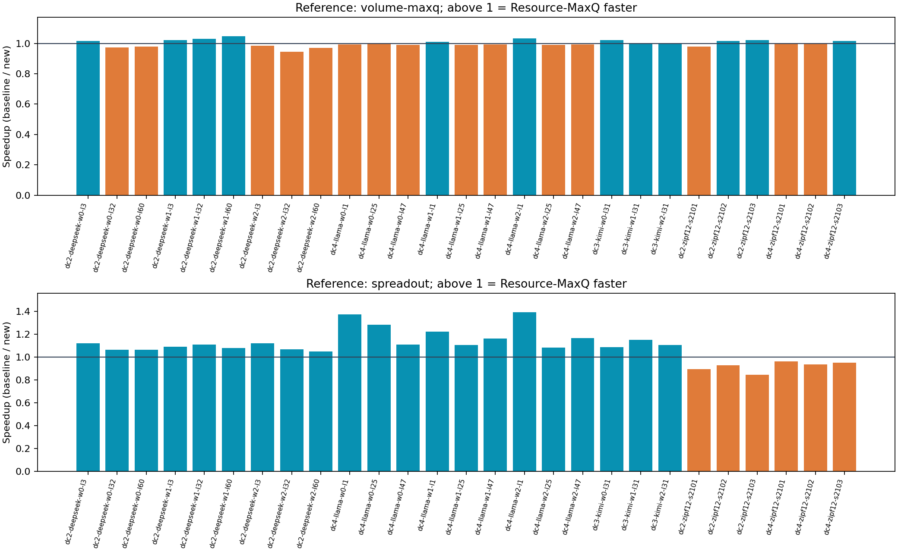

# 资源感知 BvN：独立输入验证与异构拓扑设计

## Material Passport

- 日期：2026-11-15；执行模式：SimAI/ns-3，固定路径、事件驱动、不加全局 barrier。
- 本轮先执行已授权的独立输入验证，再设计异构拓扑；后者尚不作为已验证收益。
- 冻结算法：`cc76a17` 中的 Resource-MaxQ 与 Volume-MaxQ；不按验证结果调参或选择版本。
- 研究技能用于配对、来源与负结果登记；用户已授权自行设计并执行，故不另设命令确认。旧失败项不重试，原始数据只读。

## 1. 预先确定的验证矩阵

| 输入 | 端点规模 | 层、窗口或种子 | 条件数 |
|---|---|---|---:|
| DeepSeek 实测专家选择 | 2 DC，64 GPU | 层3/32/60，窗口0/1/2，全组合 | 9 |
| Llama 实测专家选择 | 4 DC，128 GPU | 层1/25/47，窗口0/1/2，全组合 | 9 |
| Kimi 实测专家选择 | 3 DC，96 GPU | 层31，窗口0/1/2 | 3 |
| 合成 Zipf1.2 | 2/4 DC，64/128 GPU | 新种子2101/2102/2103，每rank约4MiB | 6 |

共27条件。21个真实输入复用原成功场景与FAST-SimAI/Spreadout基线，只回放Volume-MaxQ/Resource-MaxQ；6个新种子输入运行四方法，共66次新回放。若失败，保留失败记录、不换种子、不自动重试。旧场景目录不写入。

其中DeepSeek w0/l3、Llama w0/l25、Kimi w0/l31是上轮已报告的3个参考条件，保留用于检查冻结版本与回放一致性。因此本轮是24个此前未报告条件加3个参考条件，不能把27个全部称为未见过的保留集。

窗口沿用原数据目录排序后的不重叠文件范围；同窗口不同层共享输入来源，不应当作完全独立样本。专家到GPU映射保持seed1101；新种子只用于合成流量。真实专家选择是采集值，token来源GPU、专家部署与8192B向量仍为建模假设。

严格均衡矩阵没有生成随机性，不运行多个同值种子。4 DC均衡既有同31轮反例保留为机制证据，不纳入本轮新种子样本。

控制拓扑仍为上一轮32GPU/DC、100Gbps/单向50us WAN。首轮先检验输入迁移，避免同时换拓扑与负载。拓扑扩展见第3节，单独成组。

## 2. 分析与验收

- 原始字节交付、同矩阵/硬件/路由/背景/前景epoch/配置/后端库逐项校验。
- 分别报告通信时间、stage数、规划CPU；规划不藏在通信时间里。
- 报告新算法相对三对照的逐条件结果、几何平均、胜/平/负和最差退化，不只挑选正收益。
- 对层/窗口仅做描述性分组统计；不将同窗口各层和多次回放当独立统计重复，不宣称总体显著性。
- 通过相对Volume-MaxQ的结果区分拓扑组合增量与最大系数本身贡献。
- 完整性要求27条件与所有预定方法有明确状态；只对双方成功且配对通过的项算加速比，缺失项显式列出。

## 3. 异构拓扑候选（设计，尚未执行）

共同设置：每server4GPU，每ToR4server；先64GPU（4ToR），再128GPU（8ToR）；server物理上联400Gbps。静态唯一路径、不启用ECMP或路径优化。所有速率先核对现有DCQCN配置支持，禁止因不支持某速率悄悄调传输参数。

| 名称 | 连接与参数建议 | 要验证的机制 |
|---|---|---|
| 同构、足额上联Leaf–Spine对照 | 4个Spine；每ToR至每Spine400Gbps，总上联1.6Tbps；交换链路单向700ns；目的server均匀固定到Spine | 无网络异构时不应声称必有拓扑收益；验证额外选择是否损害基线 |
| 带宽异构Leaf–Spine | 结构不变；各ToR四条上联按机架组分别400/200/100/400Gbps；128GPU重复该组；各链路仍700ns | 不同机架具有不同超售比，且多条共享瓶颈并存；不需要DC或长WAN来解释 |
| 多级异构Pod–Core | 4Pod，每Pod2ToR、8server、32GPU；Pod内Leaf/Aggregation足额；每Pod经两条上联接双Core，每条上联按Pod设400/1600/400/1600Gbps，延迟先统一700ns | 通信对同时受源Pod与目的Pod出口约束；检测重叠瓶颈而非单个WAN分组 |
| 分层多切口树（机制） | 4个16GPU机架组挂在串联/分层汇聚节点；关键割边100/200/100Gbps，其余400或1600Gbps，单向700ns | 一条固定路径经过多个相近瓶颈；有的流只跨一部分割边。作为受控机制图，不称真实生产网络 |
| 时延异构消融 | 保持同构Leaf–Spine容量，只将不同机架组的交换上联单向延迟设700ns/2us/5us/700ns | 区分纯传播差异与共享带宽收益；不预设存在正收益 |

推荐主实验先采用：同构对照、带宽异构Leaf–Spine、多级异构Pod–Core。多切口树作小规模机制验证，时延异构作消融。这里的参数是可检验设计，不是对某厂商拓扑的测量或“标准配置”。物理容量足额不保证给定固定路由下的每个匹配无争用，因此同构对照不预设零收益。

无阻塞的说法还需要检查固定路由，不仅看物理割带宽：每条固定上联承载的输入需求和可达并行能力都要核对，避免路由散列制造意外热点。不同拓扑不能只改DC名称，必须输出链路表、固定路径及通信对资源关联。

首版算法已按全部物理资源产生共临界锚点，但“优先覆盖尚未服务的资源组”和部分平局优先级仍使用`wan:`标签。泛化时应核对这些分组规则，不能把普通链路仅重命名成WAN便声称完成泛化。所有物理链路已经参与计价；本轮不偷偷修改冻结算法。

拓扑关系示意（箭头仅表示层级，实际双向链路按两个有向资源计价）：

```text
Leaf–Spine（同构/带宽异构，64GPU）：
  每个ToR下：4server × 4GPU
  ToR0      ToR1      ToR2      ToR3
     \       |        |       /
       四个Spine（每个ToR与每个Spine均相连）
  每ToR四上联速率：同构全400G；异构按ToR为400/200/100/400G

Pod–Core（128GPU）：
  Pod0       Pod1       Pod2       Pod3
  2ToR       2ToR       2ToR       2ToR
  8server    8server    8server    8server
  双Agg      双Agg      双Agg      双Agg
     \         |          |         /
             Core0、Core1
  每Pod两条Core上联：400/1600/400/1600G，组内700ns

多切口树（64GPU，受控机制）：
  机架A--汇聚A--100G--汇聚B--200G--汇聚C--100G--汇聚D--机架D
                         |                |
                       机架B            机架C
  每机架4server×4GPU；机架接入400G；所有交换链路700ns
```

Pod–Core设计采用每个Agg一条Core上联；一条固定跨Pod路径依次经过源Pod上联和目的Pod下联。因此瓶颈集合可能重叠，不能把通信对划入互斥的一组。双Core只用于提供物理并行资源，不做运行时路径切换。

容量核对：Leaf–Spine每ToR服务器总上联1.6Tbps，对应1:1/2:1/4:1超售；Pod–Core每Pod服务器总上联3.2Tbps，两条400G或1600G出口对应4:1或1:1。初稿Pod出口100–400G会变成4:1到16:1，过强超售可能让单个容量下界长期主导，已在实施前收窄为上述温和配置；这不是根据新拓扑的收益选择参数。

## 4. 规划时间口径与目标

上一轮核心CPU约为：64GPU（16server）0.15–0.32s；96GPU（24server）约0.81s；128GPU（32server）约2.6–9.2s，视分解轮数和匹配自由度变化。单项增量更新优化在相同计划下曾由17.1s降至6.8s，不能把这个最小值当全部样本的统一开销。

这些是核心规划CPU，不是ns-3程序仿真墙钟时间，也不全等于输入到可执行计划的总墙钟。流水线在线生成还要看每轮延迟和首轮可用时间；目前为离线完整计划后回放，不能宣称其开销已被隐藏。

真正盈亏条件为：`P_new + T_new < P_base + T_base`。若基线计划可复用，新增规划几乎必须低于通信节省值；若双方都现场规划，应比较CPU/墙钟差，而不是只要求新方法小于通信时间。

工程目标（本项目建议，不是行业标准）：先把64GPU完整规划压到1ms以内、128GPU压到2ms以内；最终争取规划不超过算子通信时间的10%，同时新增开销小于实际通信收益。对5–20ms通信对应约0.5–2ms；对拓扑增量只有0.1ms的输入，需要更低的增量规划开销，或明确采用可复用计划。当前还差至少数百至数千倍，不应只靠“多项式复杂度”作在线论证。

优先方向是静态资源关联缓存、复用匹配合法性结构、数组化/编译关键循环；不是增加搜索预算。本轮不修改算法以满足这些目标。

## 5. 执行结果

66次新回放全部成功，与42条旧成功基线组成108条方法记录。27条件均四方法配对通过，没有缺失条件或重复矩阵。算法保持冻结，没有运行新的异构拓扑、重试失败项或调整网络配置。

### 5.1 分组结果

表中是 `基线通信时间 / 新算法通信时间` 的几何平均；大于1表示新算法更快。不是算术平均通信时间，也不包含规划CPU。

| 输入组 | 条件数 | 相对FAST-SimAI | 相对Spreadout | 相对Volume-MaxQ | 相对Volume的胜/负 |
|---|---:|---:|---:|---:|---:|
| DeepSeek，2DC，3层×3窗口 | 9 | 2.304× | 1.083× | 0.995× | 4/5 |
| Llama，4DC，3层×3窗口 | 9 | 3.870× | 1.204× | 0.999× | 2/7 |
| Kimi，3DC，3窗口 | 3 | 4.464× | 1.113× | 1.008× | 3/0 |
| Zipf1.2，2DC，3新种子 | 3 | 1.621× | 0.888× | 1.005× | 2/1 |
| Zipf1.2，4DC，3新种子 | 3 | 3.676× | 0.948× | 1.005× | 1/2 |
| 全部 | 27 | 2.986× | 1.085× | 0.99993× | 12/15 |

相对FAST为27胜0负，相对Spreadout为21胜6负（六个Zipf条件全部负收益）。剔除3个旧参考条件后，24个此前未报告条件分别为2.926×、1.076×、0.99863×；相对Volume为10胜14负。

**结论：整套方案相对FAST的收益可以迁移到这批输入，但拓扑选择本身相对纯最大系数的平均增量近乎零，不能声称在真实输入中已经稳定获益。** 旧4DC均衡的2.12×拓扑增量仍是有效的机制证据，但它不是本轮层/窗口结果的总体表现。换到异构拓扑是下一步要检验的假设，不是对已有结果的重新命名。

最差拓扑增量反例是DeepSeek窗口2/层32：纯MaxQ 8.989683ms、55轮，新算法9.519825ms、58轮，实际时间增加约5.90%。固定每轮最大系数并不保证后续系数序列或阶段数相同；这一结果不应从报告中删除。



### 5.2 逐条件完整算子时间

单位ms，越低越好。dc后数字为既有验证拓扑的DC数；w为不重叠窗口、l为层ID、s为合成种子。所有真实条件为每GPU64token、每server4GPU。

| 条件 | FAST-SimAI | Spreadout | Volume-MaxQ | Resource-MaxQ |
|---|---:|---:|---:|---:|
| dc2-deepseek-w0-l3 | 20.937 | 10.167 | 9.226 | 9.089 |
| dc2-deepseek-w0-l32 | 21.771 | 10.085 | 9.237 | 9.499 |
| dc2-deepseek-w0-l60 | 20.764 | 10.166 | 9.365 | 9.575 |
| dc2-deepseek-w1-l3 | 21.420 | 10.111 | 9.477 | 9.289 |
| dc2-deepseek-w1-l32 | 22.593 | 10.053 | 9.351 | 9.084 |
| dc2-deepseek-w1-l60 | 21.844 | 10.084 | 9.775 | 9.343 |
| dc2-deepseek-w2-l3 | 21.058 | 10.128 | 8.908 | 9.047 |
| dc2-deepseek-w2-l32 | 21.575 | 10.168 | 8.990 | 9.520 |
| dc2-deepseek-w2-l60 | 21.942 | 10.175 | 9.435 | 9.715 |
| dc4-llama-w0-l1 | 48.643 | 13.930 | 10.098 | 10.157 |
| dc4-llama-w0-l25 | 46.920 | 14.325 | 11.135 | 11.186 |
| dc4-llama-w0-l47 | 47.227 | 14.287 | 12.786 | 12.900 |
| dc4-llama-w1-l1 | 47.836 | 14.417 | 11.917 | 11.809 |
| dc4-llama-w1-l25 | 40.108 | 14.181 | 12.741 | 12.853 |
| dc4-llama-w1-l47 | 51.791 | 14.409 | 12.333 | 12.429 |
| dc4-llama-w2-l1 | 46.099 | 14.130 | 10.500 | 10.166 |
| dc4-llama-w2-l25 | 39.158 | 14.103 | 12.916 | 13.030 |
| dc4-llama-w2-l47 | 44.361 | 14.011 | 11.939 | 12.038 |
| dc3-kimi-w0-l31 | 51.783 | 12.610 | 11.865 | 11.624 |
| dc3-kimi-w1-l31 | 52.781 | 12.531 | 10.902 | 10.887 |
| dc3-kimi-w2-l31 | 50.055 | 13.420 | 12.168 | 12.152 |
| dc2-zipf12-s2101 | 20.454 | 11.558 | 12.659 | 12.936 |
| dc2-zipf12-s2102 | 20.992 | 12.572 | 13.790 | 13.585 |
| dc2-zipf12-s2103 | 23.716 | 11.497 | 13.902 | 13.593 |
| dc4-zipf12-s2101 | 95.086 | 24.698 | 25.598 | 25.664 |
| dc4-zipf12-s2102 | 95.610 | 24.056 | 25.768 | 25.787 |
| dc4-zipf12-s2103 | 92.682 | 24.329 | 26.065 | 25.631 |

### 5.3 来源、公平性与审查

- 108条执行记录全部重建并匹配原`input_fingerprint`。该指纹覆盖执行文件内容、动态库、调度、输入、配置模板、线程数与运行环境；并非仅核对当前二进制路径或动态库。
- 再逐条件比较相同矩阵、硬件、拓扑、路由、背景、前景epoch、数值配置、线程、执行文件摘要和运行时语义。交付与依赖校验沿用既有入口。
- 实际使用的采样文件在三个窗口间没有交集。DeepSeek各窗口使用31/32/29个文件，Llama25/57/59个，Kimi47/43/40个；同窗口不同层仍有依赖，不作显著性或独立同分布声明。
- 3个旧参考条件下，两种新方法共6个FCT与上轮报告精确一致。
- 只读代码审查发现配对入口三个问题：错误参考可能连带屏蔽有效配对、worker异常可能覆盖已经完成的方法、运行契约未绑定执行文件与线程。均先写反例RED再修复GREEN；本轮所有回放本身成功且旧契约原已一致，修正后只重新读取与分析现有产物，没有重跑仿真，FCT未变化。
- 执行状态和配对资格分开保存；未知是否启动的中断项不计为确定实际尝试。固定层集也加了入口检查，外部catalog变化不再偷偷改变样本数。
- 变更范围75通过、6跳过；全仓227通过、11跳过、既有10失败/3错误，完整名称见结果目录`verification.json`。因此不作全仓全绿或可合并认证。

新回放核心CPU（3worker并行下的进程CPU，不是隔离墙钟基准）为64GPU约207–324ms、96GPU约672–743ms、128GPU约1.41–2.94s。它们不包含4DC严格均衡高自由度例，因此不能用这批上限替换前节约9s的既有最坏观测。

### 5.4 数据与重建入口

结果目录：`astra-sim-alibabacloud/experiments/alltoall/results/resource-heldout-20261115/`。

- `study.json`：108条原始执行状态、配对资格、契约、CPU与分组统计。
- `paired.csv`：27个配对条件，含时间、阶段数、CPU、状态与配对错误。
- `summary.json`：分组几何平均、胜/平/负与最差加速比。
- `verification.json`：实际回放数量、指纹/来源校验与测试结果，含全部既有失败名称。
- `experiment_snapshot.py`与`planner_snapshot.py`：执行开始时快照；`analysis_snapshot.py`为审查修正后的只读汇总实现。
- `replays/`：66次新回放的完整输入、计划、包与事件轨迹。旧成功基线仍在原工作区，只读引用。

重新审计、绘图只读既有回放，不启动仿真：

```bash
python3 astra-sim-alibabacloud/experiments/alltoall/tools/run_resource_budget_validation.py \
  --out astra-sim-alibabacloud/experiments/alltoall/results/resource-heldout-20261115 \
  --analyze-only
```
