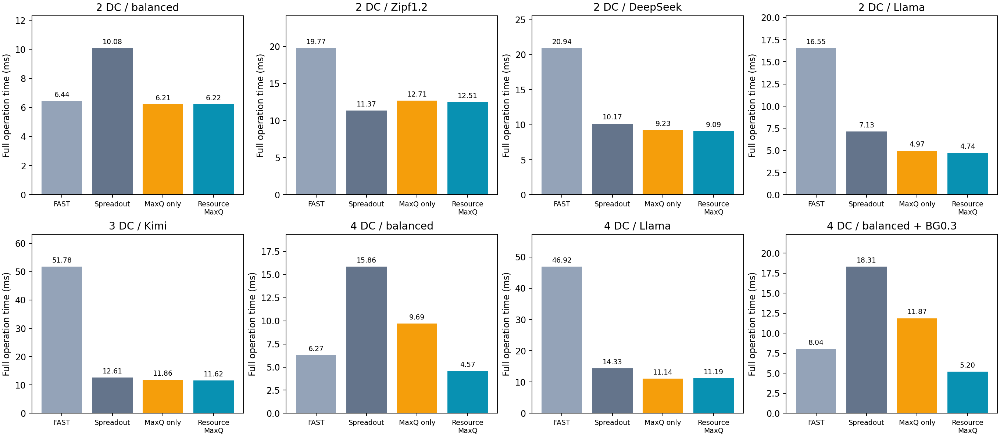
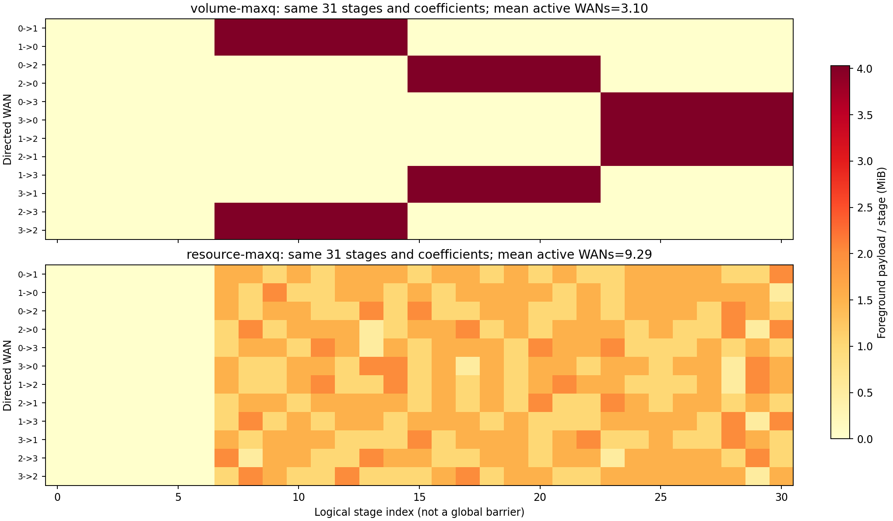
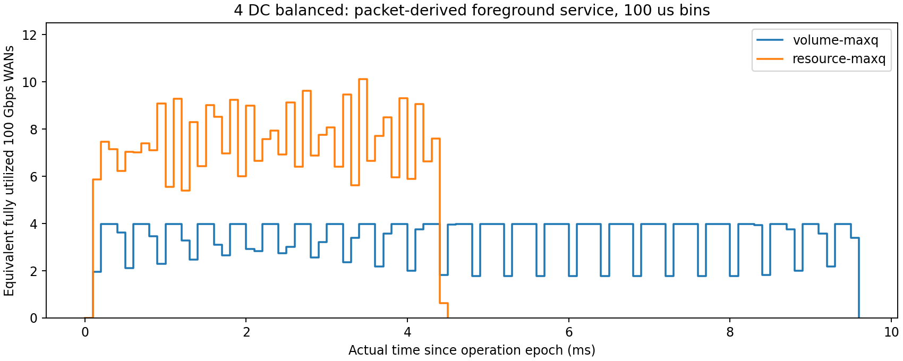

# 资源感知 BvN：新算法迭代、机制与验证

## Material Passport

- 日期：2026-11-15；隔离分支：`research/wan-budget-v1-20261115`。
- 使用 academic-research-suite 的实验审查口径；本文是探索性仿真报告，不是正式总体性能认证。
- 后端仅使用 SimAI/ns-3。没有调用原生 FAST 仿真器计时，没有修改原工作区的后端、拥塞控制配置或运行时。
- 核心实现仍在一个调度模块内；没有新增调度器类、全局优化器、多路径选择或运行时全局 barrier。
- 原实验因系统重启终止，未重启、未重跑失败项。新实验复用其成功输入及成功基线，重新核对启动时刻、背景流、路由、硬件和运行库。

## 1. 结论：哪些属于实现问题，哪些属于目标局限

**资源共享这一 insight 有直接证据，但“始终优先最大链路”和“主动拆分一定有利”并不成立。** 本轮定位并处理了交接被遗忘、单 WAN 表示、预算不可行却绕过拓扑、阶段粒度估计、平局时不必要改变残余，以及实验元数据复制问题。

目前主线是 **Resource-MaxQ：保持每轮最大可行 BvN 系数，再按共享资源和端点依赖选择同轮组合**。较小系数仍作为独立研究分支，不把某一次正收益当作稳定贡献。

最清楚的因果机制来自 4 DC 均衡输入：两种方案都是 **31 轮、相同系数序列、相同总字节、相同机内计时**，只改变匹配组合。纯最大系数方案的 WAN 轮次只同时服务 4 条有向 WAN；资源感知方案能把工作分散到更多有向 WAN。详细最终时间见第 6 节和配套图。

同时必须拆开两类收益：

1. 相对 FAST-SimAI 的较大收益，往往包含最大瓶颈系数减少阶段碎片的贡献，不能全部归因于拓扑。
2. 相对“相同最大系数、但不看拓扑”的收益，才更直接反映资源感知的增量。它在 4 DC 均衡/背景压力例中明显，在部分真实和 Zipf 输入中较小，也存在退化。

当前 Python 规划时间仍明显大于通信时间，**尚不能宣称已保持 FAST 的实际在线延迟优势**。本轮主表评价通信方案，不将规划 CPU 隐藏成零成本；后文单列这一限制。

## 2. 修复与淘汰记录

| 问题或假设 | 最小证据 | 本轮处理与结论 |
|---|---|---|
| 拆分的后继机会被遗忘 | 第一轮以 2→3 完成为见证，第二轮仍重复原匹配而不是 2→1 | 先验证合法、可推进的后继，再保留该后继；不是运行时加 barrier |
| 兑现交接就一定更快 | 消息缩小、放大、见证变重后，即使交接兑现仍出现退化 | 不作为普适规则；增加等量工作比较，主线固定最大系数 |
| 路径只保存一个 WAN ID | 两条流的首条 WAN 不同，却共享后续 WAN | 每条边保存全部 WAN/物理资源；分组是重叠的关联关系，不是互斥分区 |
| 并列瓶颈只剩一个锚点 | 真实反例首轮后三/四条 WAN 并列最大 | 每个当前共临界资源保留代表边，重复的代表边去重 |
| 贪心丢掉已知可行解 | 初始支持匹配 `[2,0,3,1]` 已在预算内，后续贪心死路却返回失败 | 保留已经验证的完整匹配证书，不增加回溯求解器 |
| 锚点独占时间被当作可行完整轮预算 | 两条必须同时出现的流共享后续 WAN，完整轮需 170 μs，独占预算只有 90 μs | 用已有合法完整匹配确定可行预算上界，仍保留锚点；不将预算写成启动时间 |
| 当轮多发字节掩盖未来切分 | 真实小残量把辅助系数压小；合法大系数却没进入候选 | 每轮显式加入最大瓶颈参考匹配；固定系数版本复用全局 q* |
| 剩余每个通信对只估一次启动 | 某行/列最大辅助残量限制未来系数，一条剩余真实流可能必需分多次 | 用行列最大值的廉价上界估计不可避免的消息次数，无需重新完整分解 |
| 时间目标平局时仍偏好更多字节 | Llama 反例中本轮多发、清更多真实通道、Phi 更低，最终仍慢 | 最终时间与本轮时间均平局时保留参考方案，不将字节数当作额外优化目标 |
| 扩大近瓶颈候选就更好 | 原 handoff 时间变为 3.979 ms，大消息变为 4.452 ms | `near_anchors=True` 仅留作对照，不作为默认策略；所有路径资源仍完整计价 |
| 中转 WAN 统计漏记 | 0→2 的固定路径经 0→1、1→2，旧统计两条链路均未计入该需求 | 按真实固定路由逐跳归属，不再只比较源/目的 DC |
| 规划或交付校验异常遗漏结果 | 旧策略遇多 WAN 抛异常，后续方法不再执行；交付失败可能未登记 | 分方法记录 unsupported/preparation/execution/validation 状态；错误不算有效 FCT |
| 复制场景改变了启动时刻 | 旧场景 2.176 ms，新复制入口 1 ms | 保留完整源拓扑元数据；最终主表均重新对齐，只重放新方法，未重跑旧失败项 |

先前 handoff 中只交换后两轮确实得到 2.389457 ms，但这是机制反事实，不是最终主线在所有尺寸上的结果。较小系数的收益依赖后续顺序、控制消息和实际拥塞反馈，不能只凭首轮更短接受。

## 3. 主线的实际流程

### 3.1 静态阶段：不改变真实需求的单位

输入每个通信对唯一固定路径，保存其资源列表、带宽和整条路径单向传播时间。反向传播时间从反向通信对的路径读取。

```text
edge(i,j) = {path资源IDs, WAN资源IDs, 单向传播时间}
```

不把数据量乘 RTT，不把数据矩阵转换成“假字节”。真实每 GPU 通道需求 U 与辅助等行列和矩阵 R 分开。一个流经过两条串行瓶颈时，对两条资源各登记一次字节；传输时间不能简单把两条链路的字节/带宽相加，因为存在流水。

### 3.2 动态阶段：确定系数，再构造资源组合

主入口：

```python
result = plan(prepared, topology_snapshot, maximum_quantum=True)
```

流程为：

```text
真实 U 计算各资源剩余工作、端点后续通信工作
    ↓
在正辅助残余 R 中求本轮最大可行系数 q*
    ↓
保留一个不看拓扑的合法 q* 参考匹配
    ↓
对共临界资源代表边/端点代表边，固定 q* 构造完整匹配
    ↓
按完整路径共享负载和可行时间窗填充，支持图 oracle 只维护合法性
    ↓
比较预计完成时间；平局比较本轮时间；仍平局保留参考
    ↓
扣减 R；真实 U 只发送 min(q*,真实残量)；继续
```

“最大瓶颈匹配”和这里的“最大化匹配最小残量”是同一目标：

```text
q* = max_合法完整匹配P min_匹配边(i,j) R[i,j]
```

它不保证最终轮数最少。不同的同系数匹配仍会改变后续残余支持图，所以后面的系数序列也可能不同。

构造器按资源覆盖和残余压力直接选边；SCC（交替图强连通分量）与交替环用于验证与维持“这些已选边还能补成完整匹配”。它们不是事后反复枚举置换并评分的搜索器，也没有“交换次数预算”。

### 3.3 本轮共享资源计价

以下 B 使用字节/μs，所有时间均为 μs：

```text
x[i,j](q) = sum_GPU通道 min(q,U[i,j,通道])
V[r]      = sum_本轮选中且经过r的通信对 x[i,j](q)
L[r]      = 仍需经过r的真实字节 / B[r]
Phi       = max_r L[r]
T_proxy   = max_r (该资源上所选路径的最大整路径传播时间 + V[r]/B[r])
```

独立资源分别计算后取最大；共享资源累加真实字节。两个流在同一路径上经过两条资源，不会被当成两份真实需求；但它们确实各占用两条资源的容量。

`T_proxy` 是容量近似，不是精确包级 FCT。有效预算 H 至少要容纳已经找到的合法完整匹配，不能只拿锚点独占时间当不可违背的完整轮上限。

### 3.4 不再把预计完成时间压缩成一个最大链路值

每个 server 保存发送/接收时间前沿，近似递推：

```text
数据释放 = max(本发送槽可用, 本接收信用发出+反向传播)
数据可见 = 数据释放 + 正向传播 + 预计共享资源服务时间
发送槽可用 = 数据可见 + ACK返程
```

剩余时间估计取：已规划前沿、发送端后续串行工作、接收端后续串行工作、各剩余资源容量工作的最大值，而不是把它们相加。单个 sender 后续要换多个目标时，不能仅用其总字节/物理 NIC 带宽代替这些依赖。

这一前沿目前是 server 级近似；实际执行仍是 GPU/rank 级信用与 ACK 事件。估计没有精确模拟 DCQCN、逐流提前完成或机内引擎的全部错位，不宣称是 ns-3 下界或全局最优值。

## 4. 数学依据与安全边界

### 4.1 分解正确性不依赖资源启发式是否选得好

每轮 P 都是 R 正支持图中的完整匹配，q 不超过所选 R 残量。因此 `R'=R-qP` 非负，各行列和同减 q；每个真实通道更新为 `U'=max(U-qP,0)`，继续满足 U≤R。R 清空时 U 必然清空。

固定 q* 模式每轮至少一条辅助边归零，阶段数不超过初始正辅助项数。自由拆分模式额外要求至少一项 R 或一条正 U 通道归零，阶段数不超过初始 `nnz(R)+nnz(U)`。整数表示避免极小浮点尾片。

### 4.2 廉价的未来消息次数下界

```text
Q_ub(R) = min(所有行的最大项，所有列的最大项)
```

任何完整匹配的系数都不会超过 Q_ub；以后 R 只减不增，这个上界也不会增大。因此某真实通道仍有 U 字节时，其后续消息数至少为：

```text
ceil(U / Q_ub)
```

把不可避免的重复传播/ACK 开销计入剩余估计，能避免把“剩一个通信对”误认为“一次就能完成”。这个上界只需扫描矩阵，不需要为候选重新执行多次完整分解。

### 4.3 为什么不惩罚瓶颈换名

最大链路工作是容量下界，不是一定可达到的完成时间。应同时看经过时间与残余：

```text
t + Phi(t) - Phi(0)
  = 原瓶颈尚未兑现的容量时间 + 瓶颈转移项
```

只罚换名会漏掉原瓶颈自身的空闲，也会误伤合理的关键路径交接。本轮只利用这些量作启发式，不声称它们精确等于“可消除的损失”。

这里的 t 与残余必须来自同一实际执行时刻，不能把提交计划时扣掉的 U 当作网络已完成的字节。在线预测器的时间前沿只是近似，不等同于读取了 ns-3 的未来完成事件。

### 4.4 匹配自由度解释了部分优势区间

固定 q* 后，若支持图仅有一个合法完整匹配，拓扑策略没有改变 P 的空间；如果存在大量可替换边，同轮资源组合才有较大优化空间。

本轮按真实发送字节加权的“活跃 sender 平均合法真实目标数”在 4 DC 均衡例约为 16，2 DC 均衡约为 8，Zipf 例约为 1.46。它是描述性诊断，不是收益定理，但说明为什么均衡并不意味着没有优化空间：端点流量均衡，仍可能把物理 WAN 使用集中在少数资源上。

## 5. 实验边界与公平性

### 主场景

- 每 DC 两个 ToR，每 ToR 四台 server，每 server 四 GPU，即 32 GPU/DC。
- 2/3/4 DC 对应 64/96/128 GPU。
- server 上联 400 Gbps；Leaf–Spine、Spine–GW 1.6 Tbps；这些链路单向 700 ns。
- DC 两两直连 WAN，100 Gbps、单向 50 μs；每对固定唯一路径。
- 机内 alpha/beta、本地 balance/intrinsic/dispatch 计时与既有入口一致。
- 有背景例复用旧 ρ=0.3 输入及其原始启动/结束契约。ρ 是配置负载，不等于观察到的利用率。

真实输入复用 DeepSeek、Llama、Kimi 的已有专家选择采样及原来的 rank/专家布局。`b64` 表示原入口的每 GPU token 配置，不是 GPU 数。新工作没有重新采集或替换数据。

### 最小机制与保留集

使用 4 server×2 GPU 的字面矩阵隔离交接、共享出口和链式中转；链式拓扑让一个通信对经过多条 WAN。额外改变 WAN 为 50 Gbps、传播为 100 μs、接入为 100 Gbps，以及真实需求和中间瓶颈位置。这些小输入不能冒充主论文规模。

### 四种对照的含义

| 名称 | 含义 |
|---|---|
| FAST-SimAI | 现有 FAST 无权 Kuhn 分解规则及相同整数预处理在 SimAI 中的端口，不是原生 FAST 仿真器计时 |
| Spreadout | 原始 GPU 对的循环偏移一发一收基线；不声称完整复现 NCCL 协议 |
| Volume-MaxQ | 每轮只求最大瓶颈系数及任意合法匹配，不按拓扑选择；与新方法保留相同本地流程和执行协议 |
| Resource-MaxQ | 本文主线：相同最大系数、共享资源构造、依赖前沿评价和保守平局规则 |

FAST、Volume-MaxQ、Resource-MaxQ 共用 balance、补齐、dispatch 和事件回放。Spreadout 不做 FAST 的相同数据重排，故它是算法级基线，不是仅替换匹配函数的消融。

所有主表新结果均与成功旧基线逐项核对：矩阵、硬件、拓扑、路由、背景文件、前景 epoch、数值配置、运行库及 runtime semantics。新入口曾错设 1 ms；26 条历史成功回放标记为 source epoch 不一致，保留但不用于主表与旧基线比较。

## 6. 最终结果：通信时间，而非阶段数

单位 ms，越低越好；每行使用同一输入。主方法整表统一，不逐样本挑选自由拆分、近瓶颈扩搜或历史版本的最优结果。

| 条件 | FAST-SimAI | Spreadout | Volume-MaxQ | Resource-MaxQ |
|---|---:|---:|---:|---:|
| 2 DC，均衡，64 GPU | 6.435211 | 10.080628 | 6.211343 | 6.216818 |
| 2 DC，Zipf1.2，64 GPU | 19.772539 | 11.370504 | 12.709792 | 12.505882 |
| 2 DC，DeepSeek，64 GPU | 20.937388 | 10.166536 | 9.226306 | 9.088842 |
| 2 DC，Llama，64 GPU | 16.548557 | 7.133447 | 4.968572 | 4.738369 |
| 3 DC，Kimi，96 GPU | 51.782766 | 12.610358 | 11.864938 | 11.624191 |
| 4 DC，均衡，128 GPU | 6.273791 | 15.862146 | 9.691969 | 4.568271 |
| 4 DC，Llama，128 GPU | 46.920313 | 14.325241 | 11.135093 | 11.186320 |
| 4 DC，均衡，背景ρ=0.3 | 8.035134 | 18.310423 | 11.868440 | 5.204817 |



主要解释：

- 4 DC 均衡及背景例，相对 Volume-MaxQ 的收益约为 2.12×、2.28×；这是本轮最明确的拓扑增量。
- 真实 DeepSeek/Llama/Kimi 样本的拓扑增量较小，不能把相对 FAST 的几倍收益全部说成拓扑贡献。
- 2 DC 均衡相对 Volume-MaxQ 略慢；4 DC Llama 也略慢。保留这些反例，不声称主线逐样本支配纯最大系数方法。
- Zipf 相对 FAST 明显更快，但仍比 Spreadout 慢约 10%；这说明还没有解决所有倾斜流量情形。

## 7. 同样 31 轮，为什么 4 DC 仍能明显变快

两个方案的系数序列均为每 GPU 通道 132096 B，共 31 轮；总真实字节、机内计时完全一致。

两者前 7 个逻辑轮次均为 DC 内通信。资源感知方法**没有消除所有 WAN 空闲**；关键区别在后面的 WAN 组合：Volume-MaxQ 主要同时使用 4 条有向 WAN，新方法把相同工作分散到更多 WAN。

这个机制也能直接量化：一个服务器对本轮发送 `4×132096=528384 B`。纯最大系数方案的 WAN 轮中，同一个有向 WAN 同时承载 8 个服务器对；资源感知方案的峰值为 3–4 个。100 Gbps 下，相应串行化工作由约 338.17 μs 降至 126.81–169.08 μs，再加相同的路径传播项。这解释的是共享资源组合，不是减少总流量，也不是减少轮数。实际完成时间仍由异步依赖及拥塞反馈决定，不能直接把这些阶段代理相加当作 makespan。





热图是计划中每个逻辑轮的字节，不是全局屏障。实际曲线以 100 μs 分箱，纵轴是各 100 Gbps WAN 前景吞吐之和/100 Gbps，表示等效满速 WAN 数。

此外，**rank 更同步不必然代表更快**。源完成错位、阶段释放错位在资源感知方案中可能增加，而总时间下降；它们应作为依赖诊断，不能代替完整算子时间目标。精确错位与空闲数据保存在 `dc4_mechanism.json`。

## 8. 仍未解决的局限

1. **预测模型不精确。** 它用名义带宽和依赖前沿近似，没有精确预测 DCQCN、QP 速率状态、缓冲及逐 GPU 错位。因此局部估计改善不保证实际 FCT 改善。
2. **贪心只优化有限前瞻。** 固定 q* 下选的 P 会改变后续支持图；Llama 4 DC 曾在第二轮出现相同时间目标、更多真实服务的选择，却在第六轮后改变系数序列并增加阶段。最终加入“时间目标全平局时保留参考”，减少这类无依据扰动，但不构成全局保证。
3. **主动拆分无稳定优势。** 严格等量比较是必要门槛，不是精确预测器；主线不把它作为贡献。
4. **在线 CPU 尚未验收。** 固定 q* 避免反复阈值搜索，增量预算避免每个候选复制/扫描全部资源；单独增量优化在相同计划下将 4 DC 规划从约 17.1 s 降至约 6.8 s。但这仍远大于约 4.6 ms 通信。若逐算子把当前 Python 规划计入端到端，当前收益不成立。需要后续静态缓存/实现优化，不能仅凭多项式复杂度宣称在线可用。
5. **样本有限。** 主表是 8 个明确选择的条件，不是多种子完整扫描；大量迭代回放也不是独立统计样本。
6. **QP 与本地执行仍是既有假设。** fresh-QP、机内 alpha/beta 计时和无真实 GPU 算力波动均保留，不外推为实机绝对延迟。

## 9. 代码与运行入口

均相对 `astra-sim-alibabacloud/experiments/alltoall`：

| 文件/接口 | 功能 |
|---|---|
| `src/simai_a2a/schedulers/resource_budget.py::prepare_resources` | 静态完整路径、多 WAN 关联及资源容量 |
| `pressure / select_anchors` | 真实残余资源压力、共临界代表与端点工作 |
| `anchored_cap / propose_quanta` | 最大可行系数；主模式复用全局 q* |
| `construct_round` | 资源预算直接构造、SCC 合法补全、可行证书与有效预算 |
| `_advance_frontier / _remaining_time` | 依赖前沿与剩余消息次数估计 |
| `_interleave` | 可选自由拆分的等量工作比较；不是主模式 |
| `_charge_time` | 仅更新新路径会影响的资源峰值；不改变评分含义 |
| `plan` | 统一入口与模式开关，返回置换、系数、逐轮诊断 |
| `src/simai_a2a/native_analysis.py::analyze_native_links` | 固定路由逐跳 WAN 需求归属，支持中转 |
| `tools/run_resource_budget_iterations.py` | 固定机制输入、成功旧输入复用、独立方法异常登记与实际回放 |
| `prototype_tests/` | 守恒、交接、资源计价、系数与实验元数据回归 |

示例：

```bash
python3 tools/run_resource_budget_iterations.py \
  --out results/my-resource-maxq-check \
  --cases chain-tied-supported \
  --methods volume-maxq resource-maxq
```

复用旧的成功输入时使用 `--source-scenario <原场景目录>`。入口会保留其完整拓扑元数据和背景文件，不重新生成流量矩阵。输出目录必须是新目录；不自动重试失败项。

## 10. 验证、审查与数据索引

- 所有主表成功结果检查原始来源/最终目的字节、信用/ACK 依赖、相同输入和执行配置。
- 测试先复现再修复。全仓仍有修改前就存在的 10 个失败、3 个错误，主要是隔离快照未复制的旧研究脚本和 `trace-format.h`；不能报告“全仓全绿”。
- 最终变更范围回归为 64 通过、6 跳过；全仓为 216 通过、11 跳过、上述 10 失败和 3 错误，失败集合与修改前一致。
- 本轮共保留 329 次实际回放：325 次完整交付，4 次因 150 Gbps 未配置 ECN 速率表而在初始化失败。它们是重复条件与不同中间政策，不是 329 个独立样本；最终主表只有 8 个严格配对条件。
- 独立只读审查覆盖两批 600/300 个生成计划，检验多 WAN、奇数字节、完整重构及最大系数枚举 oracle。其覆盖修订之后的增量计价另做 180 组前后精确计划对照，并对大规模保存计划验证一致性。
- 独立审查发现并修复方法异常/交付校验异常遗漏登记；随后本地公平性审计发现并修复前景 epoch 复制问题。
- 审查的次要遗留是异构 WAN 场景旧辅助指标使用统一 100 Gbps 分母。本文排除这类 legacy utilization，不使用它作结论；FCT、交付与按实际包时长统计的 wire busy fraction 不受该错误影响。

汇总目录：`astra-sim-alibabacloud/experiments/alltoall/results/resource-budget-iterations-20261115/`。

- [primary.csv](astra-sim-alibabacloud/experiments/alltoall/results/resource-budget-iterations-20261115/primary.csv)：最终统一主方法与三基线，含阶段数、CPU 和匹配自由度。
- [all_runs.csv](astra-sim-alibabacloud/experiments/alltoall/results/resource-budget-iterations-20261115/all_runs.csv)：所有迭代记录，包含负结果与 source epoch 标记。
- [verification.json](astra-sim-alibabacloud/experiments/alltoall/results/resource-budget-iterations-20261115/verification.json)：总量、配对校验、旧实验可用状态。
- [matching_freedom.csv](astra-sim-alibabacloud/experiments/alltoall/results/resource-budget-iterations-20261115/matching_freedom.csv)：固定阈值下允许边/真实目标数。
- [dc4_mechanism.json](astra-sim-alibabacloud/experiments/alltoall/results/resource-budget-iterations-20261115/dc4_mechanism.json)：逐轮 WAN 并行、空闲和错位诊断。
- [first_plan_differences.json](astra-sim-alibabacloud/experiments/alltoall/results/resource-budget-iterations-20261115/first_plan_differences.json)：匹配和系数首次分叉位置。
- [analyze.py](astra-sim-alibabacloud/experiments/alltoall/results/resource-budget-iterations-20261115/analyze.py)：只读重建表和图，不运行仿真。
- `paired_evidence.tar.gz`：最终 8 个条件的输入、计划、关键事件与成功基线记录；不包含体积较大的原始包轨迹。完整原始输出仍保留在各回放目录。

压缩证据包约 29 MiB，留在本地结果目录，不加入轻量源码提交；汇总 CSV、图、校验记录和分析脚本随说明保存。

旧实验保留 766/804 条登记，其中 730 成功、12 不完整、24 超时；38 条未登记不擅自标成失败。完整六方法成功配对条件有 101 个。只复用成功且对齐的条目，不把超时当作无限加速，也不重启旧任务。

## 11. 本轮取舍与下一步

保留固定 q* 的资源感知主线，以及不改变原始 R/U 的可选消融；不默认近瓶颈扩搜，不通过增大交换预算求正收益。代价是放弃部分较小 q 的个例收益，也不保证候选中包含全局最优。

旧研究脚本缺失不在本轮扩修；代价是只能给出变更范围与既有失败对照，不能认证完整旧项目。异构分母辅助利用率排除，故异构结论限于完整 FCT、逐跳字节和实际 wire 占用。没有实机验证或拥塞模型校准声明。

下一步优先：冻结主线后补独立层/窗口/种子；分析 Zipf 相对 Spreadout、真实输入相对 Volume-MaxQ 的退化；将不依赖残余的拓扑构造迁入静态缓存，解决规划耗时，而不是继续增加搜索轮数。
