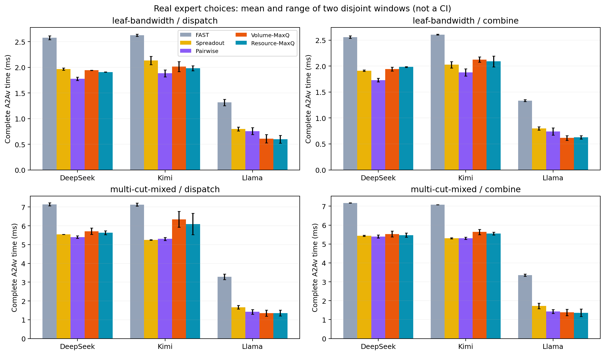
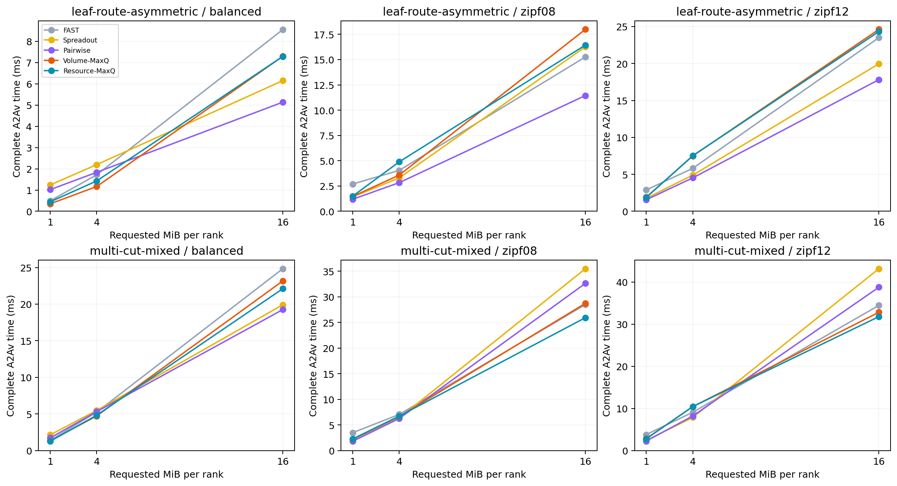
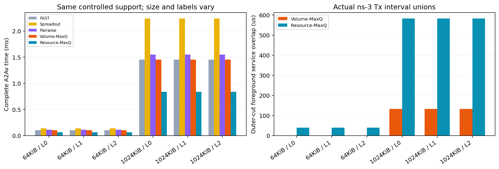
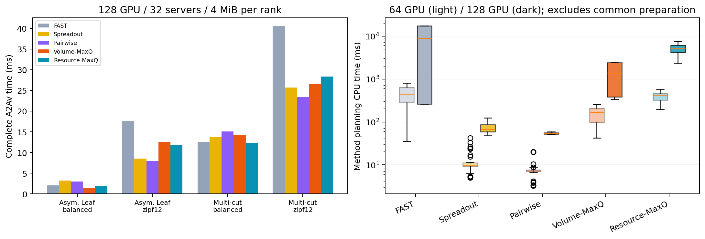

# SimAI补充实验结果（完整集合）

## Material Passport

- Type: simulation experiment result; fixed-routing All-to-Allv.
- Scope: 52 registered conditions × 5 methods; exploratory extension, no policy tuning.
- Status: 260/260 successful; 260 common-contract records.
- Timing: complete operator return (ACK + local dispatch); not application/inference latency.
- Provenance: study.json, source_hashes.json, source_snapshot/, per-attempt native event/Tx traces.

加速比=对照完成时间/Resource-MaxQ完成时间；>1表示Resource-MaxQ更快。胜/平/负阈值为1e-6。窗口范围不是置信区间；单种子合成结果不用于推断总体显著性。

| 实验组 | 对照 | 配对/未配对 | 几何均值加速比 | 胜/平/负 | 最差–最好 |
|---|---|---:|---:|---:|---:|
| real | FAST | 24/0 | 1.5578× | 24/0/0 | 1.0563–2.9395 |
| real | Spreadout | 24/0 | 1.0699× | 14/0/10 | 0.7857–1.4518 |
| real | Pairwise | 24/0 | 0.9918× | 7/0/17 | 0.8073–1.3181 |
| real | Volume-MaxQ | 24/0 | 1.0098× | 18/0/6 | 0.9569–1.0715 |
| synthetic | FAST | 22/0 | 1.1378× | 17/0/5 | 0.7728–1.7966 |
| synthetic | Spreadout | 22/0 | 1.0439× | 8/0/14 | 0.6508–2.7843 |
| synthetic | Pairwise | 22/0 | 0.9368× | 8/0/14 | 0.5794–2.2921 |
| synthetic | Volume-MaxQ | 22/0 | 0.9710× | 11/0/11 | 0.7319–1.1650 |
| mechanism | FAST | 6/0 | 1.6755× | 6/0/0 | 1.6135–1.7399 |
| mechanism | Spreadout | 6/0 | 2.4110× | 6/0/0 | 2.1672–2.6823 |
| mechanism | Pairwise | 6/0 | 1.8178× | 6/0/0 | 1.7823–1.8541 |
| mechanism | Volume-MaxQ | 6/0 | 1.6755× | 6/0/0 | 1.6135–1.7399 |

## 四组图

## 边界与复核

- 真实trace的专家选择实测；源GPU轮转、专家放置及8192字节向量是建模假设。combine为相同dispatch需求的转置。
- Pairwise为rank XOR配对；Spreadout为循环目标序列。二者复用同一rank级异步执行协议。
- 机制族保持机架内重标号和相同支撑结构；是否同q、同轮数和改变匹配见mechanism_evidence.json，不能仅凭速度推断机制。
- plan_comparison.csv和first_differences.json检查Volume/Resource的首次分叉是否来自相同残余、相同q*下的合法匹配；之后残余改变可能使后续q与轮数改变，不能将所有端到端对比说成整条配额序列固定。
- 待发空闲使用有剩余payload下界且无任何物理Tx的区间；重传使其偏保守，不把全部空闲都称为可消除。
- workload_metrics.csv记录真实矩阵的收发倾斜、机内原生通信与balance字节；method_metrics.csv含rank进度错位、PFC原始hook记录数、规划时间和完整通信时间。PFC记录数不是唯一暂停帧数或暂停时长。
- 所有负收益、失败、超时保留；未通过配对检查的记录不参与速度计算。不存在失败后自动重跑。
- 规划时间是当前Python实现的CPU时间，不能称为已经具备在线就绪性能。正文选图应标明适用范围，不以挑选成功样本代替该范围的完整统计。

状态计数：`{'success': 260}`。字节守恒错误：0；冻结输入变化：0。
