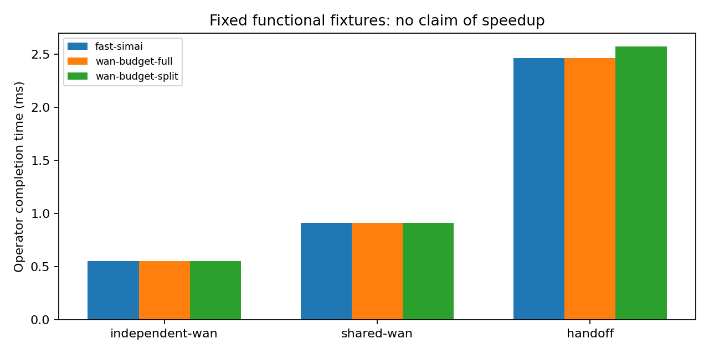

# 资源预算调度原型：最小功能验证

## Material Passport

- Origin Skill: academic-research-suite / experiment-agent；superpowers:executing-plans
- Origin Mode: run / functional prototype
- Origin Date: 2026-11-15
- Verification Status: 13项原型测试、39项复用组件回归通过；9次ns-3回放成功并校验交付/依赖。同带宽初次与修复后回放的9个FCT完全一致。不是性能普适性或包级模型校准认证。
- Version Label: isolated-wan-budget-v1

## 1. 本轮结论

五步算法已经在独立工作区实现，完整匹配、整数扣减、真实字节交付、H预算、回退和有限阶段进展均通过检查。**功能跑通不等于收益已成立：两组持平，一组主动拆分退化4.315%。** 本轮没有为了得到正收益更换失败样本、添加全局barrier或追加交换搜索。

原工作区`/home/julius/fast/SimAI`及正在进行的旧算法矩阵未改；新代码位于`/home/julius/fast/wan-budget-v1`的`research/wan-budget-v1-20261115`分支。不运行原生FAST仿真器获取时间。原型复用只读SimAI/ns-3二进制/动态库，哈希见study.json。SOURCE_SNAPSHOT.json核对了136个继承文件，与原工作区逐字节一致。

## 2. 算法具体实现

核心仅新增`src/simai_a2a/schedulers/resource_budget.py`，没有改动原来的分解器、流导出器或运行时。

1. `prepare_resources`读取每对固定路径、传播时间、物理有向资源、首末端点及唯一WAN ID；按WAN分组，DC内单列。路径含多个WAN时拒绝，不悄悄套用单WAN模型。
2. `pressure/select_anchors`按真实U的资源字节/容量计算剩余工作；WAN压力与端点压力分别提供锚点。虚拟补齐不贡献网络压力。
3. `anchored_cap/propose_quanta`先看锚点清空所需q，再检查包含锚点的完整匹配允许的上限。小q来自另一个sender先向其它目标发送、又有需求转向锚点receiver的结构事件；必须清空该见证的真实通道。它只是潜在机会，不是已验证的实际加速因果。
4. `construct_round`锁定锚点/见证，按资源覆盖、真实服务、剩余压力与预算直接填流。SCC与交替环只维护合法可补全的支持图，不作为事后换边优化器。所有最终补全真实边都计价；预算死路返回具体原因，再回退最大瓶颈合法匹配。
5. `evaluate_round/plan`按容量势函数剩余损失/真实字节选择候选，更新R/U。每轮必须清空至少一项R或一项正U；阶段数不超过初始nnz(R)+nnz(U)。没有按交换次数或随机候选名额限制算法。

固定(q,H)下使用同一时间代理，单位为us：

```text
x[i,j](q) = sum_u min(q,U[i,j,u])
T_proxy   = max_resource(该资源上真实选中路径最大单向传播 + 本轮字节*0.008/容量Gbps)
H         = 锚点独占时的同一代理
Phi       = max_resource(剩余真实字节*0.008/容量Gbps)
score     = (T_proxy + Phi_after - Phi_before) / 本轮真实字节
```

不同独立资源分别计算后取最大，不把甲路径传播与乙路径服务直接拼接。共享资源内仍是保守容量近似，不是精确逐流完成时间。信用包、ACK、缓冲复用和DCQCN/PFC只在同一个真实ns-3执行层体现。H不写成启动时刻或等待barrier。

## 3. 最小实验，而非主论文拓扑

每组只有4台服务器、每台2GPU，共8GPU，保留实际balance和dispatch字节，以及本地intrinsic操作。

| 输入 | DC划分 | 机制 |
|---|---|---|
| independent-wan | 4DC，每DC1server、1ToR、1GW | 两组独立端点/有向WAN，无换搭档机会 |
| shared-wan | 2DC，每DC2server、1ToR、1GW | 两条不同端点流共享同一有向WAN；严格预算可能使完整匹配失败，检查安全回退 |
| handoff | 4DC，每DC1server、1ToR、1GW | 锚点receiver与另一sender后续目标重合，产生真实残量事件小q |

服务器/DC内链路400Gbps、单向700ns；WAN100Gbps、单向50us；GPU接入与本地alpha/beta沿用旧模型。源GPU初始按3:1分担远端tile，balance非零；目的GPU集中放置，使dispatch非零。每通道单位262144B，各字节矩阵由固定小整数给出，不是扫描后挑选。

三个方法：FAST-SimAI、资源预算不主动拆分(full)、资源预算允许有见证拆分(split)。它们共用预处理、实际依赖、本地计时和ns3配置，均无全局stage barrier。保留已有fresh-QP，不添加QP敏感性。旧主矩阵的64/96/128GPU结果不混入此处。

## 4. 实际结果

| 条件 | FAST-SimAI(ms) | 预算full(ms) | 预算split(ms) | stage数：FAST/full/split |
|---|---:|---:|---:|---|
| independent-wan | 0.553441 | 0.553441 | 0.553441 | 1 / 1 / 1 |
| shared-wan | 0.914305 | 0.914305 | 0.914305 | 2 / 2 / 2 |
| handoff | 2.465533 | 2.465533 | 2.571910 | 2 / 2 / 3 |



独立WAN例没有无理由拆分。共享WAN例首轮的锚点独占H不足以容纳支持图所迫使的全部共享流，构造正确拒绝，随后合法回退，没有少传流量来假装缩短时间。

### 4.1 小q功能确实被触发，而非只有接口

handoff的初始辅助正残量只有1572864B和2097152B。split首轮选择524288B，低于辅助支持图中所有正阈值；这不是旧4q搜索已有阈值的同义改写。

首轮匹配为`0->1,1->0,2->3,3->2`。Z_R=0、Z_U=2：辅助边都未清空，但sender2发往server3的两个真实GPU通道完成，满足新进展条件。完整GPU原始来源/最终目的字节守恒验证通过。

| 首轮代理 | full | split |
|---|---:|---:|
| q，每GPU通道B | 2097152 | 524288 |
| 本轮真实服务量 | 13MiB | 4MiB |
| H/T_proxy(us) | 388.54432 | 136.88608 |
| Phi_before(us) | 335.54432 | 335.54432 |
| Phi_after(us) | 251.65824 | 251.65824 |

小q在当前评分下更划算，但这没有转化为真实整体加速。

### 4.2 退化例说明结构见证没有兑现成后续交接

split首轮之后，算法又先选了锚点余量，没有立即让见证sender转向锚点receiver。真实事件显示（相对算子epoch，us）：

| 事件 | full | split |
|---|---:|---:|
| rank0->rank2首次数据可见 | 499.689 | 193.299（仅第一段） |
| 同一对余量数据可见 | 已完成 | 605.514 |
| 后继rank4->rank2实际释放 | 552.699 | 658.523 |
| 最终关键rank5->rank3 ACK | 2465.533 | 2571.910 |

因此，单看第一段receiver更早可见会误判：后续真正的交接反而更晚。增加一个阶段也增加了控制与发送顺序的影响。以上是观察到的依赖轨迹；不能只凭这几行将全部网络差异归因于单一原因。完整事件、队列和CNP/PFC均保留。

## 5. 另一个已明确保留的构造局限

`diagnostics/feasible_but_greedy_rejected.json`给出4server严格均衡的纯规划检查：q=2097152B、H=388.54432us时，`[2,0,3,1]`是预算内合法完整匹配。但贪心先锁定`0->2,2->0`，使剩余边被迫重复占用同一WAN，最终返回`budget_completion_dead_end`。

这不是存在性求解器，也不是合法性bug：失败后回退仍正确。但它证明资源指导构造还不完备，支持图可补全不能保证预算可补全。该诊断没有新增ns3性能样本，更没有被删除以掩盖问题。

下一步应优先研究加入边时对**剩余必选资源负载的下界**检查，以及如何让结构性交接机会兑现到后续匹配；不应先做大规模扫描或随意增加交换次数。

## 6. 审查、修复与验证

- 初始11项测试通过，随后独立审查发现100/60Gbps下q向下取整使见证时间超H。补回归测试先复现q3!=q4，再改为最小覆盖事件的整数q=4。无新增重型求解器。
- 补充拒绝原因：支持图失败、端点冲突、锚点/见证超预算、预算补全死路、无离散进展，避免将所有None解释为不存在好方案。
- 当前13项原型测试通过；复用v2组件10项、execution9项、runner12项、ns3adapter8项，共39项回归通过。
- 修复后9次ns3回放全部成功；上述同带宽固定样本与初次9次FCT逐个完全一致。异构取整由解析回归确认，不冒称已完成异构性能扫描。

可重跑（--out必须是新目录，不覆盖原始数据）：

```bash
cd /home/julius/fast/wan-budget-v1/astra-sim-alibabacloud/experiments/alltoall
PYTHONPATH=src python3 -m unittest discover -s prototype_tests -v
python3 tools/run_wan_budget_smoke.py --out results/wan-budget-smoke-repeat
```

## 7. 边界与保留判断

1. 保留完整匹配/补齐，以隔离新动态构造；尚未检验部分匹配更自由的收益。
2. 每轮真实/辅助归零条件排除纯碎片化机会，换取nnz阶段上界；不保证阶段最少。
3. 结构见证、容量势函数、H均为启发式，不证明全局最优或真实执行更快。
4. 继承源文件由哈希验证；原有后端仍是共享只读依赖，不声称完成了后端物理校准。
5. 当前构造会错失预算内完整匹配，CPU也未优化；尚不宜宣称保持在线性能优势或进入论文正式收益实验。
