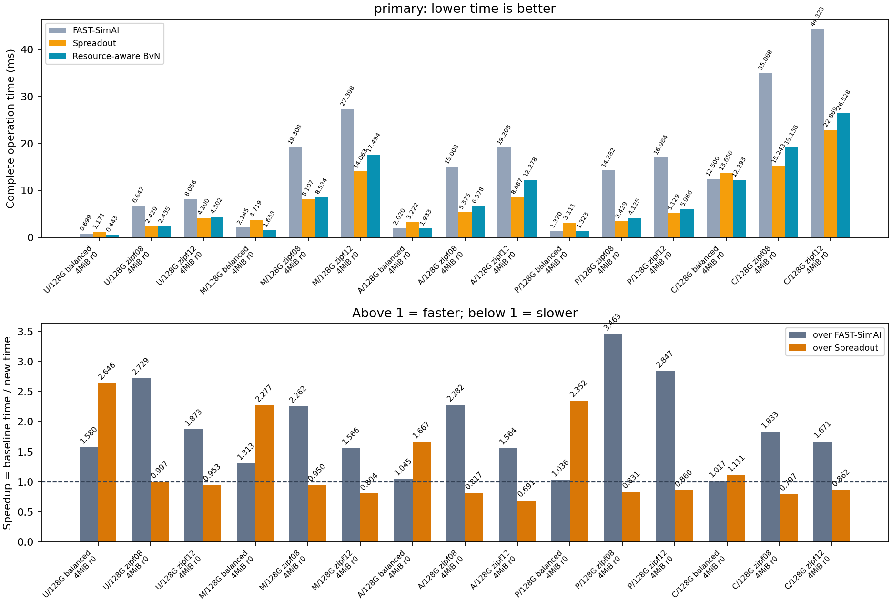
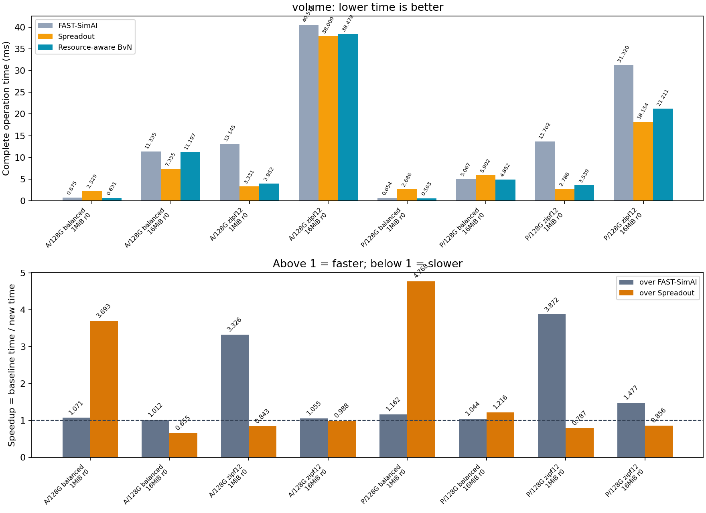
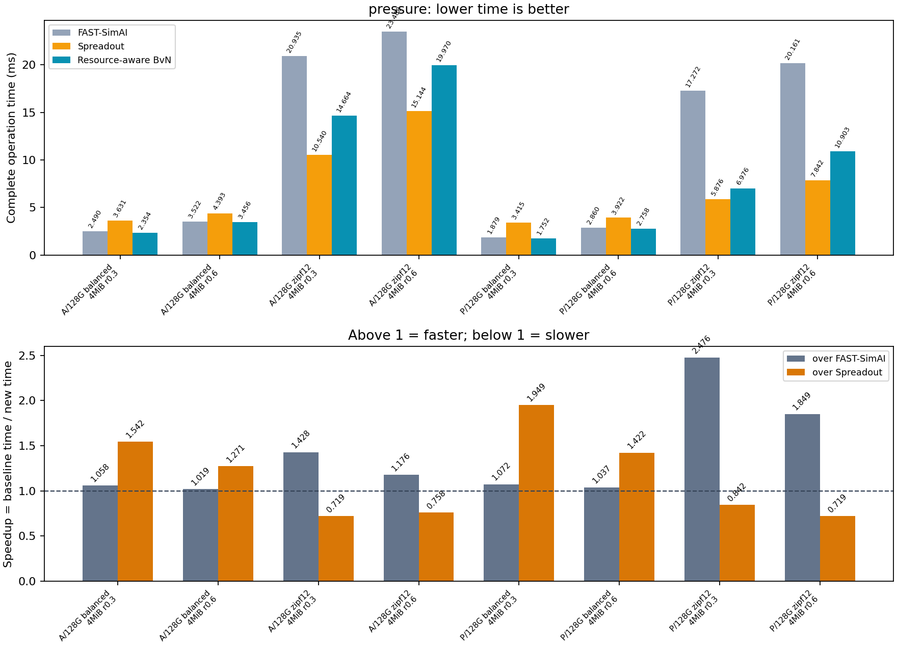
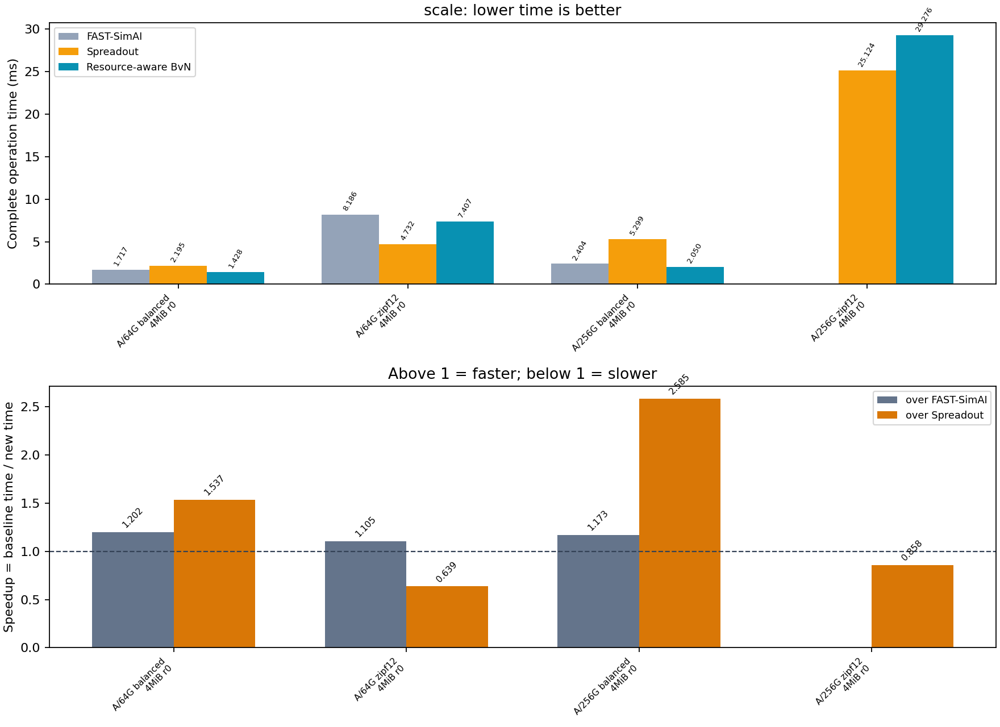
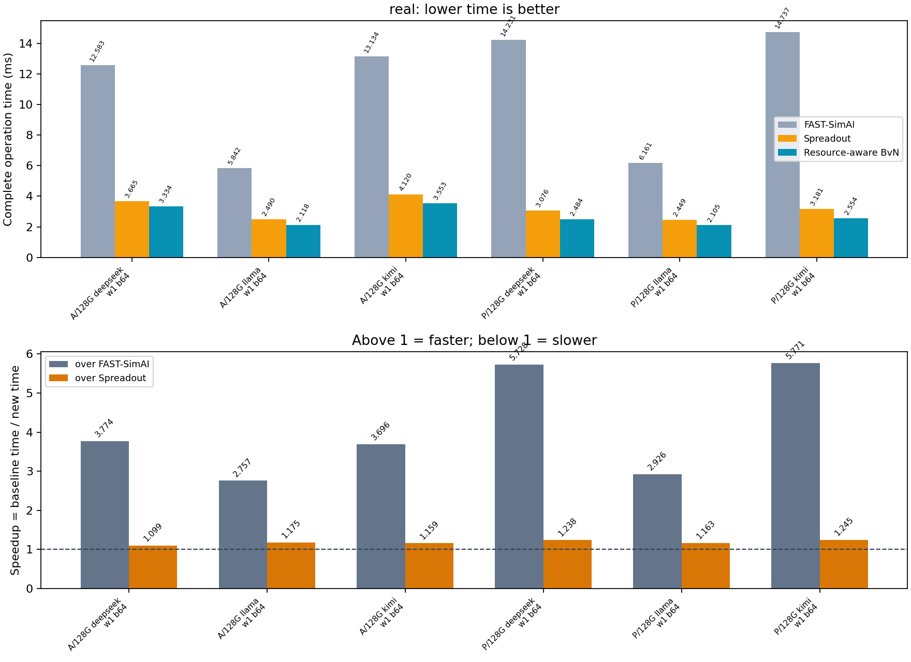

# 异构拓扑扩展实验：FAST / Spreadout 对照

日期：2026-11-15。执行配置在[实验登记](EXPANDED_EXPERIMENT.md)中预先固定；调度算法、后端和拥塞控制均未依据本轮结果调整。123次已结束，122成功、1超时；超时项不重跑，不视为收益。

## 1. 比较口径与此前“全为1”的原因

主对照是 **FAST-SimAI、Spreadout、资源感知BvN**，不再把纯MaxQ作为主图分母。FAST-SimAI保留当前移植的balance、服务器分解及dispatch；不是独立运行FAST原生二进制。Spreadout是一发一收的循环调度基线，不代表完整NCCL协议实现。

加速比 = 基线完整通信时间 / 新算法完整通信时间。大于1才加速；图中同时给三方法的原始毫秒和至少三位小数的比值，CSV保留完整精度。旧pilot第一栏相对纯MaxQ，六个均衡条件的完整调度确实相同，因此为1；它不表示相对FAST或Spreadout也为1。旧72次回放的结果未重跑、未修改。

## 2. 拓扑、负载和规模的含义

每server4GPU、每ToR4server；固定路由，不优化路由选择。物理链路仍为双向同速率/时延；不对称Leaf通过正反向不同路径产生端到端不对称，不是把同一线缆两个方向设为不同速率。

“路径独占带宽”是无竞争时路径最小容量；共享后实际带宽由ns-3中的并发、DCQCN/PFC与依赖事件决定，不是静态带宽直接相除得到实测完成时间。传播时间均为单向。

### 物理路径特征

| 拓扑（图中缩写），128GPU | 独占带宽Gbps | 单向传播us | 无序服务器对中正反向BW或传播不同的比例 |
|---|---|---|---:|
| 同构Leaf，U | 400 | 1.6–3.0 | 0% |
| 带宽/时延混合Leaf，M | 100/200/400 | 1.6–11.6 | 0% |
| 路由不对称Leaf，A | 100/200/400 | 1.6–11.6 | 59.68% |
| 混合Pod，P | 400 | 1.6–10.0 | 0% |
| 多割边异构链，C | 100/200/400 | 1.6–19.1 | 0% |

不对称比例只比较独占带宽和传播，不因“资源ID方向不同”就算不对称。64/256GPU不对称Leaf分别为53.33%/62.70%。例如128GPU的server0→5为100G、7.3us，5→0为400G、3us。这些特征均来自实际固定路径，而非只给规划器附加权重。

Pod出口400/1600G均不低于400G服务器接入，所以其单流瓶颈为400G；它测试的是多流共享的聚合容量异构。其它三种异构拓扑另外覆盖通信对的独占带宽差异。同构Leaf控制组也包含同机架/跨机架的距离差异，不是所有通信对的路径长度完全相同。

### 流量与压力

- 合成：均衡、Zipf0.8、Zipf1.2；每rank总字节保持相同，Zipf改变目标倾斜。对目标按随机置换的排名赋权`rank^(-alpha)`，对每个发送者屏蔽自身后归一化，再做多项采样。它是受控目标热点模型，不声称拟合真实MoE分布。
- 字节规模：每rank约1/4/16MiB，不是每个通信对；整数块粒度导致实际字节稍有差别，详见CSV。规模实验64/128/256GPU是固定每rank字节的弱扩展，总流量随GPU数增加。
- 背景压力：rho=0/0.3/0.6，是按最忙共享资源归一化的配置平均负载，不是实测利用率。所有对照同背景、同前景起点、同拥塞配置。
- 真实输入：DeepSeek/Kimi/Llama专家选择，窗口1、固定代表层、每GPU64token；`b64`不是64GPU。来源GPU、专家部署和8192字节向量是建模假设，不能称为实机测得的完整通信轨迹。
- 图中`128G`等旧缩写指128GPU，不是128Gbps。分布固定seed4101；真实输入窗口、层号和实际字节均另列CSV。

| 真实输入 | 层号 | token/GPU | 全部非self通信MiB | 每rank发送MiB范围 |
|---|---:|---:|---:|---:|
| DeepSeek | 32 | 64 | 508.00 | 3.875–4.000 |
| Llama | 25 | 64 | 63.46 | 0.336–0.500 |
| Kimi | 31 | 64 | 508.02 | 3.820–4.000 |

每个模型在两个拓扑上复用完全相同的矩阵；它们是拓扑配对，不是新增的独立流量样本。

## 3. 完成情况与主结果

预先登记41条件、123次新回放，122成功，唯一超时为不对称Leaf、256GPU、Zipf1.2、4MiB/rank的FAST-SimAI。单次后端超时300秒，不重试；该条件保留，FAST比值留空，Spreadout仍可配对。完整算子时间不含规划CPU。

| 实验块 | 条件数 | FAST有效配对 | 相对FAST几何均值 | Spreadout有效配对 | 相对Spreadout几何均值 | 对Spreadout胜/平/负 |
|---|---:|---:|---:|---:|---:|---:|
| 主拓扑×分布 | 15 | 15/15 | 1.751× | 15/15 | 1.117× | 5/0/10 |
| 字节规模 | 8 | 8/8 | 1.505× | 8/8 | 1.294× | 3/0/5 |
| 背景压力 | 8 | 8/8 | 1.320× | 8/8 | 1.076× | 4/0/4 |
| 规模扩展 | 4 | 3/4 | 1.159× | 4/4 | 1.215× | 2/0/2 |
| 真实输入 | 6 | 6/6 | 3.936× | 6/6 | 1.179× | 6/0/0 |
| 全部（探索性混合汇总） | 41 | 40/41 | 1.758× | 41/41 | 1.160× | 20/0/21 |

对FAST的40个有效配对全部加速，最小1.012×；缺失的一例没有加入均值。对Spreadout最差0.639×、最好4.768×，所以几何平均大于1不代表大多数条件获益。

图中均为线性坐标，原始时间列及加速比列含义分开。

主拓扑组15条件；字节规模8条件；背景压力8条件；规模扩展4条件；真实数据6条件。不同实验块的混合总体仅供描述，不替代逐块结果；一个合成种子不支持显著性或普遍性结论。

## 4. 优势与退化边界

主拓扑组固定128GPU、4MiB/rank、rho0；不同分布不是把数据量一起放大。

| 分布（各5拓扑） | 相对FAST | 相对Spreadout | 对Spreadout胜/平/负 |
|---|---:|---:|---:|
| 均衡 | 1.180× | 1.922× | 5/0/0 |
| Zipf0.8 | 2.456× | 0.875× | 0/0/5 |
| Zipf1.2 | 1.852× | 0.829× | 0/0/5 |

这是当前最重要的边界：**相对FAST稳定有收益，不等于相对Spreadout也稳定有收益**。更强异构也没有自动扩大收益。按主拓扑组汇总，不对称Leaf、多割边链相对Spreadout分别仅0.980×、0.914×。

主拓扑组原始完成时间如下，单位ms；列的顺序始终为FAST、Spreadout、新算法，不是阶段数。

| 拓扑 | 分布 | FAST | Spreadout | 新算法 | FAST/新 | Spreadout/新 |
|---|---|---:|---:|---:|---:|---:|
| 同构Leaf | 均衡 | 0.699335 | 1.171191 | 0.442663 | 1.580 | 2.646 |
| 同构Leaf | Zipf0.8 | 6.646549 | 2.428792 | 2.435131 | 2.729 | 0.997 |
| 同构Leaf | Zipf1.2 | 8.056137 | 4.099976 | 4.301815 | 1.873 | 0.953 |
| 混合Leaf | 均衡 | 2.144666 | 3.719099 | 1.633247 | 1.313 | 2.277 |
| 混合Leaf | Zipf0.8 | 19.308367 | 8.107071 | 8.534142 | 2.262 | 0.950 |
| 混合Leaf | Zipf1.2 | 27.397625 | 14.062882 | 17.494141 | 1.566 | 0.804 |
| 不对称Leaf | 均衡 | 2.020291 | 3.222007 | 1.932604 | 1.045 | 1.667 |
| 不对称Leaf | Zipf0.8 | 15.007673 | 5.375030 | 6.577787 | 2.282 | 0.817 |
| 不对称Leaf | Zipf1.2 | 19.202502 | 8.487337 | 12.278324 | 1.564 | 0.691 |
| 混合Pod | 均衡 | 1.370031 | 3.111398 | 1.322667 | 1.036 | 2.352 |
| 混合Pod | Zipf0.8 | 14.282480 | 3.429106 | 4.124530 | 3.463 | 0.831 |
| 混合Pod | Zipf1.2 | 16.984176 | 5.128669 | 5.966217 | 2.847 | 0.860 |
| 多割边链 | 均衡 | 12.499562 | 13.656191 | 12.292656 | 1.017 | 1.111 |
| 多割边链 | Zipf0.8 | 35.067926 | 15.243147 | 19.136321 | 1.833 | 0.797 |
| 多割边链 | Zipf1.2 | 44.323019 | 22.869195 | 26.528141 | 1.671 | 0.862 |

均衡组确实是优势区间，但不是“只对严格均衡才有用”：六个真实数据条件相对Spreadout全部加速，几何平均1.179×，范围1.099–1.245×；相对FAST为3.936×。这是建模后的专家采样结果，而不是对所有真实部署的保证。

也不能外推成所有均衡规模都更好：不对称Leaf均衡负载扩大到16MiB/rank时，新算法11.197ms、Spreadout7.335ms，仅0.655×。因此优势范围同时受分布、字节规模和拓扑影响。

反例不能隐藏：不对称Leaf＋Zipf1.2＋4MiB，新算法12.278ms、Spreadout8.487ms，约慢44.67%，尽管仍比FAST19.203ms快。进一步解释要看流粒度、发送槽/ACK依赖及物理资源占用轨迹；单凭这张总时间表不能认定是哪一个环节造成，也不能把它简单归因于“FAST针对Zipf”。

扩大规模并没有反转这个边界：64/256GPU均衡条件相对Spreadout分别1.537×/2.585×；对应Zipf1.2条件为0.639×/0.858×。256GPU Zipf时Spreadout25.124ms，新算法29.276ms，FAST超时而非已知通信时间。

背景压力组相对Spreadout为4胜4负，恰为均衡4胜、Zipf4负。能够说明加背景后仍有均衡收益，不能据此宣称已普遍解决拥塞；PFC和释放错位需结合逐链路轨迹分析。

相对FAST的总收益并不能全部归因于拓扑：该算法还使用最大可行提取系数，和原始Kuhn的分解粒度不同。纯MaxQ可留作内部归因消融，但不是本轮主基线；本轮没有新增纯MaxQ回放，不能从这些主对照直接推出拓扑自身的独立增益。

## 5. 执行、规划及诊断边界

通信指标来自SimAI/ns-3实际事件，不是按规划时间提前释放流；沿用发送槽/ACK/接收可见性依赖，无全局stage barrier。阶段释放错位、原始发送者完成错位及PFC记录保存为补充诊断；PFC记录是钩子观测次数，不等于唯一暂停帧或累计暂停时间，不能单独证明拥塞被消除。

例如混合Pod＋Zipf1.2＋rho0.6，FAST/Spreadout/新算法的前景窗口PFC观测为42/0/16，对应完成时间20.161/7.842/10.903ms；平均stage释放错位约163.94/294.10/369.90us。暂停观测减少仍可能更慢，且新方法释放错位并未总变小。不同方法的stage粒度也不同，不能把错位均值单独当作总时间替代指标。

规划CPU与通信时间分开，前者不计入主加速比；它仍需披露，不宣称已满足在线调度时延。新算法核心CPU约0.327–222.590秒，方法相关规划＋物化/校验约0.463–225.206秒；公共预处理不在后者计时范围。新算法通信约0.443–38.478ms。多进程测得的CPU范围不是隔离环境中的规划墙钟基准，也不能将通信加速比直接当作端到端在线收益。

## 6. 复核与材料

全部122个成功结果均通过原始发送者→最终接收者字节交付检查及执行指纹复核；配对比较真实矩阵、硬件、物理拓扑、固定路由、背景、前景epoch、运行环境、后端及拥塞配置，不只比较矩阵哈希。共复核3,278,144条后端实际安装的路由条目。登记源码摘要未改变，后端没有重新构建。

本轮相关测试95通过、6跳过。全套247通过、11跳过，另有10失败、3错误；这13项与之前完全相同，涉及快照中缺失的旧研究脚本/头文件，不属于“全项目测试全通过”。独立只读审查未发现关键或重要正确性问题；`128G`缩写的轻微展示歧义在本报告中解释，未改动冻结的实验入口。

- [完整41行配对CSV](../../astra-sim-alibabacloud/experiments/alltoall/results/heterogeneous-expanded-20261115/paired.csv)：全部因素、实际字节、状态、时间、阶段数、比值。
- [全部123次记录](../../astra-sim-alibabacloud/experiments/alltoall/results/heterogeneous-expanded-20261115/all_runs.csv)：包括唯一超时。
- [分组汇总与PFC/错位](../../astra-sim-alibabacloud/experiments/alltoall/results/heterogeneous-expanded-20261115/expanded_summary.json)。
- [验证记录](../../astra-sim-alibabacloud/experiments/alltoall/results/heterogeneous-expanded-20261115/verification.json)。
- [只读汇总代码](summarize.py)，[预先固定的实验入口](experiment.py)。

紧凑证据包保留全部合成输入、合成分解计划与小型诊断，以及不对称Leaf均衡/Zipf1.2两组的详细事件证据，其余合成原始日志提供哈希索引。完整原始产物与较大的证据包留在本地，不将大体积轨迹强行放入Git。

原始专家数据、凭据、可执行文件和完整包轨迹不公开；所有原始实验产物保留本地，合成输入和紧凑证据可随研究分支保存。
