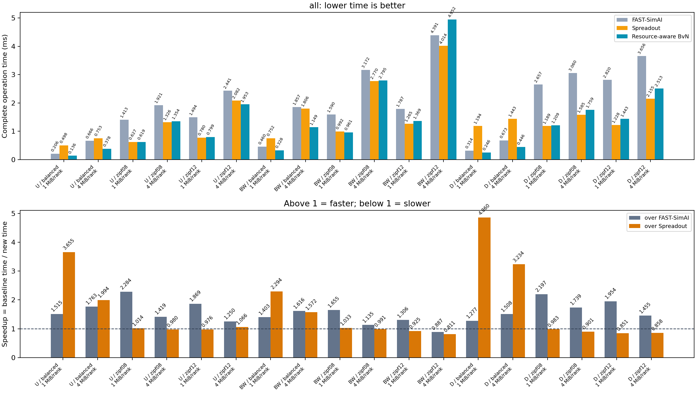

# 异构拓扑×分布×字节规模：首轮结果

## Material Passport

- 日期：2026-11-15；执行算法版本`ef4249e`，预先固定18条件，不逐样本挑版本。
- 后端：既有SimAI/ns-3，DCQCN/PFC与机内模型不变；固定路径、rank信用/ACK事件驱动，无全局barrier。
- 目的：先验证异构拓扑与负载两个轴；不是总体性能或在线能力认证。

## 配置与口径

每server4GPU、每ToR4server，共64GPU、4ToR、4Spine。服务器上联400G；同构交换上联400G/700ns，带宽异构按机架400/200/100/400G，时延异构按机架700ns/2us/5us/700ns。每ToR均有四条Spine上联。

严格均衡、Zipf0.8、Zipf1.2三分布，每rank约1/4MiB，seed3101、无背景流。保持同一分布和种子时，仅改变整数块字节数；同一负载跨拓扑复用相同矩阵。因此矩阵重复是配对控制，不是新的独立随机样本。两种Zipf是目标热点多项式采样，不声称拟合真实MoE。

所有时间单位ms，包含现有balance/intrinsic/dispatch的本地模型及完整通信，不含规划CPU。四种方法含义见[报告](REPORT.md)。

## 逐条件结果

| 条件 | FAST-SimAI | Spreadout | Volume-MaxQ | Resource-MaxQ |
|---|---:|---:|---:|---:|
| leaf-uniform-balanced-m1 | 0.206310 | 0.497673 | 0.136151 | 0.136151 |
| leaf-uniform-balanced-m4 | 0.665932 | 0.753106 | 0.377741 | 0.377741 |
| leaf-uniform-zipf08-m1 | 1.412765 | 0.627270 | 0.613206 | 0.618660 |
| leaf-uniform-zipf08-m4 | 1.920639 | 1.325970 | 1.349576 | 1.353648 |
| leaf-uniform-zipf12-m1 | 1.493682 | 0.780031 | 0.797970 | 0.799346 |
| leaf-uniform-zipf12-m4 | 2.440842 | 2.081851 | 2.009229 | 1.952914 |
| leaf-bandwidth-balanced-m1 | 0.459754 | 0.751570 | 0.327690 | 0.327690 |
| leaf-bandwidth-balanced-m4 | 1.857383 | 1.806425 | 1.149361 | 1.149361 |
| leaf-bandwidth-zipf08-m1 | 1.590263 | 0.992379 | 0.959560 | 0.960804 |
| leaf-bandwidth-zipf08-m4 | 3.172429 | 2.770047 | 2.873895 | 2.795471 |
| leaf-bandwidth-zipf12-m1 | 1.786906 | 1.265469 | 1.385555 | 1.368514 |
| leaf-bandwidth-zipf12-m4 | 4.390858 | 4.014124 | 5.007518 | 4.951645 |
| leaf-delay-balanced-m1 | 0.313788 | 1.194167 | 0.245736 | 0.245736 |
| leaf-delay-balanced-m4 | 0.672994 | 1.442957 | 0.446229 | 0.446229 |
| leaf-delay-zipf08-m1 | 2.657299 | 1.188630 | 1.205659 | 1.209401 |
| leaf-delay-zipf08-m4 | 3.060376 | 1.584853 | 1.747726 | 1.759495 |
| leaf-delay-zipf12-m1 | 2.819762 | 1.227968 | 1.494235 | 1.443140 |
| leaf-delay-zipf12-m4 | 3.656219 | 2.155304 | 2.527630 | 2.513281 |

`m1/m4`表示每rank约1/4MiB，不是每个通信对1/4MiB。实际字节与整数块粒度在输入矩阵manifest中保存。



主图已改为FAST/Spreadout，两项速度比都是“基线时间÷新方法时间”，保留三位小数；不是将新方法除以自身。原`pilot_speedup.png`保留为历史内部消融图，其中第一栏相对纯MaxQ，六个均衡条件确实等于1。改变图表没有重跑仿真、修改FCT或更换样本。

## 能支持的结论

- 相对FAST-SimAI：总体几何平均1.529×，17胜1负。
- 相对Spreadout：1.346×，9胜9负；均衡六例较好，Zipf尤其高倾斜并非稳定优势。
- 相对纯MaxQ：1.0053×，6胜6平6负；拓扑选择的额外收益仍小。
- 按字节规模分组，相对Spreadout为1MiB时1.471×、4MiB时1.233×。规模改变后并非线性平移，不能只跑一个大小。
- 六个均衡条件中，资源算法全部选择`maximum_reference`，15轮的匹配及系数序列与纯MaxQ完全一致。它说明当前启发式没有改变这些计划，不能据此证明拓扑没有优化空间。
- 带宽异构Zipf1.2/4MiB中，FAST222轮而新方法89轮，却新方法更慢。因此阶段数不是最终完成时间的充分代理；需要后续按实际信用、发送槽和资源服务轨迹定位，当前不把原因直接归给拥塞模型或代码错误。

## 验证与未执行边界

72次执行均通过完整交付与依赖检查，四方法输入/硬件/路由/背景/epoch/数值配置/线程/动态库/执行文件指纹逐项一致。全部原始事件与包轨迹本地保留。多速率链路不使用旧统一100G分母的利用率作结论。

独立只读审查检查全部8种已支持的拓扑/规模组合的逐GPU路径与服务器快照一致性、rho归一化，重构了16份现有计划、911个stage：匹配合法、系数为当轮最大可行值、资源字节一致、残余归零。它不是额外仿真重复，也不等于最终全部数据的统计认证。

本轮没有执行压力/真实输入/128GPU/多切口树/Pod–Core性能扫描。相关入口与负载设计已经保存，但不能把输入准备测试当成成功的网络实验。仅一个固定种子，不报告总体显著性或置信区间。

代码审查修复了`--prepare-only`误要求后端文件、非pilot阶段被写成pilot标签的问题，均有RED→GREEN测试；只重新分析已完成产物，没有重跑仿真。修正后的分析快照与原执行快照分开保存。

变更范围85通过、6跳过；全仓237通过、11跳过，仍有修改前已有的10失败和3错误，失败集合一致。具体名称与校验计数见结果目录`verification.json`，不宣称全仓全绿。

## 数据和命令

[结果目录](../../astra-sim-alibabacloud/experiments/alltoall/results/heterogeneous-pilot-20261115/)中保存`paired.csv`、`all_runs.csv`、`summary.json`、`study.json`、图、源码快照与压缩证据。完整实验维度见[experiment_matrix.json](experiment_matrix.json)。

`paired-evidence.tar.gz`约29MiB，含667个条目；内置逐文件SHA清单，全部校验通过。它保存合成输入、调度计划、FCT、完成事件和交付证据，不含完整包轨迹、原始专家数据、凭据或可执行文件。压缩包摘要见`verification.json`。

```bash
python3 research/resource_a2av/experiment.py --analyze-only \
  --out astra-sim-alibabacloud/experiments/alltoall/results/heterogeneous-pilot-20261115
```

上述重新审计需要本机完整回放与原指纹对应的可执行文件；新克隆可直接读汇总/图、解压证据，或根据固定配置重新生成合成输入。原始专家数据、凭据和二进制不随仓库发布。
