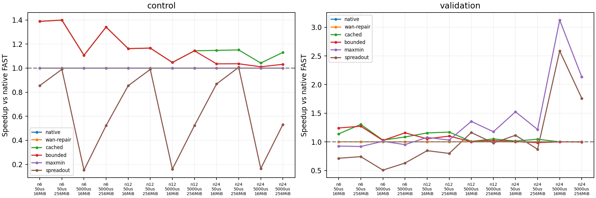
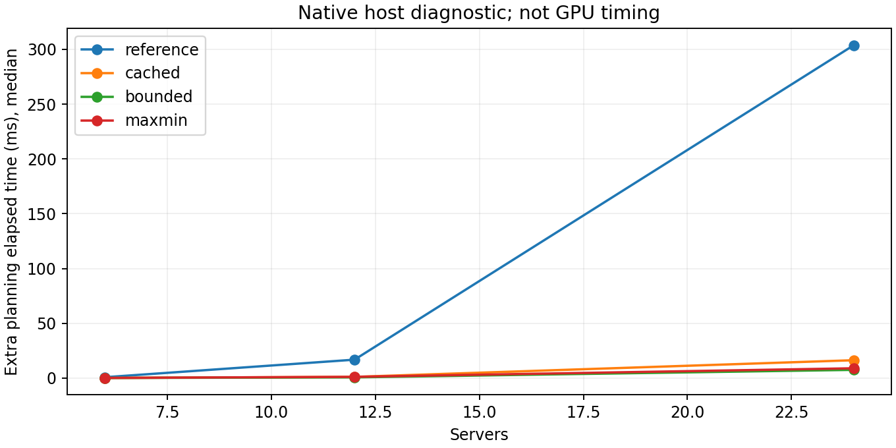

# 原生FAST：共享瓶颈与轻量匹配修补

日期：2026-10-28。本轮继承原生pipeline2和机内SpreadOut，不使用SimAI/ns-3，不修改既有论文复现结果。原生网络模型扩展与调度策略改进分开评估。

## 研究问题与基线

研究问题：服务器端点匹配不冲突时，多条流仍可能争用同一条DC间链路。改变同一阶段内流的组合，是否能减少累计瓶颈服务时间，并且收益超过额外调度开销？不把增加WAN覆盖率本身作为成功标准。

主要基线是原生C++的FAST匹配；所有方法都使用同一套新网络评价器及原生pipeline2。30个原始链路表oracle和额外30个论文速率输入检查了关闭网络hook时与固定原始源码二进制的一致性，另用2GPU各100MB手算确认2000.7µs。新评价器本身不是调度创新，也不能将结果称为逐包仿真或实机吞吐。

## 拓扑与负载

3DC，DC间两两独立全双工连接；每DC2/4/8服务器，共6/12/24服务器，每台8GPU。服务器收/发各400Gbps聚合、DC网关收/发各400Gbps、每个有向DC对WAN100Gbps。LAN每跳700ns；WAN单向50µs或5ms。机内使用450GB/s、alpha0.1µs的SpreadOut。这里服务器出口是400Gbps总量，**不是论文同构场景的每GPU400Gbps**。

服务器—ToR—网关—WAN—网关—ToR—服务器；相同DC不同服务器路径传播1.4µs，跨DC为WAN+2.8µs。阶段网络时间近似为最大活跃路径传播代价加最大链路真实字节/带宽。按原生pipeline2与前阶段redistribution取max，不新增barrier；没有ACK、RTT、包队列或拥塞控制模型。

每GPU平均预算16/256MiB；balanced为所有非对角GPU对等量，整数取整后略小于预算；Zipf采用原生alpha=.9、截断10000的生成器，再归一化到精确总字节。开发种子280101/280103，新验证280201/280203。每个网络配置balanced只计一次，不伪造多个种子重复。60配置包含30个不同矩阵，每个矩阵在2种WAN时延下复用；不把这些相关配置当作60份独立随机证据。

## 方法定义

- 原生FAST：原始匹配、原始分解顺序，统一网络评价。
- WAN修补：当仍有真实WAN需求而当前匹配未覆盖时，用交替环尝试修补，保留为消融，不强制默认使用。
- 参考链路代价：既有原型，每阶段最多N条候选交替环，按本阶段耗时/真实字节择优；候选评价反复构造字符串资源map。
- 缓存链路代价：同样的候选、访问次序、评分和接受规则，但路由预编译为整数资源ID并复用数值负载数组。必须与参考版生成相同匹配与通信结果；这是实现优化，不是新调度算法。
- 受限修补：从原生匹配出发，最多检查2条真实残余需求最大的候选边，以交替环调整。仅当每阶段耗时/真实字节严格改善、且匹配最小系数不低于当前原生匹配时接受；否则回退原生。
- Max-Min：既有的最大化匹配最小系数基线，不作为原创。
- SpreadOut：原生GPU轮转配对，使用相同新链路资源；不是已验证的NCCL实现。

受限修补不枚举排列，不调用求解器。每次仍扣最小正残余，阶段数≤N²，候选尝试≤2×阶段数；但这不保证全局阶段数不增加，也不保证完成时间改善。系数保护只约束当前残余上的一次选择。

## 指标与实验纪律

60输入×7方法=420次独立方法运行。比较通信模型时间、相对原生FAST加速、WAN阶段数、总阶段数、累计瓶颈序列化代价、每条链路总真实字节及调度经过时间。原始JSON摘要独立登记，所有实际字节由原生派发前后差分核验，虚拟补齐不变成网络字节。

瓶颈WAN服务占比=最忙有向WAN总字节/容量/整体时间。相同输入下分子对所有方法相同，因此它与完成时间改善不是两份独立证据；解释机制要看逐阶段共享链路负载组合，而非只展示利用率提高。

调度耗时使用本机墙钟时间，分原生首次分解和额外规划；当前桥接先生成原生分解再替换，因此二者都计入诊断估算，不能隐藏重复分解开销。“通信模型时间+规划经过时间”不是GPU端到端实测。缓存与参考模式的语义必须一致，不能把缓存带来的CPU加速说成通信改善。

本轮先固定全部配置再运行，不根据验证种子调整预算、候选顺序、评分或系数保护。负例和Max-Min胜出的场景全部保留。已有论文图17a差异继续记录，不因本轮开始优化而宣布复现成功。

## 结果

权威结果：[run-33e58e040218](results/run-33e58e040218/)。420/420次完成，并重新调用原生程序逐项回放、重算路径字节与pipeline时间；参考版和缓存版在全部60个输入上匹配、阶段、字节、模型时间与非计时统计完全一致。开发24组、验证24组、balanced控制12组；表中对配置等权取配对加速比的几何平均，不把阶段数当作独立样本数。

### 总体结果与新验证集

加速=原生FAST通信时间/本方法通信时间，大于1为快于原生FAST。含规划估算加上原生首次分解与额外规划经过时间；它不是GPU端到端测量。

| 方法 | 全60组通信加速 | 全组胜/平/负 | 新验证24组通信加速 | 新验证含规划加速 | 新验证相对Max-Min通信加速 |
|---|---:|---:|---:|---:|---:|
| 原生FAST | 1.0000× | 0/60/0 | 1.0000× | 1.0000× | 0.7858× |
| WAN修补 | 0.9984× | 0/53/7 | 1.0000× | 0.9932× | 0.7858× |
| 参考链路代价 | 1.0968× | 55/0/5 | 1.0810× | 0.8641× | 0.8495× |
| 缓存链路代价 | 1.0968× | 55/0/5 | 1.0810× | 1.0573× | 0.8495× |
| 受限修补 | 1.0739× | 51/0/9 | 1.0686× | 1.0569× | 0.8397× |
| 已知Max-Min | 1.2188× | 32/12/16 | 1.2726× | 1.2452× | 1.0000× |
| SpreadOut | 0.8509× | 20/0/40 | 0.9556× | 0.9609× | 0.7509× |

缓存只改变计算开销，不改变通信结果。受限修补确实更便宜，但通信平均收益也更小，且新验证集6个负例；不能宣称已普遍优于Max-Min。WAN修补在本轮没有正例，不建议作为默认硬规则。



图中cached与reference通信曲线完全重合，省去重复参考线。右图每点为同配置2个验证种子的几何平均，因此可能掩盖单个种子的退化，完整CSV保留所有输入。绘图标签native=原生、cached=缓存、bounded=受限修补、maxmin=已知Max-Min。

### 核心正例：相同阶段数、相同WAN轮数，链路组合不同

6服务器×8GPU、balanced256MiB/GPU、WAN单向5ms：

| 指标 | 原生FAST | 缓存链路代价 | 受限修补 |
|---|---:|---:|---:|
| 通信完成时间 | 229.799833ms | 171.315179ms | 171.315179ms |
| 总阶段/真实WAN阶段 | 5/5 | 5/5 | 5/5 |
| 累计传播费用 | 25.014000ms | 25.014000ms | 25.014000ms |
| 累计瓶颈序列化费用 | 204.696289ms | 146.211635ms | 146.211635ms |
| 每条有向WAN总真实字节的最大值 | 1,462,116,352B | 相同 | 相同 |
| 最忙WAN模型服务占比 | 50.90% | 68.28% | 68.28% |
| 初始balance费用 | 0 | 0 | 0 |
| 原始机内A2A/每阶段dispatch | 89.543876µs | 相同 | 相同 |

完成时间下降**25.45%**，不是减少阶段、增加WAN覆盖、忽略机内通信或改变等待规则造成的。各阶段最繁忙有向WAN的真实payload如下（十进制MB；各阶段可能是不同WAN方向）：

| 方法 | stage0 | stage1 | stage2 | stage3 | stage4 |
|---|---:|---:|---:|---:|---:|
| 原生FAST | 365.529 | 731.058 | 365.529 | 731.058 | 365.529 |
| 缓存/受限修补 | 365.529 | 365.529 | 365.529 | 365.529 | 365.529 |

端点不冲突不代表中间链路不冲突：原生在部分阶段将两条流压在同一个DC对WAN上，而其他WAN方向未充分分担；改进改变匹配组合，减少逐阶段最大资源负载之和。全程每条WAN的总用户字节仍完全相同。这是当前模型内可直接归因的不足，不以“WAN必须每阶段活跃”作为解释。

### 优势区间与反例

下面对每个服务器规模/时延，将2种预算×2个新验证种子的加速比取几何平均：

| 服务器数 | WAN单向时延 | 缓存链路代价 | 受限修补 | Max-Min |
|---:|---:|---:|---:|---:|
| 6 | 50µs | 1.2200× | 1.2580× | 0.9233× |
| 6 | 5ms | 1.0579× | 1.0895× | 0.9806× |
| 12 | 50µs | 1.1635× | 1.0772× | 1.0547× |
| 12 | 5ms | 1.0298× | 1.0140× | 1.2641× |
| 24 | 50µs | 1.0305× | 0.9953× | 1.3624× |
| 24 | 5ms | 1.0016× | 0.9990× | 2.5826× |

当前证据支持“小规模、共享链路组合代价显著”这个优势区间；更大规模、高传播场景，原生分解碎片和大量阶段成为更大问题，单纯局部链路评分不足。这是当前验证结果，不据此回头挑选参数宣称普遍有效。

正例：6服务器、seed280201、256MiB/GPU、WAN50µs，原生221.131891ms，缓存165.339946ms（1.3374×），受限173.846391ms；均22个WAN阶段。缓存累计瓶颈序列化219.073229→163.307962ms，而Max-Min为240.810735ms，说明仅追求较大系数也未必解决链路组合问题。

反例：24服务器、seed280203、256MiB/GPU、WAN5ms：

| 方法 | 完成时间 | WAN阶段数 | 瓶颈序列化费用 |
|---|---:|---:|---:|
| 原生FAST | 3395.498691ms | 510 | 843.189822ms |
| 缓存链路代价 | 3403.990948ms | 510 | 851.683510ms |
| 受限修补 | 3422.847264ms | 510 | 870.539700ms |
| Max-Min | 1598.114268ms | 178 | 706.736440ms |
| SpreadOut | 1947.442647ms | 191 | 991.907847ms |

Max-Min同时减少阶段数和序列化费用，并不是只靠某一个指标。两种链路方案保留510轮，其中传播费用约2551ms，局部网络效率评分没有解决主要矛盾。

同一矩阵在WAN50µs时，受限修补894.506988ms、原生870.998691ms，反而增加2.70%。每步耗时/真实字节严格改善不推出全局完成时间改善，且局部系数保护不能保证后续残余或总阶段数更好。缓存方案的匹配还会随WAN时延变化，所以不同延迟点不能只按同一条固定时间直线解释。

### 规划开销：缓存解决了什么，尚未解决什么



下表为每规模20配置的单次经过时间中位数；不是微基准置信区间，也不包含未来优化假设。

| 服务器数 | 参考链路代价 | 缓存链路代价 | 受限修补 | Max-Min |
|---:|---:|---:|---:|---:|
| 6 | 0.7510ms | 0.0929ms | 0.0742ms | 0.0883ms |
| 12 | 16.7741ms | 1.0727ms | 0.6162ms | 1.0878ms |
| 24 | 303.8815ms | 16.2761ms | 7.4801ms | 8.9163ms |

逐输入配对的参考/缓存规划加速几何平均，按6/12/24服务器分别为7.67×/14.07×/18.21×，通信语义没有改变。新验证集计入规划的诊断加速由参考版0.8641×改善到缓存版1.0573×，说明先前“通信省时但规划抵消收益”的工程问题得到明显缓解；然而24服务器仍有毫秒级开销，也尚未胜过Max-Min，不宣称部署已足够轻量。

## 校验、已知边界与证据

实现经历缺失模块RED→测试GREEN，最终检查包括2项C++（手算、400数值/map对照、24匹配等价/守恒输入）、2项Python（30oracle、2GPU论文速率手算、真实14调用smoke和计时篡改拒绝）。额外30个论文速率输入与固定原始源码二进制一致。旧topology的8项Python+2项C++、论文复现7项Python回归均通过。

一次独立只读审查未发现Critical/Important问题；不等于审查确认实验收益或EI创新。保留两项低优先级事项：候选检查仍分配一个小seen数组；系数保护缺少直接“拒绝更小系数候选”的专项回归（现有守恒与尝试上限测试通过）。本轮未修复历史pipeline1等原生缺陷，未独立重写验证完整机内调度器；机内费用沿用原生，网络与pipeline组合由Python独立重算。

源码归档已在独立临时目录解包、重新编译并完成14调用smoke与审计；全部60矩阵也已从登记种子和原生生成器重新生成一致。最终新模块、旧topology与论文复现测试全部通过；保持工作区原状，不做Git提交或上传。

关键限制：阶段流体模型不模拟包队列/ACK/拥塞控制；原生pipeline2的阶段组合近似保留，传播代价按阶段计入；结果不等于真实WAN线速、实测链路空闲或GPU吞吐。新方法全局有效性、包级可迁移性与EI新颖性仍未被证明。

原始记录与复现入口：

- [comparison.csv](results/run-33e58e040218/comparison.csv)：全部420行，包含负例、CPU成本及逐输入加速。
- [study.json](results/run-33e58e040218/study.json)：预登记配置、输入/源码/二进制摘要和独立raw摘要。
- [raw/](results/run-33e58e040218/raw/)与[matrices/](results/run-33e58e040218/matrices/)：逐阶段真实负载和全部输入。
- [build.json](results/run-33e58e040218/build.json)、source.tar.gz及source/：本轮实际编译源码快照和命令；所有旧结果未覆盖。

从FAST目录运行：

```bash
make -C simulation/bottleneck check
python3 simulation/bottleneck/study.py --phase prepare
python3 simulation/bottleneck/study.py --phase run
python3 simulation/bottleneck/study.py --phase render
```

## 下一步建议

1. 将下一轮目标收敛到“阶段粒度与共享链路组合的联合选择”，而不是继续加强WAN覆盖；Max-Min应作为明确强基线。
2. 探索在较大系数的合法支持图内做轻量拓扑修补，同时避免当前局部评分造成的全局退化；本轮验证种子已使用，下轮必须重新冻结新验证输入。
3. 保留6服务器正例、24服务器高传播反例和完整规划成本，先形成稳定、可解释结论，再回到ns-3；缓存效率不能单独当作新的调度算法贡献。
