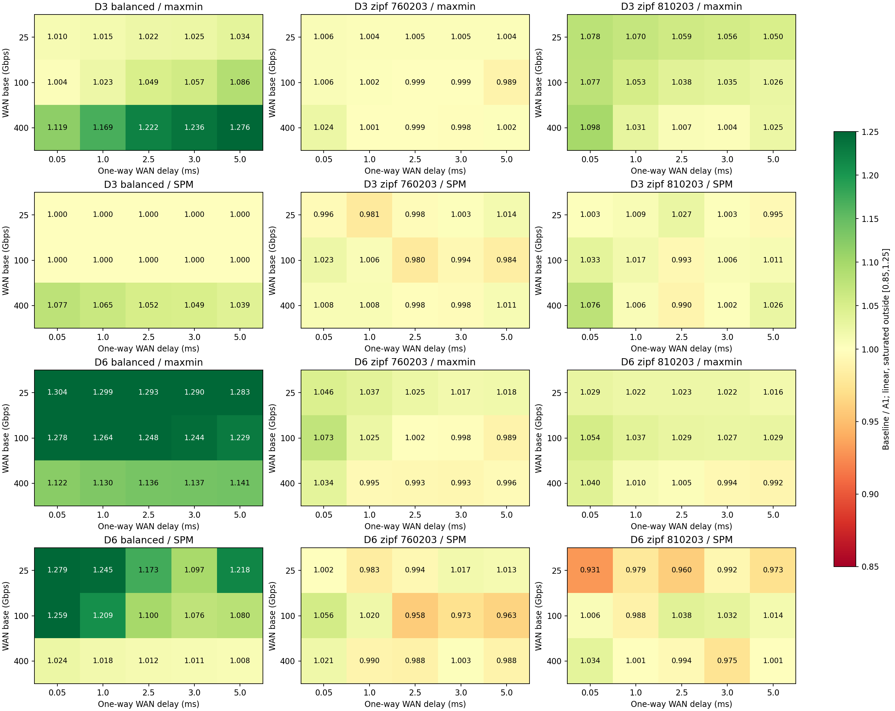
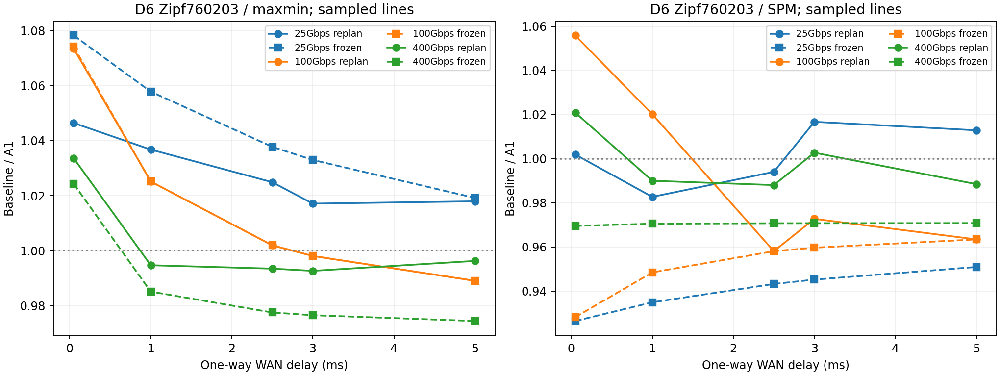

# 固定FAST优化算法的WAN优势边界

## 1. 本轮问题和不变条件

本轮只回答：共享WAN带宽和传播时延变化时，上一轮A1相对原生FAST、Max-Min、SpreadOut、X10和静态路径SPM何时有收益、何时无收益或退化。算法定义见[上一轮报告](../planning/REPORT.md)。仍使用FAST原生解析仿真、原pipeline2机内隐藏规则，无ns-3拥塞/PFC/DCQCN或实机结论。

复用`planning/final-96b18da3da36`冻结二进制，不重新编译或修改C++、匹配次序、评分、候选预算、路由或barrier。本轮raw中的单次CPU时间只作执行诊断，不作为在线规划性能，也不沿用上一轮CPU数值计算新场景含规划收益。

## 2. 预注册配置和目的

|项目|固定值/扫描值|目的|
|---|---|---|
|规模|24服务器×8GPU；DC数3/6，连续均分|固定端点规模，比较共享资源分组；不外推N48|
|机内|原生H100、3600Gbps、0.1µs|不改变FAST论文对齐方式|
|服务器/网关|均400Gbps；单段DC内700ns单向|让WAN变宽后有机会切换成网关瓶颈|
|WAN带宽|基准25/100/400Gbps；DC对0.5/1/2模式均值归一化|改变WAN共享瓶颈强度，不改变路径和需求|
|WAN时延|单向50/1000/2500/3000/5000µs|覆盖传播很小、阶段开销显著及已知约2.73ms临界附近|
|负载|balanced；Zipf(.9)760203；Zipf(.9)810203|分别为均衡控制、已知反例诊断、新种子前瞻检查|
|数据量|平均每rank64MiB，原生生成器和总量归一化不变|所有网络条件重用同一矩阵，避免数据量混淆|

2DC分组×3负载矩阵×3带宽×5时延=90配置，6策略=540结果。这里只有3个不同rank矩阵，不是90份独立随机负载；不做显著性推断，不新增或删除不利点。主要比较A1/Max-Min和A1/SPM，原生FAST用于分离阶段粒度收益，SpreadOut不是完整NCCL实现，SPM不是外部论文的完整复现。

快/慢分类阈值预设为基线CCT/A1 CCT：>1.01为明显更快，<1/1.01为明显更慢，其余近似持平。它是1%实用区间，不是统计置信阈值。图保留原始比值和线性坐标。

## 3. 实际重新规划与冻结调度的区别

每个新条件都运行6策略，得到重新规划CCT。另取每组“DC/矩阵/策略”在基准100Gbps、单向5000µs下的调度作为固定锚点，保持流字节、匹配、stage、机内dispatch不变，仅重新计价网络资源。两者的差别衡量换网络参数时调度选择本身的影响，不代表最优性。

冻结重定价继续保留原生max隐藏递推：

$$T=T_{balance}+\max(T_{intrinsic},c_0)+\sum_{k=1}^{K-1}\max(c_k,d_{k-1})+d_{K-1}.$$

其中$c_k$为该阶段路径传播最大值加共享资源最大串行化项，$d_k$为原生机内dispatch。SpreadOut按每round网络/机内的max累加。没有真实WAN字节的阶段不收WAN传播成本。

冻结调度可在相邻已采样点的符号变化区间二分求一个交点；重新规划曲线只报告采样区间，不插值冒称精确算法阈值。两者都不保证穷尽粗网格内部的全部变化，也不假设优势随时延单调。

图中的虚线是A1和对应基线**各自**固定锚点后的比值，实线是两者各自重新规划的比值。SPM也会改变调度，因此两条曲线的差异不全是A1自身的适应收益；单策略的`frozen_A1/reoptimized_A1`另存在数据表。

## 4. 实验结果

### 4.1 总览：balanced优势较清楚，Zipf相对SPM没有稳定增量

540个输出全部通过完整native重放、真实字节/路由/阶段/pipeline重建；48个旧锚点一致。540对冻结/重新规划结果已分析。以下为每份矩阵30个网络条件的GM加速比（基线/A1）：

|矩阵|相对原生FAST|相对Max-Min|相对X10|相对SPM|对SPM胜/负/近似持平（1%区间）|
|---|---:|---:|---:|---:|---|
|balanced|1.153×|1.153×|1.118×|1.066×|19 / 0 / 11|
|Zipf760203，已知诊断|1.933×|1.009×|1.002×|0.999×|8 / 10 / 12|
|Zipf810203，新种子|1.993×|1.034×|1.018×|1.003×|10 / 7 / 13|

不能把Zipf相对原生FAST接近2×的加速全部归于拓扑优化：Max-Min已贡献大部分收益。新种子相对SPM只有约0.35%的GM加速增量，且有7个超过1%慢区间的点，不能声称Zipf上有稳定拓扑增益。两个Zipf也不足以推断整个偏斜负载族。



### 4.2 优势区与瓶颈转移

最清楚的增量区是**6DC、balanced、WAN基准25/100Gbps**：这10个已采样条件中，A1相对SPM都超过1%的实用区间。该区不是简单“所有异构拓扑”。

|6DC balanced，跨5个时延点GM|相对Max-Min|相对SPM|总字节工作下界的瓶颈类别|
|---|---:|---:|---|
|WAN25Gbps|1.294×|1.201×|WAN|
|WAN100Gbps|1.253×|1.142×|WAN|
|WAN400Gbps|1.133×|1.015×|网关|

WAN变宽到400时，6DC场景的聚合网关开始限制总资源工作下界，A1相对SPM的平均增量降到约1.5%。此处瓶颈指`max_e bytes_e/bw_e`的解析下界资源，不代表测到了真实交换机队列或瞬时利用率。

3DC balanced则不同：WAN25/100下A1与SPM的CCT相同，WAN400时才出现约3.9%–7.7%的加速比增量。因此不能总结成“WAN越窄，A1一定越好”；服务器/DC分组和流组合空间同样重要。

最强点是6DC、balanced、WAN25Gbps、单向50µs：

|方法|stage数|含WAN的stage|传播总项 ms|串行化总项 ms|CCT ms|
|---|---:|---:|---:|---:|---:|
|Max-Min|23|23|1.214|822.707|823.928|
|SPM|23|20|1.060|807.266|808.333|
|A1|23|20|1.060|630.972|632.038|

A1相对SPM为1.279×，完成时间缩短约21.8%。**二者stage数、WAN覆盖stage数和传播项都相同**，差别约176.294ms，来自串行化项降低。这比“增加WAN覆盖阶段”更准确地支持最初insight：优化的是同一阶段中多条流对共享资源的组合。这里的非WAN阶段仍可包含同DC服务器间网络通信，不等于机内scale-up。

### 4.3 反例不只有阶段增加：相同stage也可能组合更差

90个点中A1相对SPM最差点出现在**新Zipf810203、6DC、WAN25Gbps、50µs**，不能归咎于只挑旧反例：

|方法|stage/WAN stage|传播项 ms|串行化项 ms|CCT ms|
|---|---|---:|---:|---:|
|SPM|171 / 171|9.029|658.436|667.694|
|A1|171 / 171|9.029|708.169|717.426|

A1慢约7.45%，多出的49.733ms几乎全是串行化。此处不能用“多了几个stage”解释。A1只在当前残余矩阵中构造一个候选，并与当前Max-Min种子比较局部时间/字节，不与SPM整个调度或未来所有残余形状比较；局部guard不保证整次A2A最优。这是当前方法的真实局限，不是本轮修改了仿真启动方式或插入了barrier。

balanced相对X10也不是全胜：1%区间下23胜、3负、4近似持平（精确数值下6个负点）。后续写论文不能仅保留Max-Min而忽略已有拓扑修补对照。

### 4.4 传播临界点：冻结推算与重新规划必须分开



已知Zipf760203、6DC、100Gbps场景中，冻结A1/Max-Min两份调度的交点重现为**单向2729.429957µs**。实际重新规划在2500与3000µs采样点之间也发生原始快慢翻转：

|WAN单向 ms|Max-Min CCT ms|A1 CCT ms|Max-Min/A1|A1相对5ms锚点的调度是否改变|
|---|---:|---:|---:|---|
|2.5|603.259|602.112|1.0019×|否|
|3.0|686.759|688.112|0.9980×|否|
|5.0|1020.759|1032.112|0.9890×|否|

2.5与3.0ms都仍处于预设1%近似持平区间；不能把很小的符号翻转称为显著加速/退化。这里三个点的调度都未变，所以冻结解释适用；本轮仍只确认实际采样翻转区间，不宣称已穷尽并证明精确算法全局切换点。

同一需求改成400Gbps时，冻结A1/Max-Min交点约335.867µs，而实际重新规划仅确认在50–1000µs之间翻转；相对SPM的实际曲线在50–1000、2500–3000、3000–5000µs三个区间换过符号，冻结曲线在所采样点却没有交点。说明不存在本轮可证实的统一“一个RTT阈值”。

A1在90条件中有68个调度与自身100Gbps/5ms锚点不同，重规划也不一定更好：新Zipf810203、6DC、400Gbps、5ms时，锚点重新计价比重规划结果快约3.2%（`frozen/reoptimized=0.9683`）。这是另一种局部启发式失效，而非数据量变化。

## 5. 本轮能支持什么结论

当前更合适的研究定位是：**保持FAST规划框架，在共享瓶颈显著、多DC需求较均衡的场景改善流组合**。6DC强WAN瓶颈采样区有明确增量，可以作为主要机理展示；不应继续主张“针对任意异构拓扑/Zipf都稳定提升”。这仍不是对全部此类场景的保证，更不是EI接收或文献空白证明。

下一步建议：先解释上述正/负点的匹配与残余结构；在少量预先定义的新规模或DC分组上确认优势域；再决定是否值得增加有明确预算的剩余代价/后续阶段感知，而不是继续强迫每阶段覆盖WAN。

## 6. 复现和验证

设计/预注册：[DESIGN.md](DESIGN.md)，实施记录：[PROGRESS.md](PROGRESS.md)。冻结运行：[run-0d5b56247cfc](results/run-0d5b56247cfc/study.json)。新归档包含自身脚本、冻结引擎源码/二进制、3矩阵、命令、raw和已核验派生表；旧归档不改动。

[验证记录](VALIDATION.md)：48个Python测试及相关C++检查通过，540条完整native重放、48旧锚点、540冻结重定价、36锚点比较与搬移烟测通过。[独立只读审查](REVIEW.md)无阻塞或保留问题，另独立重建全表并抽跑9次native；不把该抽检写成再次完整native重放。原有C++调度代码、算法和网络计时模型未修改，未提交、推送或清理Git。

```bash
make -C simulation/boundary check
python3 simulation/boundary/study.py --phase audit --replay --output simulation/boundary/results/run-0d5b56247cfc
python3 simulation/boundary/study.py --phase analyze --output simulation/boundary/results/run-0d5b56247cfc
python3 simulation/boundary/study.py --phase render --output simulation/boundary/results/run-0d5b56247cfc
```

源码变动会拒绝接续旧运行；移动归档后可从其中`harness/study.py`执行audit/analyze/render并显式给output，使用包内引擎及矩阵，不需要旧planning运行目录。全新prepare默认仍需原冻结引擎来源。
