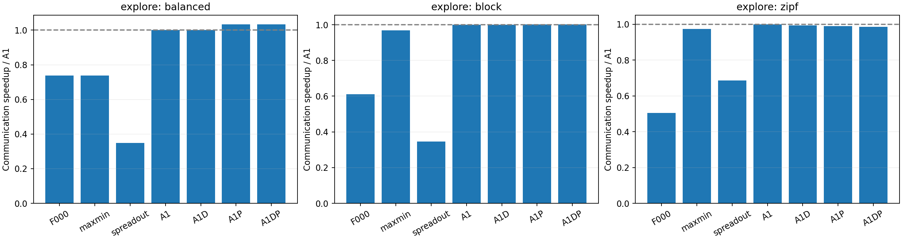
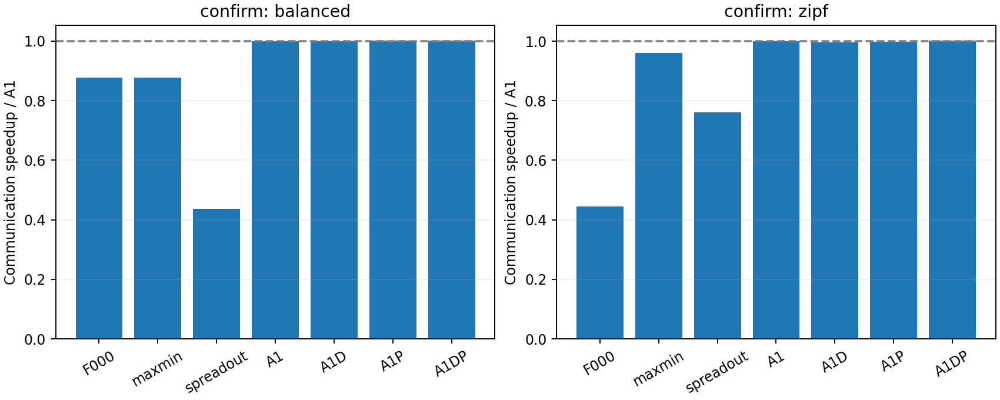
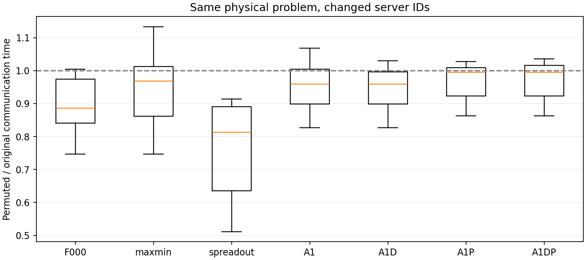
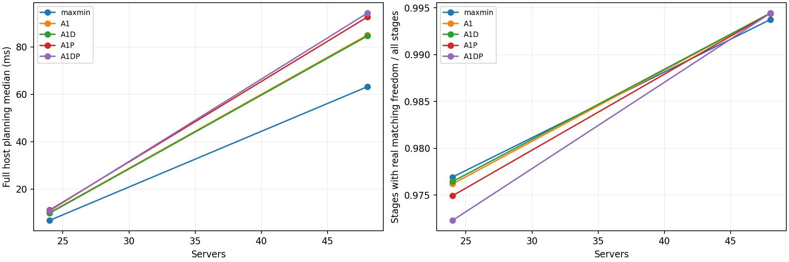

# q*匹配自由度与拓扑相关访问顺序

日期：2026-10-30。状态：52探索+64确认配置、7方法共812结果完成，并通过两轮全量回放/重建审计；正式计时样本11228个。

**结论：新增访问顺序没有提供值得默认采用的整体收益，继续保留A1主线。** 确认集D/P/DP相对A1通信加速分别0.9982/1.0008/1.0028倍，计入规划后均略差。自由度诊断有独立价值：大多数阶段仍存在能改变真实派发的替代匹配，收益偏小不能简单解释成q*把匹配唯一化。

## 1. 研究问题与不变项

本轮只检验两个问题：q*粒度保护后还有多少可重排的匹配空间；用受限行/残余瓶颈引导服务器访问顺序，能否在一次额外构造预算内改善共享资源匹配。不是限制总阶段数或求全局最优，不引入Transformer、更多权重或全局求解器。

沿用FAST原生机内balance、dispatch及pipeline2；真实流量、补齐策略、固定路由、q*、网络评价与阶段执行规则不变。服务器400Gbps、网关400Gbps、DC对WAN平均100Gbps，LAN每跳700ns；WAN单向50µs/5ms；机内450GB/s与0.1µs。所有结论仅为该解析模型中的仿真结果，不是包级拥塞或真实利用率测量。

## 2. 算法与自由度定义

每阶段先找最大瓶颈匹配系数q*。在A_ij>=q*支持图中，从基准匹配出发收缩匹配边；非匹配边(i,j)映射为行图i→m^{-1}(j)。有向环等价于可交换的交替环，因此通过强连通分量即可判断替代匹配是否存在。强连通分析本身O(N+E)，当前从稠密残余矩阵抽取支持图另需O(N²)，不枚举排列。

- **可移动行**：属于大小>1强连通分量的行。
- **可替代边**：同分量内的非匹配支持边。
- **真实可移动行**：可移动行当前匹配或可替代匹配至少一个涉及正的真实跨服务器剩余数据；排除只改变虚拟补齐/自环的自由度。

这些指标说明存在其他合法选择，不保证存在更快的选择。诊断按每种方法自己的残余轨迹进行，不能把不同算法的阶段一一对应。C++用Tarjan，Python独立用Kosaraju重建，并用小矩阵测试中的穷举匹配交叉检查。诊断在全部正式计时结束后离线导出，不参与在线算法决策、不用于跳过构造。

压力数值由Python独立重算并做浮点容差核验；访问顺序则按已核验的导出double排序，以免等价求和的一个ULP差异把数学同分误当成顺序错误。首次不完整批次因此停止，保留并排除；修正审计、补回归后重新登记完整批次，未修改算法或按收益调参。

| 方法 | 每阶段额外构造 | 服务器访问顺序 | 作用 |
|---|---:|---|---|
| 原生FAST F000 | 0 | 原生 | 主基线 |
| Max-Min | 0 | 原有匹配搜索 | 粒度强基线 |
| SpreadOut | 不适用 | 原生GPU循环配对 | 跨算法参照，不冒充完整NCCL |
| A1 | 1 | 自然服务器编号 | 已有共享资源构造 |
| A1D | 1 | 合法目标数少的行优先 | 约束紧迫度消融 |
| A1P | 1 | 残余瓶颈参与度大的行优先 | 拓扑/需求压力消融 |
| A1DP | 1 | 先合法目标数升序，再压力降序 | 联合排序 |

令真实剩余v_ij=sum_u r_iju，资源工作量h_e=L_e/B_e，归一化压力p_e=h_e/max h，行得分s_i=sum_{j:A_ij>=q*}v_ij sum_{e∈Rij}p_e/B_e。与既有残余边优先级同源，不引入新连续权重；虚拟/自环不计。A1D不计算压力，A1P/DP的压力计算、排序、匹配及必要预处理全部计入规划时间。同分稳定保留自然行序。

四种构造策略使用同一资源峰值/平方增量引导的完整增广搜索，以及相同的完整网络时间/真实字节接受条件。q*不下降，但不保证后续阶段数或完成时间单调改善；复杂顺序若没有稳定收益就不纳入主算法。

额外在线工作：D从稠密支持矩阵计算度数O(N²)，行排序O(N log N)；P/DP当前每阶段重新汇总逐GPU真实残余与路径资源，约O(N²g+N²ℓ)，ℓ为路径资源数，然后排序。不是只增加一次廉价sort，也不因构造次数相同就宣称CPU开销相同。q*搜索和增广构造属于共同成本。

阶段数量统计可能被小尾阶段主导。因此解释自由度时同时查看“存在真实替代选择的阶段承载的真实字节/网络时间占比”；这是阶段加权的覆盖指标，不等于这些字节都可自由重排，更不等于可实现的提速。

## 3. 实验矩阵与公平性

| 集合 | 规模 | DC数 | 资源配置 | 负载与时延 | 其他控制 | 配置/结果数 |
|---|---|---|---|---|---|---:|
| 探索主集 | 12/24/48服务器×8GPU | 3/6 | shared100/asymmetric | balanced/Zipf(.9)，50µs/5ms | 种子640101、原编号 | 48/336 |
| 探索热点诊断 | 24×8 | 3/6 | shared100 | block，50µs/5ms | 原编号 | 4/28 |
| 确认 | 24/48×8 | 3/6 | asymmetric | balanced/Zipf(.9)，50µs/5ms | 种子640201/640203，每问题原编号+整体重编号 | 64/448 |

shared100为每有向DC对100Gbps；asymmetric为0.5/1/2倍率按DC对组合并归一到平均100Gbps，各方向独立容量。拓扑结构与上一轮相同，服务器等分DC。需求生成沿用上一轮：64MiB是每rank平均预算，balanced/block每rank等量，Zipf不宣称逐rank封顶。不同规模使用不超过预算的可整除基准Q；方法间和同物理问题间严格复用输入。

整体重编号同时置换GPU流量矩阵的服务器行列块与DC归属，保留机内GPU位置；没有重新生成一个负载。均衡矩阵在置换后本来就相同，但物理标签映射仍改变；确认共有32个编号配对，其中均衡原始问题跨两个置换种子重复，合计24个不同原始物理配置，不当成64份或32份独立随机负载。补齐/贪心的编号敏感性也属于原算法整体行为，不能全部归因于访问顺序。

探索每方法一次暖机+5次轮转计时，确认一次暖机+21次；完整规划含Local/Global构造、分解、必要预处理和机内调度计划，排除解析评价、离线诊断和导出。静态已知拓扑对象构建不计入，不称首个冷启动成本；计时是有插桩的CPU主机时间。正式测量时不并发编译/测试。

## 4. 结果

### 4.1 探索结果：增加排序不是稳定的突破

52配置全部364结果已通过完整回放、真实逐GPU字节、q*最优性、路径容量、pipeline、访问顺序与独立自由度审计。以下为全部相应配置的配对加速比几何平均，大于1更好；不是逐场景挑选赢家。

| 访问顺序 | 全部52组相对A1 | balanced24组相对A1 | Zipf24组相对A1 | 含规划后全部相对A1 | 对A1胜/平/负 |
|---|---:|---:|---:|---:|---|
| A1，自然顺序 | 1.0000 | 1.0000 | 1.0000 | 1.0000 | 基准 |
| A1D，目标少优先 | 0.9966 | 1.0000 | 0.9926 | 0.9982 | 9/28/15 |
| A1P，瓶颈参与度优先 | 1.0112 | 1.0342 | 0.9902 | 1.0060 | 26/6/20 |
| A1DP，度数再压力 | 1.0089 | 1.0342 | 0.9853 | 1.0052 | 24/6/22 |

额外4个block诊断配置中D与A1完成时间相同，P/DP为1.0028倍。均衡矩阵每阶段合法度数相同，度数优先没有额外区分能力，因此D应与A1产生相同调度，DP与P相同；已另做逐阶段完整JSON一致检查，而非仅依据完成时间相同推测。

一个负例：N12/DC6/shared100/Zipf/50µs，DP相对A1仅0.8985倍。A1为82阶段、累计串行化48.852ms；DP为81阶段、串行化54.943ms，传播项还略低。这不是“阶段增加”造成的退化，而是阶段资源组合变差；本阶段接受评分不能保证后续全程更好。

### 4.2 确认与编号扰动

64配置448结果均审计通过，规则没有根据探索结果调整；每配置21次正式计时。

| 方法 | 相对A1通信 | balanced32组相对A1 | Zipf32组相对A1 | 含规划后相对A1 | 对A1胜/平/负 |
|---|---:|---:|---:|---:|---|
| A1 | 1.0000 | 1.0000 | 1.0000 | 1.0000 | 基准 |
| A1D | 0.9982 | 1.0000 | 0.9963 | 0.9992 | 16/32/16 |
| A1P | 1.0008 | 1.0027 | 0.9990 | 0.9950 | 35/0/29 |
| A1DP | 1.0028 | 1.0027 | 1.0029 | 0.9960 | 42/0/22 |

不能把胜场更多当作幅度足够或总体加速：DP虽赢42组，整体增量仅0.28%，计入规划反而慢约0.4%。这里无统计显著性主张，尤其原始均衡问题有重复、输入与编号配对相关。

现有A1在确认集相对原生FAST为1.5992倍、相对Max-Min1.0886倍，计入规划后相对Max-Min1.0636倍；对Max-Min为59胜/5负。balanced相对Max-Min1.1393倍，Zipf1.0402倍。原生到A1的收益包含精确粒度，不能全算成拓扑收益。本确认集只含容量不对称拓扑且加入48服务器/编号扰动，不能与上一轮强共享链路子集的1.34倍直接混为同一实验。

**编号依赖没有消失。** 同一物理问题整体重编号后，P比A1的通信时间漂移更小，但并未转化成相对A1的稳定加速：

| 方法 | 重编号/原编号时间范围 | 配对乘性变化幅度中位数 |
|---|---|---:|
| 原生FAST | 0.7469–1.0047 | 1.1283 |
| Max-Min | 0.7469–1.1332 | 1.0569 |
| SpreadOut | 0.5116–0.9134 | 1.2388 |
| A1 | 0.8271–1.0677 | 1.0546 |
| A1D | 0.8271–1.0299 | 1.0426 |
| A1P | 0.8630–1.0276 | 1.0244 |
| A1DP | 0.8630–1.0359 | 1.0325 |

乘性幅度为max(比值,比值倒数)，1表示不变；不是加速比。P在原编号32配置对A1为1.0104倍，在重编号32配置却为0.9914倍；DP分别1.0137/0.9920倍。因此不能只展示原编号结果来宣称压力排序有效，也不能把算法对编号的依赖归结为真实网络变化。







最坏P/DP例子：N24/DC3/asymmetric/balanced/640203重编号/50µs。A1为289.438ms，P/DP为339.808ms（0.8518倍）；均23阶段、16个WAN阶段，累计传播同为0.8546ms，累计串行化288.577→338.947ms。前9个阶段匹配相同，第10阶段首次分歧时A1网络时间16.843ms，P为21.040ms。说明新的访问顺序连当前构造出的候选也未必比自然顺序更好；它只与同一阶段的Max-Min种子比较，没有把A1自然顺序候选一起生成后择优，否则就超出本轮一次构造预算。

### 4.3 q*匹配自由度

探索集Max-Min轨迹中约94.26%的阶段存在能改变真实派发的替代匹配；balanced为96.30%、Zipf为94.12%。因此，“q*使大多数阶段只剩唯一匹配”这一先前猜测不受本批数据支持。

这不等于q*完全没有限制：它仍可能排除其他系数下的选择；存在替代匹配，也不代表有更好共享资源组合或更好的后续残余。阶段覆盖指标还可能被小尾阶段影响，下文将配合字节/网络时间加权结果解释，不把自由度当成提速上界。

| 集合/负载，Max-Min轨迹 | 有真实替代选择的阶段比例 | 这些阶段承载字节占比 | 这些阶段网络时间占比 |
|---|---:|---:|---:|
| 探索/balanced | 96.30% | 96.29% | 95.73% |
| 探索/Zipf | 94.12% | 95.70% | 94.33% |
| 探索/block | 86.96% | 82.07% | 84.98% |
| 确认/balanced | 97.14% | 97.14% | 96.75% |
| 确认/Zipf | 99.02% | 99.77% | 99.30% |

故本批“有选择的阶段”覆盖了大部分真实工作，不只是无关尾部。但一个阶段有选择，不等于其中所有字节可移动，也不说明更优选择存在于当前候选集合。确认Max-Min的Zipf行阶段中约86.87%的行可改变真实派发；不足更可能需要从候选构造质量、真实服务量与后续残余形态继续分析，不能仅靠自由度统计宣称已经证明其根因。



### 4.4 在线规划成本

探索集每配置5次规划中位数再按相同规模/负载取中位数，单位ms；仅作初筛，确认集使用21次。

| 服务器数/负载 | 原生FAST | Max-Min | A1 | A1D | A1P | A1DP |
|---|---:|---:|---:|---:|---:|---:|
| 12/balanced | 0.131 | 0.164 | 0.341 | 0.288 | 0.314 | 0.308 |
| 12/Zipf | 0.854 | 1.306 | 1.986 | 1.988 | 2.196 | 2.189 |
| 24/balanced | 0.687 | 0.924 | 1.806 | 1.648 | 1.857 | 1.886 |
| 24/Zipf | 10.298 | 12.490 | 17.267 | 17.124 | 19.099 | 18.679 |
| 48/balanced | 4.195 | 6.336 | 11.162 | 11.021 | 13.549 | 13.552 |
| 48/Zipf | 179.864 | 123.068 | 162.092 | 156.916 | 177.305 | 171.450 |

压力排序不是免费增强。48服务器Zipf已有百毫秒级规划，尚未设定业务截止时限，不能直接宣称任何版本都满足在线预算。均衡D与A1调度一致，探索中的小CPU差异不作为算法加速证据；不同方法的计时位置、缓存及5次样本噪声均可能影响数值。

确认集21次计时补充如下。中位数为各配置规划中位数再取中位数；p95列为该分组各配置p95的最大值，不是合并样本的总体p95。

| 规模/负载 | A1中位数ms | A1配置p95最大值ms | P中位数ms | P配置p95最大值ms |
|---|---:|---:|---:|---:|
| 24/balanced | 2.037 | 3.225 | 2.158 | 3.602 |
| 24/Zipf | 18.788 | 27.115 | 20.461 | 28.317 |
| 48/balanced | 15.345 | 24.058 | 17.894 | 25.130 |
| 48/Zipf | 159.958 | 184.578 | 173.675 | 190.864 |

48服务器Zipf的原生FAST规划中位数183.519ms、Max-Min122.466ms。A1比原生少，但比Max-Min高；因此在线性必须结合实际到达间隔/规划截止预算判断，不能凭“毫秒级”或“有限候选”自动认定。含规划指标采用规划与通信不重叠的串行诊断假设，不是GPU实测端到端延迟。计时未隔离普通编辑器后台活动，不对小CPU差异作部署保证。

独立审查补充的限制：规划计时包含初始真实行、行访问顺序和P/DP压力向量的trace捕获/复制；离线SCC和JSON输出在计时外，但trace收集不是零成本。本轮保留这一有插桩计时，不把千分之几的含规划差异当作无插桩部署结论。

### 4.5 本轮取舍

1. 保留A1为当前主线；D/P/DP留作同预算消融，不因多几个胜场升级为最终算法。
2. 保留离线自由度诊断，撤回“Zipf主要因为q*图没有其他匹配”的猜测；下一步分析需区分可行、有效服务与全程收益。
3. 不继续扩大排序组合或加入学习模型。优先完善A1的规模/编号边界与规划性能，并补能对齐模型的外部拓扑基线；若继续改构造规则，应针对已定位的资源峰值反例，而非凭压力大就优先。

## 5. 复现与边界

设计见[DESIGN.md](DESIGN.md)，执行计划见[PLAN.md](PLAN.md)，进度见[PROGRESS.md](PROGRESS.md)。从FAST目录：

```bash
make -C simulation/ordering check
python3 simulation/ordering/study.py --suite explore --phase prepare
python3 simulation/ordering/study.py --suite explore --phase run
python3 simulation/ordering/study.py --suite explore --phase render
# 确认集换成 --suite confirm；已有运行可用 --phase audit
```

当前源码归档用于本轮重编译/重生成/回放；历史兼容性测试另需上一轮冻结二进制，不隐去此依赖。没有Git提交、上传、清理或覆盖旧结果。

- 探索：[完整CSV](results/run-5f741f907916/comparison.csv)、[分组统计](results/run-5f741f907916/summary.json)、[自由度与加权覆盖](results/run-5f741f907916/diagnostic_detail.json)、[登记](results/run-5f741f907916/study.json)。
- 确认：[完整CSV](results/run-fd58e408d88f/comparison.csv)、[分组统计](results/run-fd58e408d88f/summary.json)、[自由度与物理重编号检查](results/run-fd58e408d88f/diagnostic_detail.json)、[登记](results/run-fd58e408d88f/study.json)。
- 初次审计中断目录[说明](results/run-3529088c29dc/INCOMPLETE.md)，未启动的旧确认目录[说明](results/run-f36c2931b947/NOT_RUN.md)，不混入本轮812结果。
- 探索8个不同需求矩阵，确认10个；11228个计时样本不当作11228个独立负载。均衡编号配对不是新随机流量。
- [验证与审查记录](VALIDATION.md)、[归档源码重编译21项语义一致](results/run-5f741f907916/archive_rebuild_checks.json)、[原生/模型源码指纹](results/run-5f741f907916/native_source_checks.json)。
