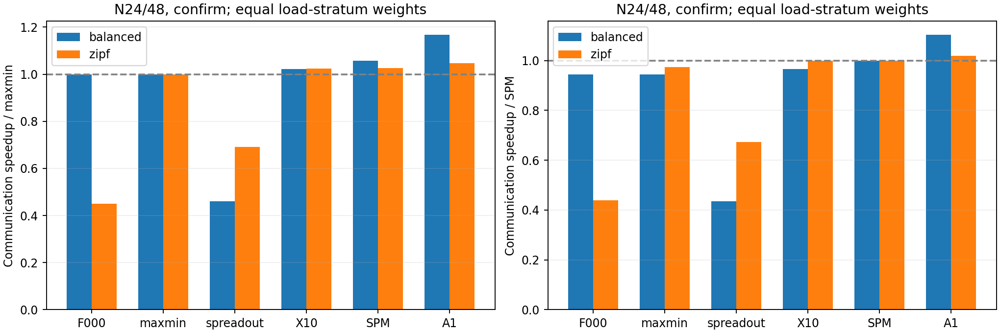
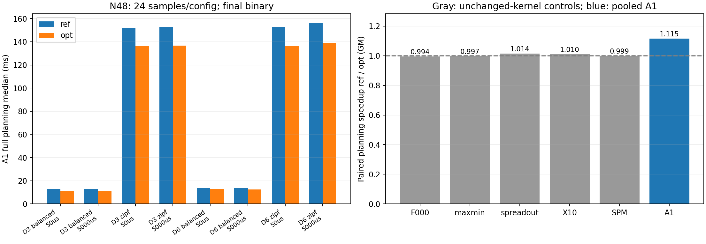

# A1语义冻结、在线规划实现优化与静态路径对照

## 1. 本轮回答什么

本轮不增加启发式组合，不改变原生FAST的通信计时。A1仍是上一轮选定的“精确q*＋一次共享资源引导匹配构造”；只优化其CPU实现，并补静态路径最大权匹配SPM，检验共享资源组合是否比单路径代价提供额外价值。实现提速与通信算法提速分别统计。

所有结果都是FAST原生解析模型下的仿真；不包含ns-3包级排队/PFC/DCQCN，也不代表实机测量。以前论文复现未完全对齐的Fig17a问题仍然存在，见[复现限制](../reproduction/REPORT.md)。本轮不借此宣称解决。

## 2. 算法、实现与计时前提

|标签|含义|
|---|---|
|F000|原生FAST匹配分解，不做新策略改动|
|maxmin|每个残余矩阵精确求最大可行匹配最小系数q*；自然DFS次序|
|spreadout|按GPU rank循环偏移，一轮每rank一个发送/接收对象；不是完整NCCL实现|
|X10|既有拓扑修补：q*后最多尝试两次交替环，用完整共享资源代价接受严格改善|
|SPM|本轮加入的静态路径最大权匹配控制，定义如下；不是外部论文的完整复现|
|A1|q*后构造一个共享资源负载引导候选，再比较真实阶段网络时间/真实字节|

后缀`-ref/-opt`只表示旧/新实现，不表示调度算法不同。同一策略必须输出完全相同的阶段、系数、真实payload、资源字节、计数、机内dispatch和CCT。

### 2.1 A1保持不变的部分

保持正残余支持图、二分q*探测序列、邻居/服务器遍历次序、种子匹配、浮点评分和严格接受条件不变。不调整阶段边界、机内流水线、补齐策略、路由、虚拟流计时和数据量。原生pipeline2继续采用已有阶段完成/dispatch递推，不另加barrier或改用open-loop启动时间。

候选构造对部分匹配的资源负载进行归一化，首先较小的最大负载/带宽，再以平方负载增量打破平局。增广路径可能替换之前行的目标，但始终维持完美匹配。接受guard只保证当前候选的局部网络时间/字节改善，不保证整体分解全局最优。

### 2.2 SPM静态路径对照

在同一q*支持图上，以真实残余生成阶段字节：

$$x_{ij}=\sum_{u=0}^{g-1}\min\{q^*,R_{iju}\}.$$

静态路径最小带宽为$B_{ij}=\min_{e\in\mathcal R_{ij}}B_e$，路径单向传播为$\alpha_{ij}$。效用：

$$w_{ij}=\begin{cases}\dfrac{x_{ij}}{\alpha_{ij}+0.008x_{ij}/B_{ij}},&i\ne j,\ x_{ij}>0,\\0,&\text{其他。}\end{cases}$$

字节、Gbps、µs单位下0.008将字节/Gbps转换成µs。在$A_{ij}\ge q^*$约束下用最大权完美匹配最大化$\sum_i w_{i,\pi(i)}$。随后仍套与A1相同的完整共享资源代价/字节guard；虚拟补齐不贡献权重。权重求解和lazy路径带宽缓存计入规划成本。构造目标不随其他并发流已占用的链路负载改变，这正是它与A1的差别。

这是受[Eclipse](https://people.csail.mit.edu/alizadeh/papers/eclipse-sigmetrics16.pdf)匹配/服务量思想启发的本文控制实现；未实现其电路切换优化、间接路由或近似保证。Eclipse的切换成本不等于WAN传播。也不把它称作[TACOS](https://github.com/astra-sim/tacos)或[Solstice](https://www.cs.cmu.edu/~dga/papers/solstice-conext15.pdf)的完整复现。外部强基线的比较边界仍需在论文中明确。

### 2.3 纯实现优化

对N48旧样例的独立`-pg`诊断，阈值可行匹配DFS与资源构造DFS占了主要采样；剖面包含模型评估/导出，因此不将采样百分比直接当规划组成。

1. 阈值可行性搜索最终沿用原`std::function/vector<bool>`实现。V1尝试直接递归/字节visited后，隔离控制显示Zipf上更慢，已撤回；不是保留所有看起来更轻的实现。
2. 资源匹配复用每个planner内的阶段字节、占用资源、逆匹配、每行减载视图及候选数组；lazy初始化计入规划，不跨独立输入复用。
3. 有限评分下使用“峰值、平方增量、原邻居序号”排序，精确复现旧stable_sort的平局次序，避免临时分配。非有限评分保留原stable_sort回退。

内核测试暖机后单次资源构造分配42→1次。所有trace仍记录；未用fast-math、未移动预处理到计时外。静态路径权重不是“整个阶段代价固定”：共享资源同时承载多少真实字节仍取决于匹配组合。

## 3. 实验配置与复现

每台服务器8GPU；机内沿用H100、3600Gbps、0.1µs的原生计时参数。模型中服务器到同DC网络共享server-out/in资源，跨DC再经过gateway-out/in及有向WAN资源。DC间完全互连，同DC服务器流没有经过WAN。这里没有新增更细的DC内部多级拓扑。

```text
DC a: servers (8 GPUs each) -- shared gateway a
                                      |
                          directed WAN a -> b
                                      |
DC b: servers (8 GPUs each) -- shared gateway b
```

服务器400Gbps，网关400Gbps；WAN基准100Gbps，DC对按固定0.5/1/2模式并归一化均值生成异构带宽。单段DC内700ns单向；服务器间LAN传播1.4µs，跨DC路径传播WAN单向时延＋2.8µs。WAN取50µs或5000µs。资源方向独立，与既有scenario定义相同。

平均每rank64MiB，全矩阵总字节保持同归一化。balanced均匀；Zipf使用原生指数0.9生成器、固定种子、对角清零，再按全矩阵总量归一化。Zipf不强制逐行均匀；真实字节与补齐服务矩阵分开核验。

|集|N|DC数|负载|Zipf种子|WAN µs|标签配置数|
|---|---|---|---|---|---|---|
|开发|12|3/6|balanced、Zipf|760101|50/5000|8|
|确认|24/48|3/6|balanced、Zipf|760201/760203|50/5000|32|

确认集balanced的两个layout_seed标签不改变服务器映射或矩阵，因此含8对重复物理配置；32标签对应24个不同物理配置。这些不是独立随机样本。按负载分层报告，整体表采用预设的balanced/Zipf等权标签配置权重，不作显著性或置信区间推断。V1的40标签合计480结果、每结果24个正式样本，共11520个计时样本。

全40标签仅有8个不同rank需求矩阵（确认集6个）；拓扑和传播条件的组合不等于新增随机负载样本。最终CPU8配置对应2个rank需求矩阵。

同一二进制12标签各一次暖机，再24次轮转；每个标签覆盖12个执行位置各两次。完整主机规划包含setup、机内规划、矩阵处理、路径缓存、分解和一致trace，排除解析网络评估、结果导出和进程启动。不使用`-pg`结果做公平计时。

负控制SpreadOut出现标签间差异，提示位置轮转不足以排除前序状态等干扰。追加N48、layout_seed760201的8配置隔离诊断：每策略单独启动进程、先暖机；两块分别正序/倒序，每块12次。所有独立planner的预处理计入。此诊断是发现异常后追加，不冒充新的独立算法确认集；未单独证明分配器就是唯一根因。

V1隔离诊断发现阈值快路径退化后，最终版撤回这一部分。最终源码/二进制另存；对V1的40配置×12标签逐项证明语义相同后沿用通信结果，最终CPU只用同一预定8配置重新采集。桥接重放中的timing_samples仅用于运行校验，**不计入性能证据**；V1/V2CPU数据不混用。

计时主机为Microsoft虚拟化环境下的Intel i5-12600KF（16逻辑CPU），g++11.4.0、C++11/O3；无绑核、无后台负载完全隔离。因此这些是本机规划开销诊断，不是部署截止时间保证或跨机器可直接照搬的绝对耗时。

冻结归档：开发[run-45a8ce2df36d](results/run-45a8ce2df36d/study.json)、确认[run-600edb9c2a2c](results/run-600edb9c2a2c/study.json)。源码、二进制、矩阵、命令、raw及校验均随归档保存；旧归档不覆盖。

复现命令：

```bash
make -C simulation/planning check
python3 simulation/planning/results/run-45a8ce2df36d/source/planning/study.py --phase audit --suite explore --output simulation/planning/results/run-45a8ce2df36d
python3 simulation/planning/results/run-600edb9c2a2c/source/planning/study.py --phase audit --suite confirm --output simulation/planning/results/run-600edb9c2a2c
python3 simulation/planning/validation/bridge.py --output simulation/planning/results/fresh-bridge
python3 simulation/planning/validation/isolated.py --archive simulation/planning/results/run-600edb9c2a2c --binary-run simulation/planning/results/final-96b18da3da36 --output simulation/planning/results/fresh-isolated
```

## 4. 结果

### 4.1 通信结果：共享资源感知有额外价值，但不是全面支配

下表为确认集GM加速比，`baseline CCT / A1 CCT`，大于1为A1更快。这里的baseline均为原生模型内策略，不再加入Direct。

|负载|A1 / 原生FAST|A1 / Max-Min|A1 / X10|A1 / SPM|
|---|---:|---:|---:|---:|
|balanced（16标签）|1.167×|1.167×|1.141×|1.103×|
|Zipf（16标签）|2.321×|1.046×|1.021×|1.020×|
|预设等负载权重合计（32标签）|1.646×|1.105×|1.080×|1.060×|

与Max-Min相比，balanced的1.167×对应完成时间缩短约14.3%，Zipf的1.046×约缩短4.4%。Zipf相对原生FAST的大部分收益来自阶段粒度，因此必须保留Max-Min强控制，不能把2.321×全归于拓扑感知。SPM本身相对Max-Min在balanced为1.058×、Zipf为1.026×；A1在其上仍有增量，但较小。

删去重复balanced标签后，24个不同物理配置上A1相对Max-Min为1.085×、相对SPM为1.047×。不把重复标签当额外独立证据。相对SPM，balanced为12胜/4平/0负，Zipf为10胜/0平/6负；负例不会从报告删掉。



在balanced中，Max-Min与A1的阶段数中位数都为35（N24与48混合）；串行化总时间中位数363.100→312.076ms，模型WAN工作占比中位数0.450→0.541。该占比是瓶颈WAN资源字节工作/总CCT的解析代理，不是ns-3链路瞬时利用率，也不能把不同配置中位数相减解释为某一个样例的精确分解。

### 4.2 一个明确反例与临界代价解释

配置：N24、6DC、Zipf760203、WAN单向5000µs。完整配置名`n24g8-d6-asymmetric-zipf-s760203-l760203-w5000`。

|策略|stage数|传播项总和 ms|串行化项总和 ms|CCT ms|
|---|---:|---:|---:|---:|
|Max-Min|167|835.468|185.071|1020.759|
|SPM|167|835.468|158.703|994.391|
|A1|172|860.482|171.409|1032.112|

相对Max-Min，A1节省约13.661ms串行化，但多5个WAN阶段，增加约25.014ms传播，最终慢约11.353ms。相对SPM，传播和串行化都更差，CCT慢约3.79%。因此失败不是“同一数据量的WAN不应更慢”，而是局部匹配改变后续残余形状，阶段数量及阶段组合共同决定总时间。

若**固定这两份已生成的A1/Max-Min调度**，不重新求匹配且机内处理继续被隐藏，差值可近似写成：

$$T_{A1}-T_{MM}\simeq 5(\delta_{WAN}+2.8\,\mu s)-13.661\,ms.$$

临界单向WAN传播约2.73ms。该数只解释这对冻结调度的代价，不是完整算法在任意负载上的切换阈值：改变WAN时延会改变候选评分、后续匹配甚至阶段数，必须重新运行才能判断真实算法优势域。

### 4.3 最终规划实现：约1.115×，不改变通信结果

最终实现只保留资源工作区/排序优化。下表是**N48、seed760201的8配置、最终二进制**的隔离结果，每配置24个样本；时间列是各配置样本中位数再取中位数，加速比列是逐配置ref/opt的GM，二者不是同一个统计量。

|负载（各4配置）|ref规划 ms|opt规划 ms|配对规划加速比|opt各配置p95的中位数 ms|
|---|---:|---:|---:|---:|
|balanced|13.374|12.014|1.110×|16.226|
|Zipf|152.973|136.509|1.120×|150.084|

8配置合计规划加速比1.115×（规划时间约缩短10.3%），单配置范围1.079–1.135×。保持同一阈值搜索的5个不变内核控制，其整体GM分别为F000 0.994、Max-Min 0.997、SpreadOut 1.014、X10 1.010、SPM 0.999；仍可见主机噪声，但没有把不变内核解释为优化成功。



V1数据只解释迭代过程：原轮转A1约1.081×，但SpreadOut约0.746×，不能据此做因果结论；V1隔离后SpreadOut约0.998×，而采用阈值快路径的Max-Min在Zipf约0.923×。因此撤回该快路径，而不是掩盖负优化。V1和最终版不同次运行的绝对时间不横向相减。

在最终8配置中，将通信与本机规划串行相加后，A1相对同二进制Max-Min的GM为1.092×：balanced 1.173×，Zipf仅1.017×。这再次说明Zipf增量较弱，CPU成本会吃掉部分通信收益。该结果**不是32配置的最终CPU结果**，不能外推到N12/N24、其他种子、硬件或生产在线截止时间。

`-pg`前后诊断仍显示阈值搜索是主要热点；资源构造递归的采样占比从23.15%变为10.88%，只能作定位线索，不当严谨计时对比。采样、编译入口和非规划工作会影响比例，公平收益只用上述最终隔离测量。

## 5. 验证、归档与交付边界

|证据|位置|用途|
|---|---|---|
|V1开发/确认|[8配置](results/run-45a8ce2df36d/study.json)、[32配置](results/run-600edb9c2a2c/study.json)|480结果、11520样本；冻结通信结果及初始CPU探索|
|V1隔离|[registration](results/isolated-600edb9c2a2c/registration.json)|96结果、2304样本；识别阈值快路径退化，非最终CPU|
|最终源码/二进制与桥接|[checks](results/final-96b18da3da36/checks.json)|480全语义等价＋116历史归档二进制等价；桥接时间不作性能数据|
|最终隔离CPU|[registration](results/isolated-final-96b18da3da36/registration.json)、[comparison](results/isolated-final-96b18da3da36/comparison.csv)|最终96结果、2304样本；只用于8个N48配置|
|V1归档独立重建|[checks](results/archive-rebuild-600edb9c2a2c/checks.json)|从冻结源码重建，3输入×12标签共36项全语义相同|
|图与数值来源|[metrics](report_assets/metrics.json)、[provenance](report_assets/provenance.json)|通信与最终CPU分别溯源，拒绝混用二进制|

测试：41个Python测试（旧34＋planning3＋validation4）及相关C++检查均通过。覆盖真实归档烟测、完整payload/路由/原生pipeline递推、来源与元数据篡改拒绝、所有ref/opt语义相同、增广失败分支与成功调用后的工作区复用、原平局次序、30个随机内核比较和80个小规模最大权目标核对。未专测完整false返回后的再次成功复用。详见[验证记录](VALIDATION.md)。原生计时/机内代码及用户已有修改保留，未提交、推送或清理Git。

[独立只读审查](REVIEW.md)未发现阻塞问题，留两项非阻塞改进：补完整失败返回后的cache恢复测试；加固绘图对派生comparison数据的自动来源绑定。当前图表数值经核验正确，但绘图元数据检查本身不是对任意被替换派生表的充分保证。

归档可重建当前仿真二进制并重放本轮输入；116项历史验证仍依赖列明的旧ordering归档，不声称把全工作区历史依赖都封装到单个tar中。默认无后缀入口仍为reference，最终优化入口为`A1-opt`，便于显式对照和回归。

## 6. 对论文的判断与下一步

本轮支持的主张是：在共享异构资源上，A1相对单路径控制仍有通信增量，且可用不改调度的工作区优化降低本机CPU开销。**不支持**“所有异构场景都优于已有方法”“已经完成外部SOTA对照”或“已满足EI接收标准”。Zipf弱收益、6个SPM负例、百毫秒规划和未完全对齐的原论文复现都需披露。

建议下一步：①固定当前算法，只沿WAN传播/共享瓶颈强度做小范围预注册边界实验，检查冻结调度的临界点与重求调度后的差别；②明确外部强基线的可比适配或论文主张边界；③按[论文证据大纲](PAPER_OUTLINE.md)整理方法、复杂度、消融和负例，不继续无约束叠加新启发式。

图表再生成：

```bash
python3 simulation/planning/validation/report_figures.py --formal simulation/planning/results/run-600edb9c2a2c --isolated simulation/planning/results/isolated-final-96b18da3da36 --final simulation/planning/results/final-96b18da3da36 --output simulation/planning/report_assets
```
