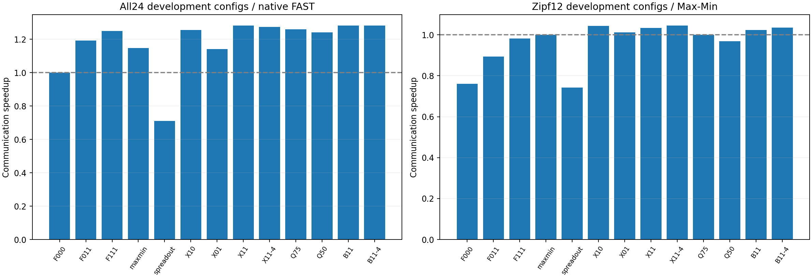
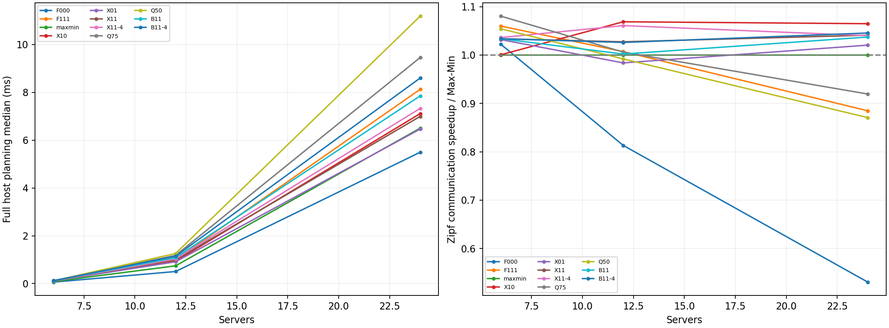

# 第二轮算法扫描：精确粒度、拓扑修补与残余评分

日期：2026-10-29。依据用户要求，本轮继续在**现有原生FAST解析仿真模型**中扫描算法，不将模型交叉验证作为前置条件；不改变网络评价器、pipeline、barrier、路由或机内操作。全部结果是开发探索，不是实机、逐包或独立新种子验证。

## 1. 目标、前提与方法

第一轮三因素联合F111能改善原生FAST，但主Zipf配置平均仍略逊Max-Min，旧高传播反例还有过多阶段。本轮检验：精确控制阶段系数后，拓扑感知是否能提供超过Max-Min的额外收益；放宽系数、加大搜索预算和残余评分是否值得其计算成本。

沿用[第一轮](../scan/REPORT.md)完全相同的26配置/13个矩阵：3DC，6/12/24服务器、每服务器8GPU，服务器/网关400Gbps聚合、DC对WAN100Gbps、LAN每跳700ns、WAN单向50µs/5ms、机内450GB/s。预算16/256MiB每GPU，balanced与原生Zipf(.9)。主开发种子280101，另2个280203旧反例只作诊断。

模型仍为每网络阶段max路径单向传播+max链路真实字节/容量，按原生pipeline2与机内通信组合。已有拓扑输入对象构建不计入规划，算法自己的资源缓存编译和实际规划都计入；不声称包含首次冷启动。所有方法真实路由字节一致，不新增barrier、求解器或Direct基线。

| 方法 | 含义 | 每阶段修补预算 |
|---|---|---:|
| F000 | 原生FAST | 0 |
| F011 | 第一轮：链路修补L+残余优先R | 2 |
| F111 | 第一轮：粗粒度G+L+R | 2 |
| Max-Min | 已有精确最大化匹配最小系数 | 0 |
| SpreadOut | 原生GPU轮转配对，不是实测NCCL | 0 |
| X10 | 精确Max-Min种子+L | 2 |
| X01 | 精确Max-Min种子+R | 0 |
| X11 | 精确Max-Min种子+L+R | 2 |
| X11-4 | 同X11，增加修补预算 | 4 |
| Q75/Q50 | 将精确系数阈值放宽到75%/50%，但不低于本轮原生系数；L+R | 2 |
| B11/B11-4 | 精确Max-Min种子+L+R；改用本阶段时间+剩余网络代价下界评分 | 2/4 |

L在合法支持图内做交替环，只接受评分严格改善且系数不低于种子的候选。R依据当前真实剩余链路工作量引导匹配，不是WAN硬优先。Q允许更丰富的流组合，但其局部系数保护不保证未来阶段更少。

B评分的剩余下界由资源工作量和残余支持图最大收/发度构成，详见[设计](DESIGN.md)。它只用于算法选择，**没有替换仿真评价器**；也不是精确预测未来阶段或任意网络上的全局保证。以上组合及13种方法在看本轮结果之前固定。

## 2. 执行与核验

权威结果：[run-7f4cfed80dd1](results/run-7f4cfed80dd1/)。26配置×13方法=338组结果，每方法1次暖机+21次交错完整规划计时，共7098个计时样本。仿真评价和JSON导出不算在线规划，计时为有插桩主机实现，不是GPU端到端实测。

338组原生回放、真实派发/路径字节/pipeline重算、13种登记种子输入重生成通过。26份矩阵与第一轮完全相同，5种共同方法共130项阶段、系数、payload和通信时间逐项一致。首轮Zipf种子修复保留，没有再次改变生成方式。

## 3. 主开发集结果

下表只含24个主开发配置，按配置等权取配对加速比几何平均；大于1为更快。胜平负相对Max-Min通信时间，负例不删除。含规划采用不重叠、串行规划诊断假设。

| 方法 | 对原生通信加速 | 对Max-Min通信加速 | 对原生含规划加速 | 对Max-Min胜/平/负 |
|---|---:|---:|---:|---:|
| 原生FAST | 1.0000× | 0.8724× | 1.0000× | 3/12/9 |
| 第一轮F111 | 1.2483× | 1.0890× | 1.2354× | 19/0/5 |
| Max-Min | 1.1463× | 1.0000× | 1.1396× | 0/24/0 |
| SpreadOut | 0.7102× | 0.6195× | 0.7159× | 1/0/23 |
| X10 | 1.2551× | 1.0949× | 1.2433× | 22/0/2 |
| X01 | 1.1407× | 0.9951× | 1.1326× | 10/4/10 |
| X11 | **1.2816×** | **1.1180×** | **1.2701×** | **21/0/3** |
| X11-4 | 1.2736× | 1.1110× | 1.2613× | 20/0/4 |
| Q75 | 1.2602× | 1.0993× | 1.2441× | 20/0/4 |
| Q50 | 1.2407× | 1.0824× | 1.2215× | 18/0/6 |
| B11 | 1.2820× | 1.1184× | 1.2683× | 20/0/4 |
| B11-4 | 1.2823× | 1.1186× | 1.2666× | 22/0/2 |

通信聚合指标B11-4略高于X11，但差距约0.06%，不足以用它的额外CPU成本换取明确结论。X11在此表中的含规划指标更好，因此作为当前性价比主候选，B系列保留作算法消融，不宣称统计显著胜负。

X11在全部24主配置及2诊断配置均快于原生；但对Max-Min仍有负例，不能声称通吃所有配置。合并26配置后，X11相对原生通信1.3126×、相对Max-Min1.1157×；这不是独立验证。



## 4. 单独看Zipf，不借均衡负载抬高平均值

以下仅12个主Zipf配置，主种子只有280101；不是12个独立随机种子。

| 方法 | 对原生通信加速 | 对Max-Min通信加速 | 对Max-Min含规划加速 | 对Max-Min胜/负 |
|---|---:|---:|---:|---:|
| 第一轮F111 | 1.2891× | 0.9811× | 0.9745× | 7/5 |
| Max-Min | 1.3140× | 1.0000× | 1.0000× | — |
| X10 | 1.3721× | 1.0442× | 1.0392× | 10/2 |
| X11 | 1.3587× | 1.0340× | 1.0296× | 9/3 |
| X11-4 | 1.3739× | 1.0456× | 1.0397× | 9/3 |
| Q75 | 1.3137× | 0.9998× | — | 8/4 |
| Q50 | 1.2735× | 0.9692× | — | 6/6 |
| B11 | 1.3457× | 1.0242× | 1.0172× | 8/4 |
| B11-4 | 1.3600× | 1.0350× | 1.0253× | 10/2 |

精确阶段粒度组合已将Zipf平均相对Max-Min从略差变为略好，但幅度只有约3%–5%，不是数量级提升。X10及X11-4在Zipf聚合值上更高，各自也有退化；此时不能事后用不同算法拼成一条“自适应”结果。

均衡控制组的X11与F111通信完全相同，均为对原生/Max-Min1.2088×；因此本轮精确粒度的主要新增价值确实来自非均匀负载，而非重画均衡数据。

## 5. 原来的高时延反例如何变化

24服务器×8GPU，Zipf种子280203，256MiB/GPU，WAN单向5ms：

| 方法 | 完成时间 | 总/WAN阶段 | 瓶颈序列化费用 |
|---|---:|---:|---:|
| 原生FAST | 3395.498691ms | 510/510 | 843.189822ms |
| 第一轮F111 | 2038.356532ms | 286/285 | 611.677704ms |
| Max-Min | 1598.114268ms | 178/178 | 706.736440ms |
| X10 | 1550.139363ms | 175/175 | 673.769936ms |
| **X11** | **1500.989219ms** | **173/173** | **634.625391ms** |
| X11-4 | 1537.409650ms | 180/180 | 636.026223ms |
| Q75 | 1787.880599ms | 230/230 | 636.357171ms |
| Q50 | 2333.389764ms | 345/343 | 616.547136ms |
| B11 | 1548.393351ms | 180/180 | 647.009923ms |
| B11-4 | 1551.859977ms | 182/182 | 640.470950ms |

X11比原生快约2.262×、比Max-Min快约1.065×，并比第一轮F111减少约26.36%完成时间。其WAN轮数从285降至173，序列化虽略高于F111，却比Max-Min更低。说明当前模型内，阶段粒度与拓扑组合确实应联合考虑，而不是只追求最小链路费用。

同一矩阵在WAN50µs时，F111为636.402937ms，X11为644.182175ms，Max-Min为717.014268ms：X11仍快于Max-Min，但略慢于旧F111。精确粒度并不是所有时延下的最优选择。

## 6. 没有奏效的方向与剩余负例

- **只加R不够：** X01主开发平均相对Max-Min0.9951×，均衡部分还会退化。残余压力优先不能替代同阶段共享链路评价。
- **放宽粒度不稳定：** Q50让旧高传播反例出现343个WAN阶段，虽然序列化更低，完成时间却差于Max-Min。Q75主Zipf平均也没有正收益。
- **增加候选不保证全局更好：** X11-4总体通信和含规划都差于X11，还在一个均衡配置慢于原生；Zipf聚合值略好。局部多搜两条边可能留下更难的残余。
- **残余下界不是完整前瞻：** B系列在主开发通信均值上只略高于X11，规划更贵，Zipf也没有稳定胜出。下界未描述全部后续系数碎片，不能把更复杂评分默认当成更好算法。

X11相对Max-Min的3个主开发负例仍全部是Zipf、16MiB/GPU、WAN5ms：

| 服务器数 | X11 | Max-Min | 总阶段X11/Max-Min |
|---|---:|---:|---:|
| 6 | 123.864537ms | 119.872492ms | 22/22 |
| 12 | 444.783510ms | 440.498962ms | 86/84 |
| 24 | 831.291957ms | 824.698071ms | 158/156 |

这说明不是所有负例都能用阶段数量解释：6服务器阶段相同，链路组合仍有损失；另外两组是少量阶段差及网络组合的共同结果。后续应定位这些具体残余选择，而非为了得到全胜而改评价器或删除数据。

## 7. 规划开销

对每规模8个主开发配置，取各配置21次完整规划中位数的中位数。单位ms，含所选算法预处理/分解/必要机内规划与插桩，不含仿真评价/导出。与第一轮CPU绝对值不直接混用；本表全部来自本轮同一交错批次。

| 服务器数 | 原生FAST | 第一轮F111 | Max-Min | X10 | X11 | X11-4 | Q75 | Q50 | B11 | B11-4 |
|---|---:|---:|---:|---:|---:|---:|---:|---:|---:|---:|
| 6 | 0.06113 | 0.11573 | 0.08501 | 0.12261 | 0.11385 | 0.11358 | 0.11861 | 0.11705 | 0.12070 | 0.12007 |
| 12 | 0.50468 | 0.99925 | 0.74214 | 0.93600 | 0.99626 | 1.03464 | 1.17865 | 1.25757 | 1.08451 | 1.14557 |
| 24 | 5.49202 | 8.12282 | 6.49966 | 7.10776 | 6.99030 | 7.32520 | 9.45299 | 11.18151 | 7.84736 | 8.59542 |

本轮X11在24服务器的完整规划比F111低，与减少阶段相关，但仍为毫秒级，不据此声称满足所有在线预算。主开发计入规划后，X11对Max-Min仍有1.1146×加速；仅Zipf为1.0296×。逐配置p95和完整21次样本均在CSV/raw中保留，不把重复计时当成独立负载。



## 8. 结论与下一步

当前主候选为**精确阶段粒度+有界拓扑修补+残余候选优先（X11）**，X10及X11-4作为低复杂度/预算消融保留。B系列尚无足够额外收益，不继续盲目增加评分复杂度。

1. 继续定位3个小负载高时延负例，研究既不改变精确粒度又能改善链路组合的候选构造。
2. 在当前模型内扩展共享上联/超售程度与DC数量，检验拓扑感知机制，而不是将工作绑定某个Zipf种子。
3. 公式和预算冻结后再用新种子独立验证；本轮不将旧开发输入的改善作为泛化证明，也不宣称已形成足够会议创新。

## 9. 验证、审查与复现范围

新C++测试通过：手算WAN/LAN/零残余下界、精确与松弛阈值、12随机矩阵×9变体的合法性/字节守恒/支持重构、以及下界不大于完整网络调度费用。2项Python集成测试通过：26组真实CLI烟雾、5个共同策略与冻结生成器等价、伪造策略预算/阈值/原始计时拒绝。

原scan的2项C++/5项Python、bottleneck的2项C++/2项Python、topology的2项C++/8项Python、论文reproduction的7项Python回归通过。新模块及scan最终再次运行通过；仅使用归档源码的完整338组审计通过，在临时目录重新编译归档源码后的26项正例/反例语义重现通过。

独立只读审查未确认匹配、真实残余扣除或当前模型内下界的算法缺陷，复核了最终报告并抽查338行结果、X11汇总值和130项历史检查登记；审查者未独立执行全部测试、重算所有表格或判定新颖性。主执行者完成上述全量测试与回放。详见[执行记录](PROGRESS.md)。

审计边界：逐阶段候选预算由源码中的2/4次循环限定，原始trace额外核验全程计数上限，没有独立逐阶段尝试事件列表；q*/原生系数trace做定义算术检查与原生回放，不冒充另一个独立求解器计算的逐阶段最优证书。

当前源码归档支持本轮构建、种子重生成与语义回放；历史`--phase baselines`及历史对照测试额外需要保留第一轮run-7be22345a21c的二进制和输入。其路径、二进制摘要、130项等价证据保留于baseline_checks.json，**不声称一份新源码包就包含全部历史依赖**。

从FAST目录运行：

```bash
make -C simulation/refine check
python3 simulation/refine/study.py --phase prepare
python3 simulation/refine/study.py --phase run
python3 simulation/refine/study.py --phase baselines
python3 simulation/refine/study.py --phase render
```

数据：[comparison.csv](results/run-7f4cfed80dd1/comparison.csv)、[raw逐阶段及21次计时](results/run-7f4cfed80dd1/raw/)、[登记及源码身份](results/run-7f4cfed80dd1/study.json)、[历史等价检查](results/run-7f4cfed80dd1/baseline_checks.json)。全部旧结果保留，不做Git提交或上传。
