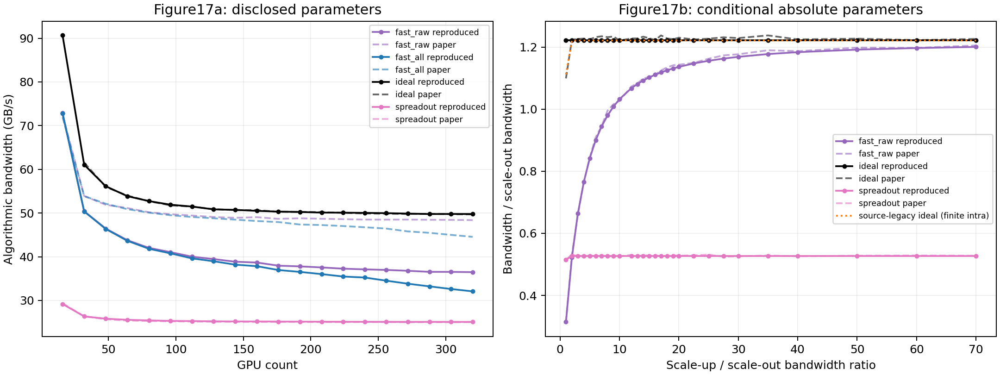
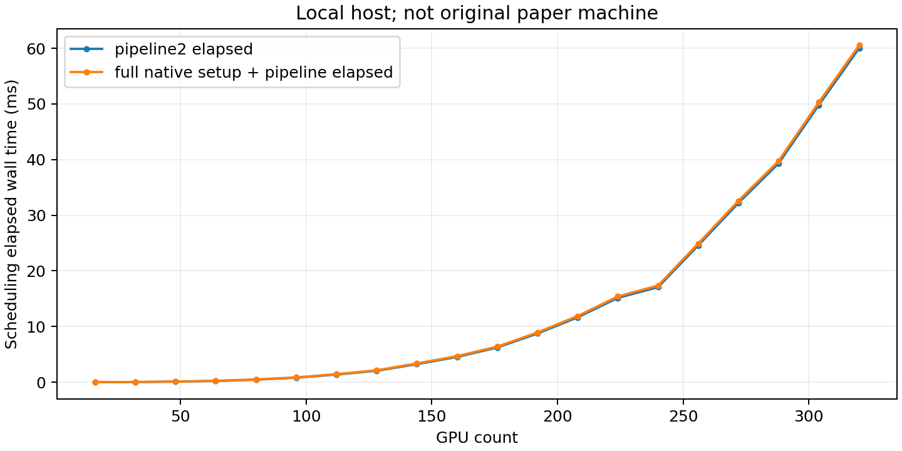

# FAST正式论文的原生仿真复现核验

日期：2026-10-28。目标是先核验原生基线，而非继续优化。使用[NSDI2026正式论文](https://www.usenix.org/system/files/nsdi26-lei-yiran.pdf)图17/§5.4及[作者公开源码](https://github.com/MangoBoost/FAST)，不使用旧FLASH版本作最终参考。

## 复现范围与尚不能宣称的结果

已完成981个固定输入的解析仿真、逐输入原生回放和曲线对照。结论：**图17b在所声明的条件参数下近似对齐；图17a的SpreadOut和理想上界对齐，但FAST raw没有对齐，尚不能宣布论文复现成功。**

原生匹配、balance、dispatch及pipeline2全部直接编译自作者提交0712d29fb13a09962425c8a57b951b91d8fc33ba，与2026-10-28读取的公开main一致；未从当前已修改的工作树拷贝核心源码。源码归档与PDF保存在assets，可独立检查。

后续核查更新：[机内计时、流水线与拓扑核查](TIMING_AUDIT.md)已计算全部4个机内模型并补充720次原生调用。论文§4.4明确机内采用SpreadOut、§5明确随机流量为均匀分布；此前交流中称这两点未明确不准确。图17a差距仍存在，但不能再通过任意更换机内模型来解释或掩盖。

本机仅一张RTX5060，缺少论文4服务器×8H200或MI300X集群。因此图12–15实机通信与MoE训练不能在这里复现；解析模型不能代替InfiniBand、DCQCN、CUDA/NVSHMEM/RCCL的真实运行结果。完整论文实机复现尚未实现。

## 配置对照

| 项目 | 正式论文/公开代码 | 本轮处理 |
|---|---|---|
| 图17a网络 | 每GPU400Gbps scale-out；450GB/s scale-up | 相同带宽参数，单集群两层网络，无DC/WAN、无共享400Gbps服务器出口 |
| 图17a流量 | 均匀随机；每GPU对平均50MB | 原生rand()%10000，MBpu=.01；平均49.995十进制MB/对，不固定每GPU总量 |
| 图17a规模 | 图中16…320GPU | 2…40服务器，每台8GPU，步长2服务器 |
| 原生链路表 | ETHER400 beta22us/MB、H100 beta2.3us/MB | 原始表单独保留；论文参数组分别设20和2.222222us/MB，不把两者视作相同 |
| 原生默认入口 | ETHER100，默认MBpu1 | 单独代码默认诊断，非论文配置；单位流平均约5000MB，不用于论文曲线匹配 |
| alpha | 论文未披露精确数值；原生Ethernet .7us、机内 .1us | 固定沿用原生值，另预注册0/10倍敏感性，不选择最贴合论文的值 |
| 随机种子 | 论文未披露 | 预注册280001…280020，每点20个输入；不是作者原矩阵逐字节复刻 |
| 图17b | 32GPU，扫描带宽比例；未单列绝对速率/负载参数 | 4×8GPU、比例1…70；400Gbps及50MB/对作为明确的条件参数，不宣称已获作者完整设置 |
| FAST all计时 | 论文绘制含调度时间曲线，精确计时边界/平台与本机不同 | 分别测pipeline2和完整Local/Global初始化+pipeline；主对照沿用公开benchmark的pipeline2口径，不按拟合效果挑口径。steady_clock测的是经过的墙钟时间，不是进程CPU占用时间 |

参数适配只替换两个链路工厂函数：原始config.cpp以编译宏更名其工厂符号，其他原生翻译单元调用适配器，匹配和本地调度代码不变。使用原生enum构造接口；公开的显式link_info构造接口存在未初始化枚举成员，故没有用它配置论文速率，也没有悄悄修改它。

## 图中参考值与指标

直接读取正式PDF的矢量折线坐标，按坐标轴标定图17a的GB/s和图17b的归一化带宽。它们是图线数字化值，不是作者公开CSV。保留PDF哈希、页码、颜色、原坐标和标定矩形；对裁剪产生的非采样点明确排除，不插值补造缺失点。原文图线渲染精度及随机种子差异均可能造成误差。

每个原生运行记录：预测FAST/SpreadOut通信时间、原生端点理想下界、算法带宽、pipeline与完整调度经过时间、原生矩阵及其SHA256、实际参数、源码与二进制。原始JSON摘要独立保存在study.json中，不靠原始文件自身声称其计时未改变；这是结果来源检查，不是防恶意同时重写全部证据的安全认证。理想下界按最忙服务器收/发总量除以GPU数和每GPU带宽计算；均使用十进制MB/GB。均值和标准差跨20个随机输入，不是重复真机运行的置信区间。

为避免量纲误读：算法带宽为全部真实GPU对字节量除以GPU数、再除以通信时间，单位GB/s；它不是交换机端口实测速率。JSON中的历史字段名`*_gbps_bytes`实际也是GB/s，不是Gbps。每GPU平均通信量随GPU规模增加而增加，因为本轮固定的是每GPU对平均50MB，而不是每GPU总量。

论文正文的理想时间下界与代码`fabric_speed_benchmark`中的理想时间还存在一处定义差异。设每服务器GPU数为g，跨服务器最大收/发量为Vmax，所有服务器的机内真实流量总和为Vintra，带宽分别为Bout、Bin：

$$
T_{\mathrm{endpoint}}=\frac{V_{\max}}{gB_{\mathrm{out}}},\qquad
T_{\mathrm{legacy}}=\max\left(T_{\mathrm{endpoint}},\frac{V_{\mathrm{intra}}}{gB_{\mathrm{in}}}\right).
$$

主对照保持论文正文的无限快scale-up假设，即前者；另输出后者为`source_legacy_ideal_*`，不把跨所有服务器的机内总量误称为某个GPU的容量约束，也不因某个公式更贴图而替换主指标。

预先设定“曲线平均相对误差≤5%”作为近似数值一致性检查，同时报告逐点及最大误差。这不是论文给出的复现验收线，更不是原始参数已全部恢复的证明。CPU曲线还受平台差异影响，只作参考。

## 固定实验清单

- 图17a：20规模×20种子=400次。
- 图17b：28比例×20种子=560次。
- 代码默认诊断：3规模×3种子=9次。
- 缺失alpha敏感性：2规模×2端点×3种子=12次。

共981个独立原生模型运行；额外审计回放不作为新的独立实验。没有Max-Min、WAN修补、链路代价、合批、Direct或ns-3。出现不一致时保留结果，先查原因，不调参逼近论文。

## 实验结果：论文图线与原生仿真叠加

正式结果目录：[run-9247cfc8536a](results/run-9247cfc8536a/)。981个输入全部完成；每个输入均重新调用原生程序核验矩阵和不含调度计时的数值结果，没有将回放计为新样本。



实线为本轮20种子均值，虚线为正式PDF图线数字化值；橙色点线单独表示源码的finite-intra理想公式。图17a包含调度开销的蓝线受本机影响，不能当作纯算法差异。图17a理想参考的GPU16点在原图坐标范围外，GPU256未保留独立矢量顶点，因此只比较18个可提取理想点，不补造参考值。

| 对照曲线 | 有效点数 | 平均绝对相对误差 | 最大绝对相对误差 | 预先设定的均值≤5%检查 |
|---|---:|---:|---:|---|
| 图17a FAST raw，不含调度耗时 | 20 | 19.095% | 24.616% | 不通过 |
| 图17a FAST all，含pipeline2调度耗时 | 20 | 20.121% | 28.002% | 不通过；另有主机平台差异 |
| 图17a SpreadOut | 20 | 0.357% | 0.721% | 通过 |
| 图17a 端点理想上界带宽 | 18 | 0.193% | 0.829% | 通过 |
| 图17b FAST raw | 28 | 0.563% | 1.553% | 条件参数下通过 |
| 图17b SpreadOut | 28 | 0.343% | 1.103% | 条件参数下通过 |
| 图17b 端点理想上界带宽 | 28 | 0.960% | 11.117% | 均值通过，但比例1的定义差异不能忽略 |

这里的相对误差分母是论文数字化值，先对20个输入计算带宽均值，再按横轴点计算误差。图17b平均误差通过不代表每点通过，尤其不能掩盖比例1的上界定义差异。

### 图17a关键规模

单位均为GB/s；FAST均不含调度耗时。

| GPU数 | 论文FAST raw | 本轮FAST raw | FAST带宽相对论文偏差 | 本轮端点理想带宽 | 本轮SpreadOut |
|---:|---:|---:|---:|---:|---:|
| 16 | 72.511 | 72.868 | +0.49% | 90.650 | 29.186 |
| 32 | 53.903 | 50.412 | −6.48% | 61.052 | 26.345 |
| 64 | 51.138 | 43.785 | −14.38% | 53.862 | 25.567 |
| 128 | 49.087 | 39.461 | −19.61% | 50.833 | 25.214 |
| 256 | 48.489 | 36.976 | −23.74% | 49.972 | 25.097 |
| 320 | 48.381 | 36.471 | −24.62% | 49.777 | 25.080 |

320GPU时，本轮原生FAST raw达到端点理想带宽的73.27%，而非论文所描述的接近理想带宽。这不是新增算法相对FAST的提升或退化：本轮完全没有运行新增优化算法。

### 图17b的上界定义差异

比例1时，论文理想归一化带宽为1.098889；本轮正文定义为1.221049，而源码legacy公式为1.111952。后者显著更接近图线，但并非完全相同。比例≥2时本轮两种公式相同。这个现象支持“图中的理想线可能采用源码finite-intra定义”的解释，但没有作者数据不能认定其真实作图过程。

图17b比例9正好对应450GB/s机内与400Gbps机外的带宽比。本轮32GPU结果在图17a和图17b比例9完全相同，为50.411825GB/s；论文两图对应FAST raw数字化值则约为53.902879与50.794443GB/s。图17b未披露独立绝对参数，因此这里只记录不一致线索，不能断言论文作图有误。

## 差异定位：已排除什么，尚不能解释什么

1. **不能归因于之前的SimAI迁移或拓扑优化代码。** 本轮编译的是固定Git提交的原始源码归档；30个迁移前保存的输入上，FAST和SpreadOut结果均在9位小数精度一致。新增的参数适配器不改匹配、dispatch和pipeline逻辑。
2. **整体流量/带宽的倍数错误缺乏证据。** 相同输入和参数下，图17a的SpreadOut与理想线都在1%以内，且原生手算用例2000.7µs正确。这不排除FAST内部模型差异，但不支持把全局字节数或Gbps/GB/s统一乘一个系数来修图。
3. **不是本机调度较慢造成FAST raw差异。** raw根本没有加本机调度计时；即使把该计时降为零，19.1%的均值差异仍然存在。
4. **预注册的alpha敏感性不能解释主要差距。** 同样前3个种子，320GPU时alpha取0/原生/10倍，FAST raw分别36.319/36.231/35.451GB/s；32GPU分别50.492/50.480/50.368GB/s。完全去掉固定启动代价也未接近论文的大规模结果。
5. **仍待解释的是原生FAST内部的机内计时/流水线设置与论文作图设置。** 公开默认入口的带宽、负载单位本就不等于论文。不能因此把公开入口当作论文完整实验脚本，也不能直接把上述差距解释成FAST可优化的真实网络不足。

### 追加诊断：原生入口和scaling开关

这是观察主实验后追加的诊断，不属于预注册981次实验，不替代主结果。使用已保存的相同矩阵、相同400Gbps/450GB/s参数，对6个规模、每规模前3个种子，运行4种**公开源码现有入口**，共72次。没有新增调度策略，也没有搜索参数。

| GPU数 | 原生pipeline2 | 原生pipeline2开启scaling | 原生pipeline3使用spread_out | 原生pipeline3使用full_mesh |
|---:|---:|---:|---:|---:|
| 16 | 75.103 | 75.103 | 75.103 | 87.959 |
| 32 | 50.480 | 50.480 | 50.480 | 58.342 |
| 64 | 44.455 | 44.455 | 44.455 | 51.585 |
| 128 | 39.397 | 39.397 | 39.397 | 49.226 |
| 256 | 36.778 | 36.778 | 36.778 | 47.912 |
| 320 | 36.231 | 36.231 | 36.231 | 47.723 |

单位GB/s。此表只有3个输入，不能与上表20种子均值混用。逐输入检查：pipeline2与pipeline3(spread_out)一致；开启原生scaling也未改变这些输入的结果。

full_mesh在大规模时显著更接近论文，但在16/32GPU时又明显偏高，不能因此宣称找到论文配置。更重要的是，源码full_mesh直接按**最大单个机内GPU对消息**计时，而spread_out按各轮最大消息之和计时。把相同450GB/s填进两者并不保证相同的GPU聚合带宽约束；full_mesh的结果不是网络容量约束等价的“优化收益”。进一步全文核查后已确认论文§4.4指定机内SpreadOut，因此该诊断只体现模型敏感性，不能据此将full_mesh替换为论文主结果。

原始诊断：[registration.json](diagnostics/results/main-9247cfc8536a/registration.json)、[results.json](diagnostics/results/main-9247cfc8536a/results.json)。其中`non_inter_fraction`是原生返回的`(总时间−各stage机外时间之和)/总时间`，**不是WAN链路空闲率**。

## 本机调度开销与复现验证



本机为i5-12600KF、WSL2/glibc2.35、Python3.10.12。320GPU时pipeline2调度经过时间为60.007±1.384ms（20种子均值±样本标准差）；完整初始化加pipeline为60.528ms。论文CPU环境与计时边界没有完全恢复，因此这组时间仅记录本机开销。

已验证：7项独立复现测试；此前native topology的8项Python回归及2个C++检查；981输入完整回放；归档适配器在临时目录独立解包、重新编译并完成2输入prepare/run/audit。现有优化源码保持不变，没有提交、上传或清理工作区。

证据文件：

- [comparison.csv](results/run-9247cfc8536a/comparison.csv)：全部981输入与独立统计；[summary.json](results/run-9247cfc8536a/summary.json)：20种子均值/标准差。
- [agreement.json](results/run-9247cfc8536a/agreement.json)：逐曲线误差汇总；[paper_reference.json](results/run-9247cfc8536a/paper_reference.json)：正式PDF矢量坐标与数字化值。
- [study.json](results/run-9247cfc8536a/study.json)：固定参数、种子、源码/编译信息及每次原始JSON摘要；raw/及matrices/保留原始记录与输入。
- [build.json](results/run-9247cfc8536a/build.json)、upstream.tar、adapter-source.tar.gz：原始源码、构建命令及可独立恢复的适配器。

从FAST目录运行：

```bash
python3 -m unittest discover -s simulation/reproduction/tests -v
python3 simulation/reproduction/reproduce.py --phase prepare
python3 simulation/reproduction/reproduce.py --phase run
python3 simulation/reproduction/reproduce.py --phase render
python3 simulation/reproduction/diagnostics/run.py simulation/reproduction/results/run-9247cfc8536a
```

prepare/run不会重新覆盖已登记的结果；遇到源码或输入改变会拒绝继续。源码变化后应使用新结果目录。诊断与主实验文件分开，主参数和原始结果未被追加诊断改写。

## 下一步建议

1. 继续核查图17a对应的机内通信模型、balance/dispatch重叠方式与实际作图入口；不能把full_mesh近似贴图直接认定为复现成功。
2. 整理向作者确认的最小配置清单：图17a/17b各自脚本或提交、机内聚合/每对带宽含义、原始矩阵/种子、alpha与调度计时口径；目前仅整理，不擅自外发消息。
3. 在图17a差异解释清楚前，暂停新增拓扑优化、性能提升结论和ns-3迁移；后续优化必须同时给出冻结原生基线和明确网络资源约束。
