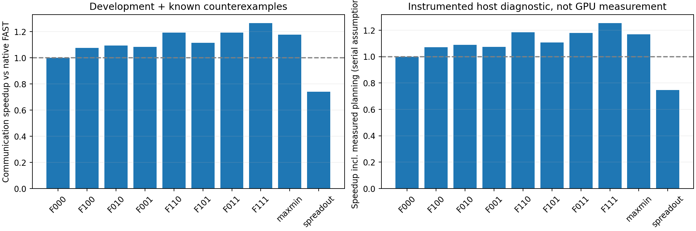
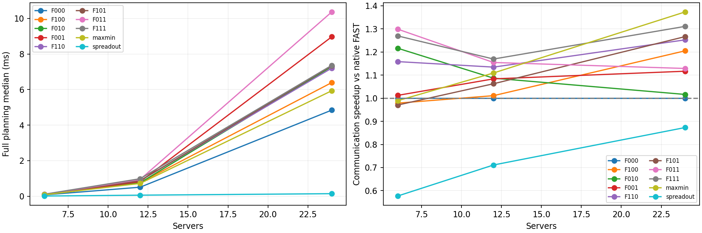

# FAST轻量拓扑感知：G/L/R组合扫描

日期：2026-10-29。原生FAST解析仿真，不使用SimAI/ns-3、实机GPU或新全局barrier。

## 1. 范围与前提

目标：保持FAST对当前已知all-to-all需求的快速规划能力，补充共享物理链路感知。只调整合法匹配，不改真实字节、路由、原有机内流程或pipeline2时间组合。这里“在线”不是运行中接收新流或根据包队列实时反馈。

网络阶段模型为最大活跃路径单向传播加最大资源真实字节/带宽，再与原生机内dispatch按pipeline2组合。不是逐包仿真，不涉及ACK、RTT握手、PFC/DCQCN；不能将模型内服务占比写成实测WAN空闲。

固定拓扑：3个DC，两两独立全双工WAN；每DC2/4/8服务器，共6/12/24服务器，每服务器8GPU。服务器收发各400Gbps聚合，DC网关收发各400Gbps，有向DC对WAN100Gbps。LAN每跳700ns，WAN单向50µs或5ms；跨DC路径传播为WAN加2.8µs，同DC跨服务器1.4µs。机内450GB/s、alpha0.1µs，沿用原生SpreadOut。

负载：每GPU平均预算16/256MiB；balanced等量非对角GPU对，整数取整略小于预算；Zipf采用原生alpha=.9、截断10000生成器并归一化到精确总字节。主扫描种子280101，另保留280203的大规模旧反例。24主开发配置+2诊断配置=26输入配置，WAN配对共复用13个不同矩阵。它们都已用于开发，不是独立验证集。

## 2. 三个优化因素与方法定义

G（阶段粒度）：在二的幂阈值支持图中找perfect matching，可行性探测最多6次/阶段，另计最终匹配构造。阈值不低于本轮原生匹配系数；实际仍扣选中匹配的最小正残余，不人为无限切块。属于借鉴已有阈值/Max-Min思想，不单独声称原创。

L（共享链路组合）：从种子匹配出发，最多2次交替环尝试；保持阈值支持及不低于种子的系数，只接受本阶段网络时间/真实字节严格改善。路径预编译为整数资源ID，真实字节由balance后逐GPU剩余量计算；虚拟补齐不作WAN服务。

R（残余瓶颈导向）：按当前真实残余在各资源上的工作量/带宽计算压力，调整增广路邻接边与L候选的优先级。不是WAN硬优先，也不是精确完成时间目标。关闭R时保留原邻接遍历顺序。

| ID | G | L | R | 含义 |
|---|---|---|---|---|
| F000 | 关 | 关 | 关 | 原生FAST |
| F100 | 开 | 关 | 关 | 只改变阶段粒度 |
| F010 | 关 | 开 | 关 | 旧版bounded受限链路修补 |
| F001 | 关 | 关 | 开 | 只按残余资源压力引导匹配 |
| F110 | 开 | 开 | 关 | 粒度与链路组合 |
| F101 | 开 | 关 | 开 | 粒度与残余压力 |
| F011 | 关 | 开 | 开 | 链路修补与残余候选 |
| F111 | 开 | 开 | 开 | 三因素联合 |
| Max-Min | — | — | — | 已有精确最大化匹配最小系数基线 |
| SpreadOut | — | — | — | 原生GPU轮转配对；不是实测NCCL |

“最好”仅指这组候选和开发输入内的比较，不是全局最优。未同时调整评分公式、前瞻深度和连续权重。

## 3. 规划计时与公平性

新入口只执行一次选定方法的分解；不先生成完整原生方案再丢弃。关闭优化时匹配、阶段、真实payload与通信时间须与旧冻结二进制一致；F010、Max-Min及SpreadOut也分别核对旧版相同方法。

每个方法先暖机一次，再按确定性轮转次序交错测量21次。计时包含Local/Global构建、选定分解、必要机内调度构建及研究插桩；不包含解析网络代价计算、JSON导出、写盘或绘图。报告完整规划中位数与p95，以及分解和资源缓存编译分项。不是GPU端到端时间，也不是无插桩生产实现的极限性能。

静态Topology评价器对象在批次开始时构造，作为已知拓扑输入，其创建未纳入计时；算法自己的ResourceCache路由/容量编译纳入完整规划并单列preprocess_us，本轮每次规划均计入，未假定免费摊销。因此这里不声称测量了从拓扑文件读取到首次通信的完整冷启动。

“通信模型时间+规划时间”明确采用不重叠、串行规划的诊断假设；不会默认规划总能隐藏。不同方法全程路由真实字节应一致，服务占比与完成时间不是两份独立收益证据。

## 4. 结果

权威结果：[run-7be22345a21c](results/run-7be22345a21c/)。260/260组完成，每组21次规划计时，合计5460个计时样本；每方法另有1次暖机。全量原生回放、真实字节/路径/pipeline重算通过；全部13种矩阵从登记种子重新生成一致，跨WAN配置严格复用输入。26配置×4方法的104项旧冻结版本等价比较通过。

### 4.1 主开发集：三因素联合最好，但不是逐场景最优

以下仅24个主开发配置，按配置等权计算配对加速比的几何平均。加速=对照时间/本方法时间，大于1为更快；胜平负以通信时间计。含规划结果采用第3节的串行诊断假设。

| 方法 | 相对原生通信加速 | 含规划加速 | 相对Max-Min通信加速 | 对原生胜/平/负 |
|---|---:|---:|---:|---:|
| F000 原生FAST | 1.0000× | 1.0000× | 0.8724× | 0/24/0 |
| F100 仅G | 1.0603× | 1.0555× | 0.9250× | 6/12/6 |
| F010 仅L | 1.1032× | 1.0988× | 0.9624× | 23/0/1 |
| F001 仅R | 1.0699× | 1.0612× | 0.9333× | 17/4/3 |
| F110 G+L | 1.1805× | 1.1718× | 1.0299× | 23/0/1 |
| F101 G+R | 1.0929× | 1.0849× | 0.9534× | 17/4/3 |
| F011 L+R | 1.1916× | 1.1785× | 1.0395× | 24/0/0 |
| F111 G+L+R | **1.2483×** | **1.2369×** | **1.0890×** | **24/0/0** |
| 已知Max-Min | 1.1463× | 1.1404× | 1.0000× | 9/12/3 |
| 原生SpreadOut | 0.7102× | 0.7158× | 0.6195× | 6/0/18 |

F111是本轮主开发集聚合指标最好的组合，24组均快于原生，最小加速1.0060×；计入规划后最小1.0032×。但它相对Max-Min是19胜5负，并非全面更优。F011也全胜原生，且4个6服务器Zipf配置优于F111；不能据平均值将其淘汰。

额外2个旧反例单列为诊断：F111相对原生几何平均1.5099×、相对Max-Min0.9399×。合并26配置的F111相对原生1.2667×、含规划1.2551×、相对Max-Min1.0767×，26胜0负；这些是已观察输入，不能写成独立验证成功。



图中汇总全部26配置，因此数字与上表24配置略不同；两幅图都不是GPU实测。F编号含义见第2节。

### 4.2 不同规模和传播时延下，组合优势不同

每格聚合主开发集的2种预算×balanced/Zipf四个配置，仍以原生FAST为对照。

| 服务器数 | WAN单向时延 | 仅L | G+L | L+R | G+L+R | Max-Min |
|---|---:|---:|---:|---:|---:|---:|
| 6 | 50µs | 1.3346× | 1.2080× | **1.3403×** | 1.3144× | 0.9753× |
| 6 | 5ms | 1.1080× | 1.1104× | **1.2582×** | 1.2259× | 1.0032× |
| 12 | 50µs | 1.0991× | 1.1597× | 1.1530× | **1.1677×** | 1.0711× |
| 12 | 5ms | 1.0741× | 1.1096× | 1.1558× | **1.1709×** | 1.1482× |
| 24 | 50µs | 1.0217× | 1.1467× | 1.1663× | **1.2098×** | 1.1643× |
| 24 | 5ms | 1.0107× | 1.3675× | 1.0920× | 1.4197× | **1.6195×** |

这支持“不同配置可能各有优势”的判断，但样本很少，不据此训练或宣称获得了可泛化的场景选择规则。

逐因素开/关，在另外两个因素的4种上下文中配对，共24×4个对照：G平均乘数1.0497×，L为1.1181×，R为1.0594×。它们分别有22、6、21次负作用。这里的96个对照不是96个独立随机负载；也不能将三个乘数直接解释为互相独立的提升。

### 4.3 正例：不要求每阶段都用WAN，整体反而更快

6服务器×8GPU，balanced256MiB/GPU，WAN单向5ms：

| 方法 | 完成时间 | 总/WAN阶段 | 累计瓶颈序列化费用 |
|---|---:|---:|---:|
| 原生FAST / Max-Min | 229.799833ms | 5/5 | 204.696289ms |
| 仅L / G+L | 171.315179ms | 5/5 | 146.211635ms |
| L+R / G+L+R | **144.382034ms** | **5/4** | **124.279890ms** |

三因素联合相对原生完成时间下降37.17%，总阶段数仍为5。原生各阶段最繁忙有向WAN的真实payload为365.529、731.058、365.529、731.058、365.529MB；联合方案为365.529、365.529、365.529、0、365.529MB。

联合方案的第4个阶段是服务器之间的同DC通信，不是GPU机内scale-up；此时后面仍有真实WAN需求。它没有强制WAN持续活跃，却通过更好的组合降低了整体序列化和传播费用。R单独反而变慢至261.351342ms，说明“少一个WAN阶段”本身也不是充分目标。各方法全程每条WAN真实字节完全相同。

### 4.4 反例：链路序列化更好，仍被更多WAN阶段抵消

24服务器×8GPU，Zipf种子280203，256MiB/GPU，WAN单向5ms：

| 方法 | 完成时间 | 总/WAN阶段 | 传播费用 | 瓶颈序列化费用 |
|---|---:|---:|---:|---:|
| 原生FAST | 3395.498691ms | 510/510 | 2551.428000ms | 843.189822ms |
| G+L+R | 2038.356532ms | 286/285 | 1425.799400ms | **611.677704ms** |
| Max-Min | **1598.114268ms** | **178/178** | **890.498400ms** | 706.736440ms |

联合方案比原生快约1.666×，但仍比Max-Min慢27.55%。相比Max-Min，序列化省约95ms，却多付约535ms传播费用，净差约440ms。它清楚暴露了当前二进制粗阈值与局部选择没有充分控制全局阶段碎片，不能用平均收益掩盖。

同一矩阵在WAN单向50µs时，联合方案636.402937ms、Max-Min717.014268ms，排名反转。联合匹配会随链路评分中的传播参数改变，因此不是将同一调度只做时延线性外推。

### 4.5 在线代价：没有重型优化器，但并非零成本

下表对每规模8个主开发配置，取各配置21次完整规划中位数的中位数。单位ms；不与旧报告的重复分解桥接计时直接拼接。

| 服务器数 | 原生FAST | 仅L | L+R | G+L+R | Max-Min |
|---|---:|---:|---:|---:|---:|
| 6 | 0.07375 | 0.09682 | 0.10413 | 0.11069 | 0.08075 |
| 12 | 0.50710 | 0.75662 | 0.94360 | 0.98479 | 0.71941 |
| 24 | 4.84355 | 7.29566 | 10.36631 | 7.36289 | 5.93406 |

F111在24服务器的完整规划仍为毫秒级，不能直接宣称满足所有在线预算。相应每配置p95再取中位数，6/12/24服务器为0.12472/1.08036/8.03970ms；这不是把不同配置样本混成单一延迟分布。资源缓存编译中位数约9.14/32.05/132.19µs，已包含在总规划中。



L+R在24服务器比三因素联合更贵，与其保留更多阶段有关。预算限制约束的是每阶段操作次数，不等于全程常数时间；全阶段数量必须一起考虑。

### 4.6 当前取舍与下一轮建议

1. 保留F111作为主候选、F011作为轻粒度干预的对照；暂不做按场景自动选择，也不扩大连续权重搜索。
2. 优先检验“精确Max-Min种子+相同L/R”或更细但有界的阈值网格，针对高传播阶段数量问题；这属于下一轮开发，不能事后改本批次定义。
3. 方法冻结后再用新种子和额外规模独立验证，同时关注24服务器规划开销。本轮只有一个主Zipf种子及一个旧反例，尚不足以声称稳健泛化。

## 4.7 验证证据

- 新模块2项C++测试、5项Python测试通过，包括24个随机矩阵下全部组合、原生/旧bounded/Max-Min调度等价、阈值界、系数拒绝、真实/虚拟边界、20组CLI烟雾及篡改拒绝。
- 旧bottleneck的2项C++/2项Python、旧topology的2项C++/8项Python，以及论文reproduction的7项Python回归通过。
- 260项原生语义回放、逐资源字节与pipeline重算，104项历史方法等价，以及13种注册输入重生成通过。已发表论文图17a剩余差异未被本轮“修好”。
- 仅使用新源码归档的完整260项审计通过；在独立临时目录重新编译归档源码，正例/反例两输入×10方法的20项语义复现通过。最终旧模块回归再次通过，旧结果未覆盖、未做Git提交或上传。
- 核对旧反例时发现输入设种子顺序问题，独立只读审查确认；已用两个RED→GREEN回归修复并重新运行。独立审查核对了修复、源归档、全部260项数据和26份历史矩阵一致性，未提出其他严重实现问题。审查代理随后因使用额度中断，最终结果段落由主执行者核对，不能称为全文已独立审过。

数据：[comparison.csv](results/run-7be22345a21c/comparison.csv)、[原始逐阶段结果](results/run-7be22345a21c/raw/)、[输入/构建登记](results/run-7be22345a21c/study.json)、[历史方法等价检查](results/run-7be22345a21c/baseline_checks.json)。

## 5. 输入问题与作废批次

第一批[run-f5a6696f2ed1](results/run-f5a6696f2ed1/INVALID.md)已明确作废并保留。新Zipf入口先设种子、后构造生成器，而原生生成器构造会用时钟重新设种子，导致注册种子失效。虽同一保存矩阵内的算法对比公平，但不能作为预定种子的实验。

通过核对旧反例阶段数发现差异；新增冻结生成器256个输出逐项对照和自洽篡改输入/登记表的拒绝测试，均先失败后修复。修复后种子在构造器之后设置，prepare按与WAN无关的输入键复用矩阵，audit从注册种子重新生成全部13种输入并核对。调度规则和预算未据作废批次调整；本报告不使用其性能数字。

## 6. 复现入口与边界

从FAST目录运行：

```bash
make -C simulation/scan check
python3 simulation/scan/study.py --phase prepare
python3 simulation/scan/study.py --phase run
python3 simulation/scan/study.py --phase baselines
python3 simulation/scan/study.py --phase render
```

源文件、编译参数、二进制与输入登记于各run目录。当前结果的运行/审计有源码快照；跨历史版本的baseline对照额外依赖保留旧目录中的native_bottleneck二进制，其摘要登记于baseline_checks.json，不能声称仅新归档就可重新生成旧二进制。

独立种子验证、更多DC与规模、包队列/拥塞控制和实机均未完成。暂不构造按样本事后择优的选择器，不承诺EI会议录用或普遍超越Max-Min。
