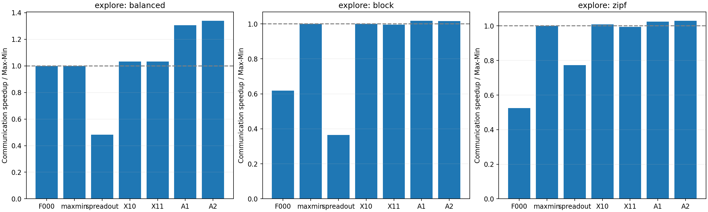
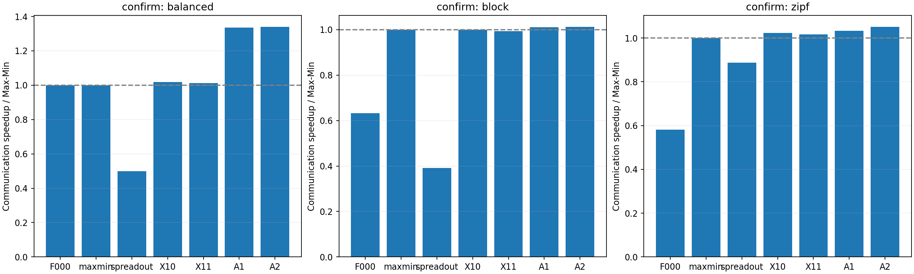
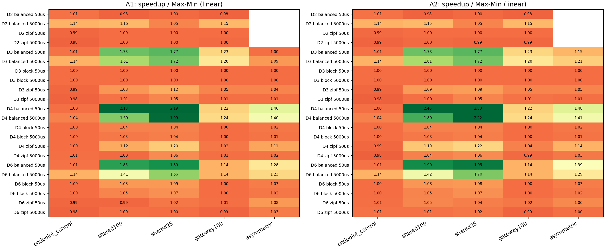
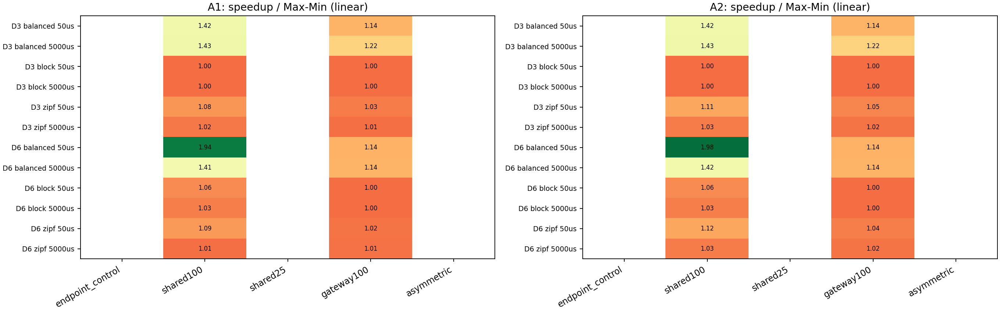
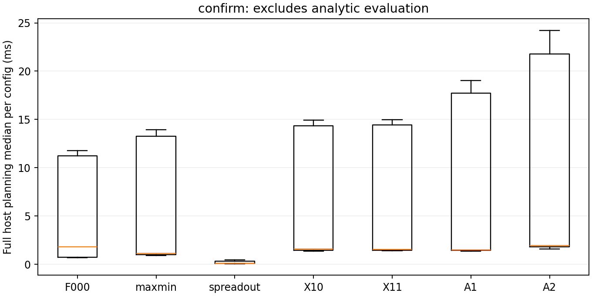

# FAST拓扑感知：适用场景扫描与构造式匹配

日期：2026-10-29。状态：106组探索、48组确认，7方法共1078个结果完成，均通过输入重生成、逐结果回放、路由字节/容量、流水线时间与算法操作次数审计。Zipf的每rank流量上限未满足原设计措辞，详见3.1的协议偏差说明。

**结论：找到了更明确的优势区间。** 最突出的不是Zipf，而是均衡端点流量遇到多DC共享链路冲突。新构造式匹配在确认集16组均衡配置中相对原生FAST/Max-Min全部加速，几何平均1.339倍；Zipf相对Max-Min仅1.050倍。收益有边界，不能写成“任意多DC负载普遍大幅加速”。

## 1. 问题和研究边界

研究对象是FAST原生仿真中的服务器级Birkhoff分解，不是替换FAST的机内负载均衡或流水线。原生匹配保证每台服务器每阶段至多一个发送/接收目标，但不同服务器可能同时经过同一网关或DC对链路。端点合法不意味着共享资源的组合有效率。

本轮检验两个问题：哪些拓扑/流量组合会暴露这一缺口；在构造perfect matching时直接考虑共享资源，能否比局部修补更有效。所有计时均为现有原生解析模型结果，不是ns-3或实机测量。保持Topology::evaluate、GlobalScheduler::pipeline2、机内调度与原始分解扣减规则不变；代码与上一轮归档逐文件比较，相关模型/执行文件均一致。

仍采用上一轮服务器400Gbps、机内450GB/s与0.1µs参数。服务器路径在同DC为1.4µs，跨DC为WAN单向时延+2.8µs。每阶段网络时间为实际经过路径的最大传播项，加共享资源上最大的字节服务时间；阶段间与机内dispatch的重叠沿用pipeline2。**没有为了新算法新增barrier，也没有改成全流并发模型。**

## 2. 算法：先区分改进来源

| 名称 | 含义 | 用途 |
|---|---|---|
| 原生FAST（F000） | 原始匹配选择、原始系数扣减 | 主要基线 |
| 精确Max-Min（maxmin） | 在正残余支持图上找最大可行匹配最小系数q* | 排除仅仅改善分解粒度的贡献 |
| SpreadOut（spreadout） | 项目已有GPU级循环偏移配对 | 强于只比较Direct的外部调度参照；不冒充NCCL完整实现 |
| 精确种子+局部修补（X10） | q*种子，每阶段最多2次交替环候选，按真实网络时间/字节接受 | 已有拓扑局部优化 |
| 精确种子+局部修补/残余优先（X11） | X10加残余共享资源压力优先的邻居排序 | 上一轮主要候选 |
| 构造式匹配A1 | q*支持图内，用共享资源负载排序增广搜索，完整构造1次 | 本轮新候选 |
| 构造式匹配A2 | A1加一次DC组间轮转的行访问顺序，共最多2次构造 | 有限预算消融 |

A1/A2构造时维护部分匹配的共享资源字节占用，优先尝试使归一化资源峰值较小的边，再用资源负载平方和增量打破平局。增广时扣除当前行的旧匹配占用，只在成功增广后提交占用更新。保留全部合法邻居，不增加剪枝，因此只改搜索顺序、不破坏可行perfect matching的存在性。完成后仍用现有真实网络时间/真实字节评分与精确种子比较，严格改善才接受。

所有候选保留q*：不通过缩小系数换取覆盖率，没有排列枚举或全局优化求解器；每次扣减至少清除一个正残余元素，所以阶段数有N²上界。不同早期匹配仍会改变后续残余，故阶段数和全程时间不保证优于种子；局部接受不是全局单调保证。

资源缓存构建、搜索、原生负载均衡和dispatch计划构造计入主机规划时间；解析模型评估、输出和矩阵生成不计入。静态拓扑对象作为已知输入，不重复计入每次在线规划。主机时间不是GPU计算时间。

## 3. 预登记实验配置

固定24服务器、每服务器8GPU，DC数D=2/3/4/6，服务器等分到DC。不再只使用最初的3DC、每DC两服务器的小原型。

```text
DC a                                      DC b
多台8GPU服务器                             多台8GPU服务器
    │ 各服务器收/发资源400Gbps                  │
  TOR ── 网关a ───── 有向DC对WAN资源 ───── 网关b ── TOR
           │           不同方向独立             │
       共享出口/入口                         共享出口/入口
```

这是固定路径的资源图，不是对交换机排队、路由选择或拥塞控制的包级仿真。LAN传播仍为每跳700ns；WAN单向时延分别50µs和5ms。

| 资源配置 | 服务器Gbps | 每DC共享网关收/发Gbps | 每有向DC对WAN Gbps | 目的 |
|---|---:|---:|---:|---|
| endpoint_control | 400 | 9600 | 9600 | 中间容量非瓶颈的对照；路径传播仍异构 |
| shared100 | 400 | 400 | 100 | 常规DC对共享瓶颈 |
| shared25 | 400 | 400 | 25 | 更慢的DC对链路，不预设拥塞越强收益越大 |
| gateway100 | 400 | 100 | 100 | 共享DC网关瓶颈，不是单一全局瓶颈 |
| asymmetric | 400 | 400 | 平均100 | 不同DC对容量异构，原始倍率0.5/1/2归一到均值100 |

### 3.1 相同总量的三类流量矩阵

令r=192，归一化基准Q为不超过64MiB的最大4(r−1)整数倍，即67,108,232字节；u=Q/(r−1)。三个负载的总字节均为rQ；balanced/block每rank总量均为Q，Zipf仅平均值为Q。

- **balanced**：所有非对角GPU对为u。
- **Zipf(.9)**：使用FAST原始生成器，在构造生成器后设置种子；对角清零，再以最大余数法整数归一到rQ。它只控制总量，不宣称每rank行列或WAN字节与balanced一致。
- **block**：同DC各项与balanced完全相同；跨DC各项先给u/4，再对循环排列中的热点目标DC额外给3(D−1)u/4。这使75%的WAN需求成分集中到热点DC目标，剩余25%均匀分布。每rank行/列总量、机内矩阵、同DC矩阵及WAN总字节与balanced严格相同，只改变WAN目标分布。

block的热点不是“某一个DC有额外总流量”，而是DC对相关性；各DC总收发仍平衡。D=2时只有一个其他DC，block与balanced重复，去掉。asymmetric在D=2归一后也与shared100重复，去掉。

**协议偏差：Zipf的64MiB是平均值，不是每rank上限。** DESIGN.md原文“每GPU预算不超过64MiB”与Zipf全局归一化的实现不一致。独立审查后核实，探索种子520101的最大rank发送量89,395,662字节，确认种子520201/520203分别为86,484,256/89,284,935字节，均超过64MiB；总量控制仍正确。这里明确保留并披露偏差，没有事后修改矩阵、重调算法或重跑覆盖旧记录。Zipf结果仅适用于平均预算相同、端点可不均衡的负载，不能作为每rank封顶64MiB的证据；均衡/block的严格行列控制与主要结论不受此问题影响。若后续要求逐rank上限，应另行定义受限生成器并单独登记实验。

### 3.2 探索集与确认集分开

| 集合 | DC数 | 容量配置 | 负载 | WAN时延 | 种子/布局 | 配置数 | 方法数 | 计时重复 |
|---|---|---|---|---|---|---:|---:|---:|
| 探索 | 2/3/4/6 | 五种，去除D2重复 | 三种，去除D2 block | 50µs/5ms | 520101；连续DC布局 | 106 | 7 | 5 |
| 确认 | 3/6 | shared100/gateway100 | 三种 | 50µs/5ms | 520201、520203；打乱服务器的DC标签 | 48 | 7 | 21 |

每方法一次暖机，随后轮转方法计时。共1078个配置×方法结果。两个集合在观察结果前同时冻结，没有根据探索结果重新调参或挑选确认场景。确认balanced只有DC布局变化，属于重编号稳健性检查，不是独立随机均衡流量。探索的矩阵在容量和时延间复用，106配置仅对应5个不同矩阵，不能视为106次独立随机验证。

## 4. 实验结果

加速比统一为“基线时间/候选时间”，大于1更好；表中为相应全部配置的几何平均，不按每个场景挑选算法后拼接。所有图均为线性坐标。

### 4.1 总体对照：不能把粒度收益当作拓扑收益

| 集合 | 方法 | 相对原生FAST | 相对Max-Min | 相对SpreadOut | 相对已有X11 | 计入规划后相对Max-Min |
|---|---|---:|---:|---:|---:|---:|
| 探索106组 | X11 | 1.455 | 1.008 | 1.909 | 1.000 | 1.003 |
| 探索106组 | A1 | 1.609 | 1.115 | 2.111 | 1.106 | 1.102 |
| 探索106组 | A2 | 1.626 | 1.127 | 2.134 | 1.118 | 1.103 |
| 确认48组 | X11 | 1.407 | 1.008 | 1.807 | 1.000 | 1.005 |
| 确认48组 | A1 | 1.559 | 1.117 | 2.004 | 1.109 | 1.108 |
| 确认48组 | A2 | 1.570 | 1.125 | 2.017 | 1.116 | 1.107 |

原生FAST到A2的1.570倍包含精确分解粒度等共同改进；**相对Max-Min的1.125倍才更接近本轮拓扑构造的增量贡献**。原生FAST仍是主要比较对象，保留Max-Min防止误归因，SpreadOut用于跨方法参照，不再依靠Direct体现优势。





### 4.2 哪些负载值得聚焦

| 确认集负载 | 配置数 | A2/原生FAST | A2/Max-Min | A2/SpreadOut | A2/Max-Min范围 | 计入规划后A2/Max-Min |
|---|---:|---:|---:|---:|---:|---:|
| balanced | 16 | 1.339 | 1.339 | 2.677 | 1.126–2.038 | 1.326 |
| Zipf(.9) | 16 | 1.807 | 1.050 | 1.184 | 1.004–1.144 | 1.014 |
| block | 16 | 1.599 | 1.012 | 2.590 | 1.000–1.064 | 1.009 |

均衡负载下原生FAST与Max-Min生成同一结果，故此处的加速不能由“把q*算准了”解释。相同端点收发总量也可能因不同DC对流量在阶段内聚集而产生明显共享资源冲突。确认均衡子集A2的1.339倍对应通信时间减少约25.3%，不是减少33.9%。

Zipf的q*支持图与真实字节分布更受约束，本实现仍有大量累计资源服务差，却只能消除其中一小部分；没有证据说明简单加大构造预算就能解决它。block把热点DC对的不可避免工作量抬高，局部重排无法改变这些总字节和路径，因此可压缩的相对空间更小。**“更不均衡”并不等于“更适合这个算法”。**

### 4.3 拓扑适用域

| 探索资源配置 | A2/Max-Min，全部对应负载和时延 | 含义 |
|---|---:|---|
| endpoint_control | 1.018 | 没有中间容量瓶颈时，主要剩传播/阶段组合因素 |
| shared100 | 1.209 | 多条DC对共享链路之间的组合更有价值 |
| shared25 | 1.240 | 本扫描中更慢的DC对链路放大了服务时间差，但不代表无限单调 |
| gateway100 | 1.063 | DC总出口接近主导，匹配选择的自由收益较小 |
| asymmetric | 1.117 | 容量不对称下仍有收益，但不是本轮最强区间 |

确认集仅预登记shared100/gateway100：相对Max-Min分别为1.192/1.061倍，与探索方向一致。





### 4.4 一个清晰的机制例子，以及一个确认例子

探索：4DC、balanced、每DC对100Gbps、WAN单向50µs。

| 方法 | 完成时间ms | 阶段数 | 含WAN阶段数 | 累计资源串行化项ms | 累计传播项ms | 最重WAN资源服务时间/总时间 |
|---|---:|---:|---:|---:|---:|---:|
| 原生FAST/Max-Min | 175.716 | 23 | 23 | 174.495 | 1.214 | 36.86% |
| 已有X11 | 168.919 | 23 | 22 | 167.749 | 1.163 | 38.34% |
| A1 | 82.365 | 23 | 18 | 81.401 | 0.957 | 78.63% |
| A2 | 71.571 | 23 | 18 | 70.608 | 0.957 | 90.48% |
| SpreadOut | 171.988 | 192 | 191 | 161.903 | 10.085 | 37.65% |

所有方法真实流量、路径和每条资源总字节相同，最重资源工作量下界64.761ms。A2比原生/Max-Min快2.455倍，比SpreadOut快2.403倍；阶段数没有增加。若把WAN降为25Gbps，原生699.202ms，A2为276.648ms，加速2.527倍。

**这不是“每个stage都塞入WAN”带来的收益。** A2反而有5个LAN阶段，WAN阶段数比原生少；累计传播只减少0.257ms，完成时间却减少104.145ms，主要来自同阶段共享资源组合改善。强制每阶段都含WAN不是本轮采用的目标。

确认：6DC、shared100、balanced、新布局520201、WAN单向50µs。原生/Max-Min96.563ms，X11为105.558ms，A1为49.188ms，A2为47.389ms，SpreadOut94.522ms。A2对原生/Max-Min为2.038倍，对SpreadOut为1.995倍，仍均为23个FAST阶段。该确认域与探索最强的4DC域不同，没有拿探索最大值当确认结果。

上述“WAN服务占比”定义为各有向WAN资源总字节/容量所需时间中的最大值除以总完成时间，**不是实际包级忙闲采样，也不是所有WAN链路平均利用率**；当网关主导时它不等于整体瓶颈利用率。

### 4.5 负例与在线成本

探索中A2相对Max-Min有17/106个严格负例，最差0.9772倍；A1有14个。确认A2通信时间无严格负例，但计入规划后仍有16/48组慢于Max-Min，不能省略CPU成本后宣称“全部更好”。

一个可解释负例是3DC、endpoint_control、Zipf种子520101、WAN 5ms：Max-Min857.365ms、169个WAN阶段；A2为877.376ms、173个WAN阶段。两者累计串行化项均约11.668ms，新增4个WAN阶段的传播项约20.011ms几乎解释全部退化。**q*不下降只约束当前阶段，不保证未来阶段数不增加；局部评分也不保证全局最优。**

确认集每配置主机规划时间的中位数再取中位数：Max-Min1.149ms，X11为1.526ms，A1为1.521ms，A2为1.933ms。分负载看，均衡A1/A2约1.509/1.929ms；Zipf约18.238/22.688ms。A2在Zipf上的通信收益较小，计入规划后相对Max-Min从1.050降为1.014倍。



A1只构造一次，在确认集计入规划后的整体几何平均略好于A2（1.108对1.107，不能据此声称统计显著）。因此后续应把A1作为轻量主线、A2作为预算消融，而不是只展示A2通信最大值。当前实验不包含首个冷启动拓扑构建，也未声称达到某一在线截止时限。

## 5. 解释、局限与论文定位

用L_ke表示第k阶段经过资源e的实际字节、b_e表示其服务速率；固定流量和路径时，各资源总字节不变：

$$
T_{serial}=\sum_k\max_e\frac{L_{ke}}{b_e},\qquad
LB_{resource}=\max_e\sum_k\frac{L_{ke}}{b_e},\qquad
T_{serial}-LB_{resource}\geq0.
$$

端点匹配不直接控制第一项，不同阶段的主导资源不同会留下组合效率差。A1/A2构造时减少部分匹配的资源峰值，是这个目标的有限预算启发式，不是求解全局最优。资源下界不一定可达，不能把全部差值当作可实现加速。

本轮的论文主张可以收敛为：**保留FAST在线规划与机内流水线，在服务器级匹配构造中感知固定物理路径的共享资源，改善多DC全交换的阶段资源组合效率。** 有理论上的可行性与守恒保证、有Max-Min和局部修补消融、有独立新布局确认，且不依赖Direct。这比只报告数个百分点或最初的WAN覆盖率思路更有实质进展。

但现在仍是可发展的仿真论文原型，不是已达到EI录用标准的结论：本轮新算法只有24服务器规模，只有两个确认种子/布局，均衡布局检查不等同于新工作负载；未复现真实采样矩阵，未验证packet/CC行为，尚缺与其他已发表拓扑感知方法的同预算比较。收益最大的区域是均衡端点流量与多个共享DC对资源，而不是所有Zipf/MoE场景。

## 6. 复现与文件

- [预登记设计](DESIGN.md)、[实施计划](PLAN.md)、[进度与裁决](PROGRESS.md)。
- 运行：`python3 simulation/scenario/study.py --suite explore --phase prepare`，接着`--phase run`；确认集换成`--suite confirm`。
- 审计/出图：对应集合的`--phase audit`或`--phase render`。
- 检查：`make -C simulation/scenario check`。旧策略历史一致性测试还需上一轮冻结二进制；本轮归档源码可独立重编译本轮程序，不把历史二进制依赖隐去。
- 探索：[完整CSV](results/run-b04dfab5ebf3/comparison.csv)、[分组统计](results/run-b04dfab5ebf3/summary.json)、[登记及执行记录](results/run-b04dfab5ebf3/study.json)。
- 确认：[完整CSV](results/run-cab50c039780/comparison.csv)、[分组统计](results/run-cab50c039780/summary.json)、[登记及执行记录](results/run-cab50c039780/study.json)。
- [归档源码独立重编译：21结果语义一致](results/run-b04dfab5ebf3/archive_rebuild_checks.json)、[验证与审查记录](VALIDATION.md)。

## 7. 下一步建议

1. 以“均衡/轻度倾斜端点负载下的共享资源冲突”为主域，补足服务器规模与更多随机DC布局，确认不是编号/固定规模特例。
2. 保留A1轻量主线，研究无需多次候选构造的行顺序或轻量前瞻，重点解释并缓解Zipf的后续阶段增加和CPU成本；不将事后逐场景挑选包装成算法。
3. 在该域引入一个已有文献的拓扑感知同预算参照，再决定是否形成EI投稿；继续保持原生FAST执行模型，后续才回到ns-3。
