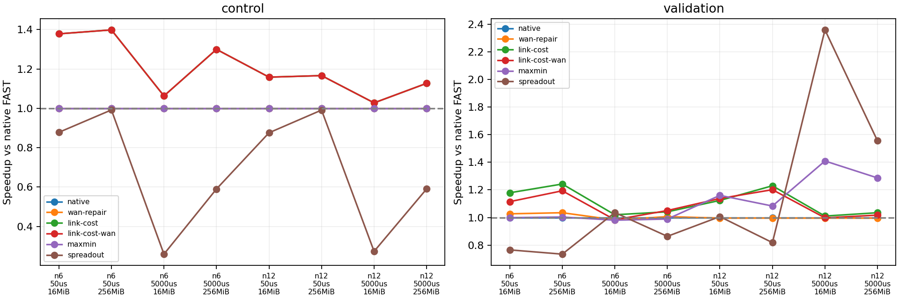
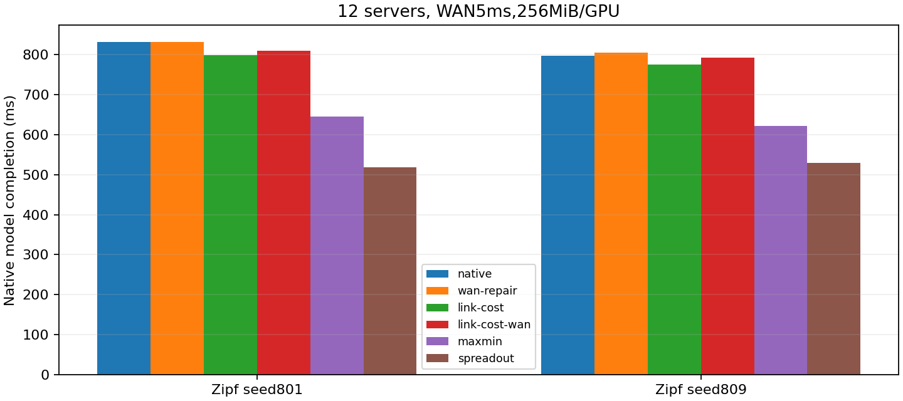

# 原生FAST：共享网络瓶颈感知的第一轮验证

日期：2026-10-27。本轮完全位于`FAST/simulation`，不调用SimAI、ns-3或旧Python FAST移植。原生C++负责预处理、balance、派发、机内重分布与pipeline2费用重叠。Direct不进入本轮对比。

结论：原生FAST确有端点匹配以外的共享链路调度空间；无需改变阶段数、WAN阶段数或执行器就能改善一个均衡高负载场景。当前链路代价原型的Zipf新验证平均通信加速1.107×，但与已知Max-Min基本持平，计入规划CPU开销的估算后优势几乎消失，不能认定已得到轻量、普遍更优的新算法。

## 前提与问题

原始阶段费用为`inter.alpha + freq × inter.beta × MBpu`。freq为每GPU配额；MBpu为每矩阵单位的十进制MB。本轮一单位为一字节，MBpu=1e-6，时间为微秒。ETHER400的原始beta=22us/MB不等于精确400Gbps，保留其原值做兼容验证，不把它悄悄换成物理带宽。

原生只凭统一freq计算阶段通信费用，不能显式表达多条端点不冲突的流共享DC网关/WAN。新增评价器对所有方法一致使用实际流量与固定路由，阶段费用近似为`最大活跃路径单向传播时间 + 最大链路总字节/带宽`，仍在原生pipeline2中与上一阶段机内dispatch取max。不是RTT模型，不含ACK、队列、丢包或DCQCN，也不是真机完成时间。

## 原生一致性

修改前源代码归档与oracle已保留。30个固定输入覆盖2/3/6服务器、1/4GPU、均匀及随机负载。修改后关闭hook、或hook返回旧阶段费用，两种方式共60次均与旧二进制结果一致。真实网络模型只在全实、均匀资源的测试上要求退化一致；旧公式会对虚拟槽位计费，而新模型不发送虚拟流量，二者不能要求所有矩阵时间完全相等。

只新增可选匹配/评价接口，未改原生默认匹配访问次序或阶段执行次序。本轮enable_scaling=false，保留原生预处理中的balance/approx判断。不合批、不增加barrier、不替换机内模型。空跨服务器需求原来会访问不存在的stage0；已补空阶段保护，返回原生机内费用。原有工作区的cstring包含修正保留。

## 拓扑与负载

3DC，每DC相同服务器数；6/12服务器，每服务器4GPU。服务器—ToR及ToR—GW均400Gbps、单向700ns；GW两两直连100Gbps，单向50us/5ms。机内沿用H100原生alpha=.1us、beta=2.3us/MB。

评价器以服务器为网络端点：同DC不同服务器路径传播1.4us；跨DC路径传播WAN+2.8us。CPU原生scale-up单独计算，不额外复制ns-3中的GPU—机内交换链路。资源包括每服务器收/发、每DC网关收/发、每有向DC对WAN；双向独立。此模型是阶段流体近似，不是逐流完成事件模拟。

Balanced为GPU非对角元素严格相同整数，向下取整后总量略低于名义预算，固定配置差96–1536B，实际总量写入输入manifest。Zipf直接调用原生`test.cpp`的截断逆CDF生成器，alpha=.9、上限10000；构造器初始化后重新srand(seed)，再按原生顺序采样，GPU对角置零。用最大余数法将Zipf归一化到精确全矩阵预算，16/256MiB/GPU是平均预算，不是每行固定总量。开发701/709，新验证801/809，Balanced单独计为控制组。

固定40输入×6方法=240个模型结果。不是240次包仿真，不把流/阶段视作独立统计重复；未依据新种子结果改方法。

## 对比方法

- 原生FAST：原始C++匹配、原始补齐、原始阶段次序，统一新网络评价。
- WAN修补：首先接受原生匹配；若无真实WAN边且残余仍有，强制第一条可行真实WAN边，通过一个交替环保持perfect matching。不最大化WAN数量。
- 链路代价：每轮从原生匹配出发，真实剩余字节降序选至多N条候选边，各生成一个交替环匹配；按本阶段真实通信费用/真实字节择优，严格改善才替换。只优化当前阶段效率，不能保证整体最优。
- 链路代价+WAN修补：先做代价选择，若仍无真实WAN再修补；可能牺牲当前阶段分数，作为独立消融，不称为未解释的mix。
- Max-Min：已有的大粒度分解基线，用正残余阈值二分与增广匹配最大化本轮最小系数；不作为原创。
- SpreadOut：沿用原生GPU循环偏移round，网络流统一评价，round内机内/机间取max，round间相加；不是已验证的NCCL实现。

所有Birkhoff方法每次仍扣匹配的最小正残余，每轮至少清零一条支持边，阶段数不超过N²。不枚举排列、不调用优化器。链路代价每阶段最多N次交替环尝试，WAN修补最多另一次；额外开销实测，不称为零开销。

所有用户字节从原生dispatch前后每GPU待发量差分读取，包含GPUi→GPUi部分；不从仅保存异GPU重分布的dispatch矩阵估算。分解中的虚拟量不会变成实际网络字节。优化器的待发量影子回放与原生实际派发逐GPU核对，逐服务器对交付与输入核对；所有方法的各条链路总用户字节相同。

## 结果

240/240个固定模型结果完成；再次执行原生二进制，核对全部非计时字段，并独立重算逐阶段路径负载与pipeline费用。不是只读缓存汇总。40输入包括Balanced控制8组、Zipf开发16组、新验证16组；统计对输入等权，使用配对加速比几何平均，不将Balanced复制成四个seed。

### 总体结果

加速比=原生FAST时间/本方法时间，大于1为改善；胜/平/负均相对原生FAST，按数值容差判断。时间不包含规划CPU成本，后面单列。

| 方法 | 全40组加速 | 全组胜/平/负 | 新Zipf16组加速 | 新组胜/平/负 | 新组相对SpreadOut加速 |
|---|---:|---:|---:|---:|---:|
| 原生FAST | 1.0000× | 0/40/0 | 1.0000× | 0/16/0 | 0.9489× |
| WAN修补 | 0.9991× | 5/24/11 | 1.0042× | 3/8/5 | 0.9529× |
| 链路代价 | 1.1102× | 36/0/4 | 1.1067× | 15/0/1 | 1.0501× |
| 链路代价+WAN修补 | 1.1078× | 36/0/4 | 1.0841× | 14/0/2 | 1.0287× |
| 已知Max-Min | 1.0775× | 21/8/11 | 1.1047× | 11/0/5 | 1.0482× |
| SpreadOut | 0.9269× | 13/0/27 | 1.0538× | 7/0/9 | 1.0000× |

链路代价对8个均衡控制均改善，几何平均1.1951×；对Zipf新验证相对Max-Min仅1.0018×、10胜6负，不能宣称明显优于已有方法。组合策略比单独链路代价更差，说明强制WAN覆盖会破坏一些有效选择。



图中同一配置的两个新Zipf种子等权取几何平均；Balanced中的链路代价与组合策略重合，原生、Max-Min和WAN修补重合。CSV保留每个种子的全部原始结果。

### 核心正例：阶段数量不变，仅共享WAN负载组合改变

6服务器×4GPU，严格均衡256MiB/GPU、单向WAN5ms：

| 指标 | 原生FAST | 链路代价 |
|---|---:|---:|
| 完成时间 | 129.667940ms | 99.789909ms |
| 总阶段/真实WAN阶段 | 5 / 5 | 5 / 5 |
| 累计路径传播费用 | 25.014000ms | 25.014000ms |
| 累计资源瓶颈序列化费用 | 104.573110ms | 74.695078ms |
| 原生初始balance费用 | 0 | 0 |
| 原生intrinsic费用 | 0.080831ms | 0.080831ms |
| 原生dispatch费用总和 | 0.404153ms | 0.404153ms |

通信时间降低23.04%，不是靠减少阶段、改变barrier或忽略scale-up。下表为各阶段最繁忙有向WAN承载的真实payload，单位十进制MB；它可能对应不同WAN口，明确是在比较逐阶段最大负载。

| 方法 | stage0 | stage1 | stage2 | stage3 | stage4 |
|---|---:|---:|---:|---:|---:|
| 原生FAST | 186.738 | 373.475 | 186.738 | 373.475 | 186.738 |
| 链路代价 | 186.738 | 186.738 | 186.738 | 186.738 | 186.738 |

每条有向WAN的全程用户字节总量在两种方案下相同；改变的是哪些方向在同一个阶段共同成为瓶颈，故`逐阶段取最大再相加`可以下降。这个例子直接支持“端点带宽利用合理，不代表全网络调度合理”的出发点，而不是泛指WAN时延越大收益就越大。

### 新Zipf正例与反例

6服务器、seed809、256MiB/GPU、WAN50us：原生121.612170ms，链路代价91.634690ms，1.3271×。两者都是25阶段/24个WAN阶段，累计传播费用相同；累计瓶颈序列化119.622239→89.682402ms。这是新输入下相同轮次的共享资源组合改进。

但同seed的16MiB/GPU、WAN5ms：原生127.591575ms，链路代价127.639829ms，微小退化。两者25阶段/24个WAN阶段，序列化7.476391→7.528014ms。若再强制WAN修补，则多一个WAN阶段，完成132.109519ms，退化约3.54%；这不是缺少WAN覆盖就一定该修补的场景。

12服务器、256MiB/GPU、WAN5ms的两个新种子中，当前方法明显不如已有强基线：

| 新种子 | 原生FAST | 链路代价 | Max-Min | SpreadOut |
|---|---:|---:|---:|---:|
| 801 | 832.385ms | 798.942ms | 644.666ms | 518.428ms |
| 809 | 797.591ms | 775.935ms | 621.860ms | 529.301ms |



这里减少匹配碎片及昂贵的WAN阶段轮次，比只改善当前阶段的链路效率更关键。例如seed801低负载5ms，Max-Min将119个WAN阶段降到82个，610.151885→423.634417ms。链路代价的局部评分不等价于整体流水线最优，不能因其在均衡例子成功就忽略这种结构性弱点。

### 规划开销：目前尚不够轻量

下表为本轮每配置单次C++计时的中位数，仅作量级诊断；额外规划是在已生成原生分解后发生的重复分解/候选搜索费用，不含未来优化假设。

| 服务器数 | 原生分解中位数 | WAN修补额外规划 | 链路代价额外规划 | Max-Min额外规划 |
|---|---:|---:|---:|---:|
| 6 | 0.026ms | 0.037ms | 0.736ms | 0.095ms |
| 12 | 0.224ms | 0.310ms | 14.419ms | 0.924ms |

当前实现反复构造候选、路径字符串map和资源统计，最多N个候选不等于实际成本足够低。将“模型通信时间+实测初始分解+额外规划”直接相加作诊断估算，链路代价全40组的加速从1.1102×降到1.0196×，新验证从1.1067×降到1.0003×；组合策略新验证降到0.9813×。Max-Min新验证对应1.0939×。

这个加法不是GPU端到端测量，也未包含全部预处理/评价/输出开销；不能用它承诺实际部署速度。但它足以否定“当前原型已满足轻量在线调度”的说法。后续既要优化目标，也要避免每个候选重复分配和完整资源回放。

### 可手算的匹配组成反例（开发诊断，不混入验证集）

6服务器、每服务器1GPU，每DC2服务器；令每条边B=100,000,000B：

```text
P_L = [1,0,3,2,5,4]   # DC内不同服务器
P_W = [3,2,5,4,1,0]   # DC间三个方向各两条流
M_1 = [3,0,5,2,1,4]
M_2 = [1,2,3,4,5,0]
D = B(P_L+P_W) = B(M_1+M_2)
```

原生匹配生成两个纯类别阶段。WAN修补将其变为两个混合阶段，不改变用户字节或总阶段数。手算与当前原生C++一致：

| 单向WAN时延 | 原生FAST | WAN修补 | 原因 |
|---|---:|---:|---|
| 50us | 18.0542ms | 16.1056ms | 将LAN通信藏入两个WAN阶段，降低累计瓶颈序列化代价 |
| 5ms | 23.0042ms | 26.0056ms | 多支付一次WAN传播费用，超过原本可节省的LAN时间 |

每个纯LAN阶段为1.4us+2000us；纯WAN阶段为a+2.8us+16000us；每个混合阶段为a+2.8us+8000us。两方案差为`a−1998.6us`，所以切换点为单向WAN传播1998.6us。它是这个固定模型和矩阵的解析边界，不是通用RTT阈值。

这个反例支持原始insight的“共享链路匹配组成值得优化”，同时反驳“只要增加WAN覆盖就总会加速”。本轮链路代价策略只优化当前阶段效率，在这个例子中仍选择原生方案；它不能预见把廉价LAN分摊到未来WAN阶段的整体收益。这是明确的局部评分局限，不通过删例子或修改执行方式掩盖。

## 适用限制

阶段模型的`max(alpha)+max(序列化)`可能由不同路径贡献，是与原生pipeline兼容的近似，不等同于真实流完成。链路利用率只报告模型服务字节/容量/整体时间，不将其代数变化当成第二份独立因果证据。原生局部调度、整数取整、padding、自匹配等行为均保留，不声称原生CPU模型等于NVIDIA GPU stream/credit运行时。

CPU计时分为初始原生分解和额外候选规划；本适配器先生成原生分解再替换，额外规划成本必须计入，不用未来重写速度替代。单次运行计时仅作量级诊断，不作精确微基准或GPU调度延迟承诺。后续回到ns-3前需先证明本模型的算法收益和适用范围。

原生`check_balance_dispatch`内部将一个无符号矩阵元素存入有符号int；原始元素达到2³¹时可能错误改变balance决策。新入口保守拒绝超过INT32_MAX的元素，另检查服务器行/列总量的原生uint32范围，不改变原生预处理算法。边界测试确认2³¹−1正常balance、2³¹明确拒绝；更大矩阵须先解决原生数值类型，不能静默缩放后冒充相同输入。

本轮生成矩阵最大元素82,061,999B，低于上述边界；没有因此丢弃输入。独立审查对原生一致性、真实字节、公共评价器及数据审计进行了核验，但没有判断尚未运行的正式性能结果；正式240项由执行后重新回放验证。GPU、真实WAN、任意外部hook、scaling=true自定义规划及其他原生历史缺陷不在本轮正确性保证范围内。

## 复现与下一步

权威结果：[run-cdcfeb24cb30](results/run-cdcfeb24cb30/study.json)，[全部240行CSV](results/run-cdcfeb24cb30/comparison.csv)、[逐阶段原始JSON](results/run-cdcfeb24cb30/raw/)、[可恢复源码归档](results/run-cdcfeb24cb30/source.tar.gz)。归档还含修改前oracle与原生源码；其他仅准备输入的旧目录不作为正式性能证据，以study指纹和完整240项审计为准。

从本目录运行：

```bash
make check
python3 study.py --phase prepare
python3 study.py --phase run
python3 study.py --phase audit --output results/run-cdcfeb24cb30
python3 study.py --phase render --output results/run-cdcfeb24cb30
```

源码变化后默认产生新目录，不覆盖旧结果；显式复用旧目录会拒绝source/grid不一致。全套检查包含8个Python测试与2个C++测试程序，覆盖60次旧口径对照、原生Zipf采样、6方法实际派发、手算链路、空负载、数值边界及篡改拒绝。最终当前工作区测试通过（Python部分5.802s）；将源码归档解压到独立临时目录重新构建，全套也通过（Python部分5.249s）。最终240项原始回放审计通过，报告本地链接及两张图已检查。原始主程序也通过重新编译兼容检查。无提交、推送或Git清理。

下一步建议：

1. 先优化候选评价的实现成本：预编译路径为整数资源ID、复用数组，要求输出匹配及通信结果保持不变，再单独复测规划成本。
2. 以Max-Min为强基线，研究阶段粒度与共享链路组成的联合选择，避免当前局部效率评分在高传播场景保留过多WAN轮次；WAN修补不作为默认硬规则。
3. 保持原生CPU为研究主线，补低负载、编号置换与更大服务器组验证；形成稳定收益和清晰边界后，再回到ns-3验证拥塞。
